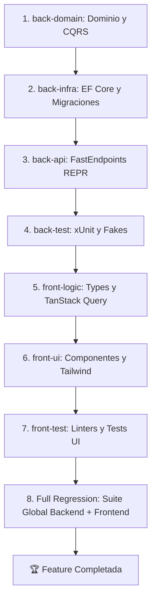

# Workflow: `/pipeline-run`

Ejecuta el ciclo de vida de desarrollo de forma totalmente autónoma y desatendida para una feature especificada, delegando sucesivamente entre los 7 agentes especialistas y culminando en la verificación de regresión global.

## Parámetros Esperados
- `$ARGUMENTS`: `<feature-id>` (ej. `/pipeline-run 001-user-profile-management`)

---

## Fases de Ejecución en Cascada

`@jarvis` ejecutará las siguientes **8 fases** de manera secuencial:



### 🔹 Fase 1: Dominio y Casos de Uso (`back-domain`)
1. Ejecuta `/opsx-delegate back-domain <feature-id>`.
2. Invoca al subagente `back-domain` ejecutando `/opsx-pickup`.
3. Verifica que la compilación de `Nexus.Domain` y `Nexus.Application` esté limpia.

### 🔹 Fase 2: Infraestructura y Persistencia (`back-infra`)
1. Ejecuta `/opsx-delegate back-infra <feature-id>`.
2. Invoca al subagente `back-infra` ejecutando `/opsx-pickup`.
3. Verifica la compilación de `Nexus.Infrastructure` y la validez de las migraciones EF Core.

### 🔹 Fase 3: Endpoints REST (`back-api`)
1. Ejecuta `/opsx-delegate back-api <feature-id>`.
2. Invoca al subagente `back-api` ejecutando `/opsx-pickup`.
3. Verifica que los FastEndpoints cumplan la regla Anti-Fat Endpoint, contratos espejo y compilen limpiamente.

### 🔹 Fase 4: Pruebas Backend (`back-test`)
1. Ejecuta `/opsx-delegate back-test <feature-id>`.
2. Invoca al subagente `back-test` ejecutando `/opsx-pickup`.
3. Verifica que `dotnet test tests/Nexus.UnitTests/Nexus.UnitTests.csproj` pase al 100% con fakes en memoria y patrón AAA.

### 🔹 Fase 5: Lógica y Datos Frontend (`front-logic`)
1. Ejecuta `/opsx-delegate front-logic <feature-id>`.
2. Invoca al subagente `front-logic` ejecutando `/opsx-pickup`.
3. Verifica que `npx tsc --noEmit` en `frontend/` no reporte ningún error.

### 🔹 Fase 6: Vistas y Componentes UI (`front-ui`)
1. Ejecuta `/opsx-delegate front-ui <feature-id>`.
2. Invoca al subagente `front-ui` ejecutando `/opsx-pickup`.
3. Verifica que los 4 estados de UI y safe-areas de Capacitor estén cubiertos, y que `npm run build` en `frontend/` compile con éxito.

### 🔹 Fase 7: Pruebas y Linter Frontend (`front-test`)
1. Ejecuta `/opsx-delegate front-test <feature-id>`.
2. Invoca al subagente `front-test` ejecutando `/opsx-pickup`.
3. Verifica `npm run lint` y pruebas unitarias de componentes.

### 🔹 Fase 8: Verificación Holística de Regresión (`jarvis`)
1. `@jarvis` ejecuta la suite de regresión completa de toda la solución:
   ```bash
   dotnet test tests/Nexus.UnitTests/Nexus.UnitTests.csproj
   ```
   ```bash
   cd frontend && npm run build
   ```
2. Si la solución completa pasa sin advertencias ni regresiones, `@jarvis` marca la Feature como completada (Definition of Done alcanzada) y reporta éxito al usuario.

---

## 🛑 Control de Incongruencias y Parada de Emergencia

Si en cualquier fase un especialista genera un archivo de bloqueo (`BLOCKED_<feature-id>.md` o `BLOCKED_DOR_<feature-id>.md`):
1. `@jarvis` **detiene inmediatamente el pipeline**. No invoca al siguiente especialista.
2. Lee el archivo de bloqueo y presenta un resumen ejecutivo al usuario:
   - **Agente afectado**: {nombre}
   - **Tipo de Bloqueo**: DoR insuficiente, contradicción arquitectónica o fallo técnico.
   - **Explicación**: {detalle}
   - **Alternativas de resolución**: {opciones propuestas}
3. El pipeline queda en pausa a la espera de la decisión del usuario (o refinamiento de tareas si fue rechazo por DoR).
