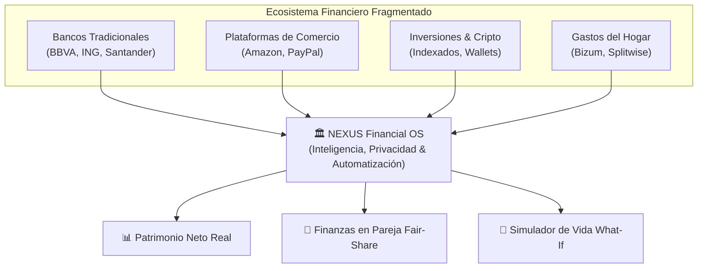
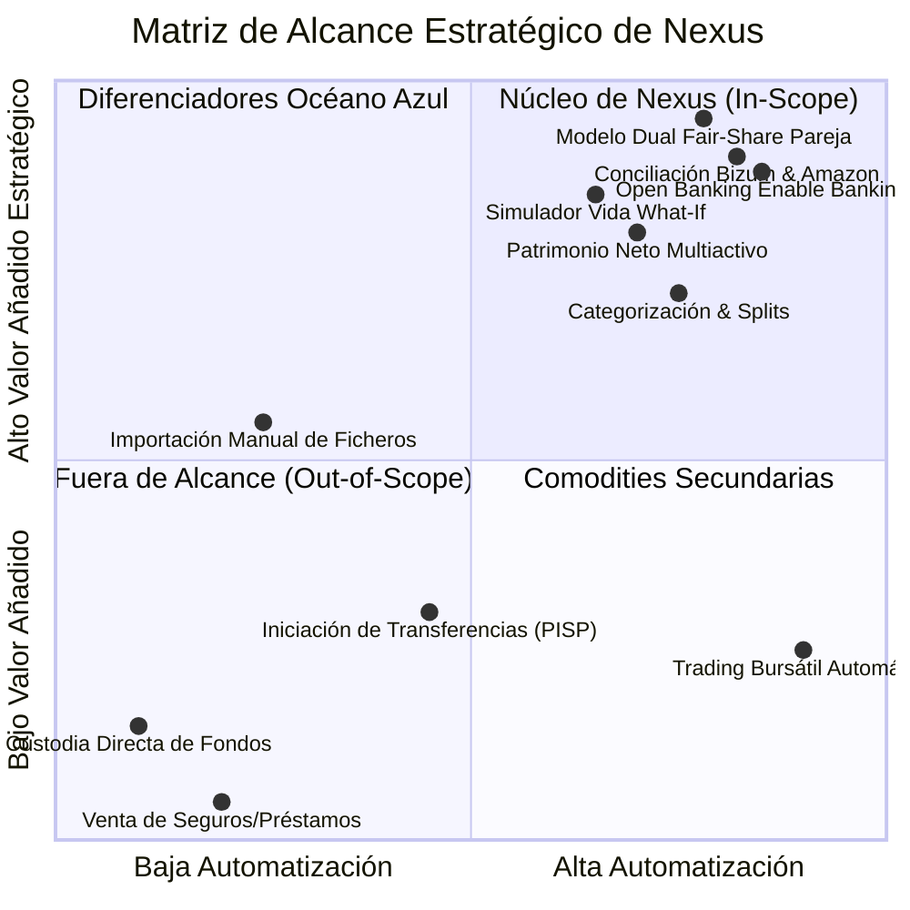
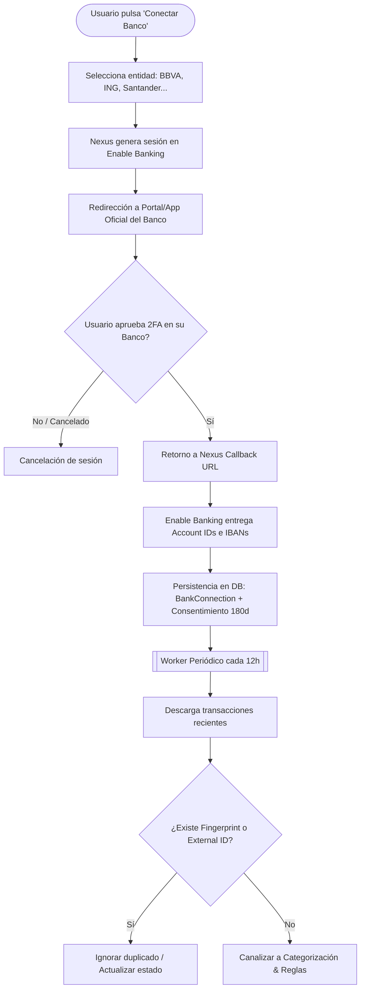
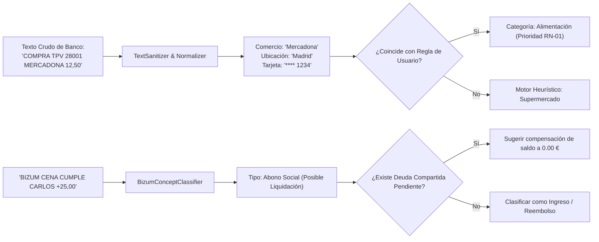
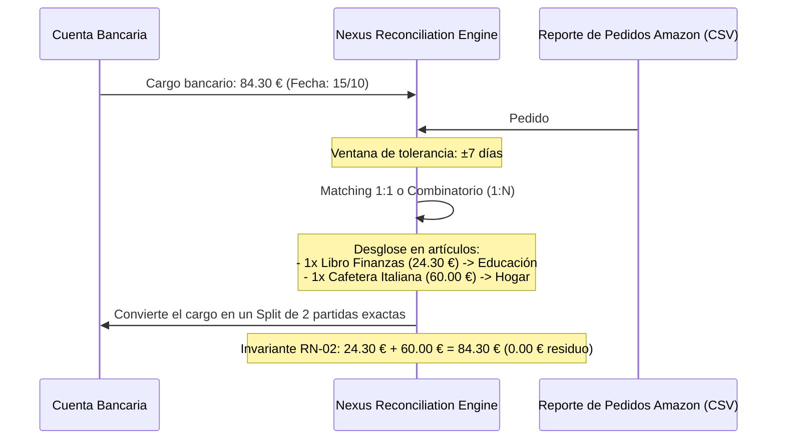
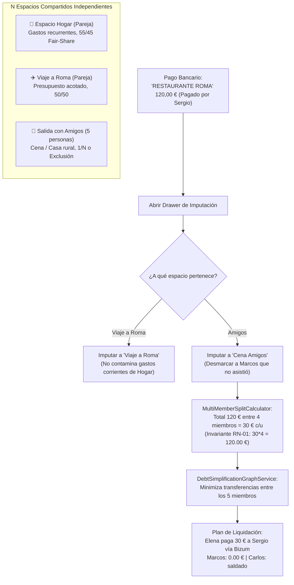
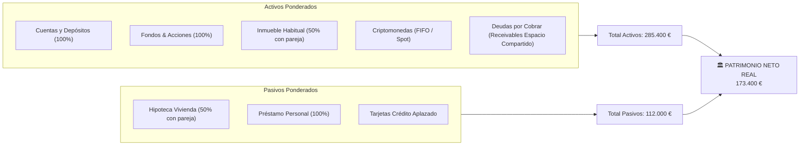
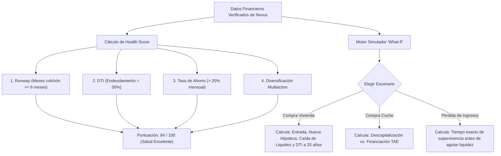
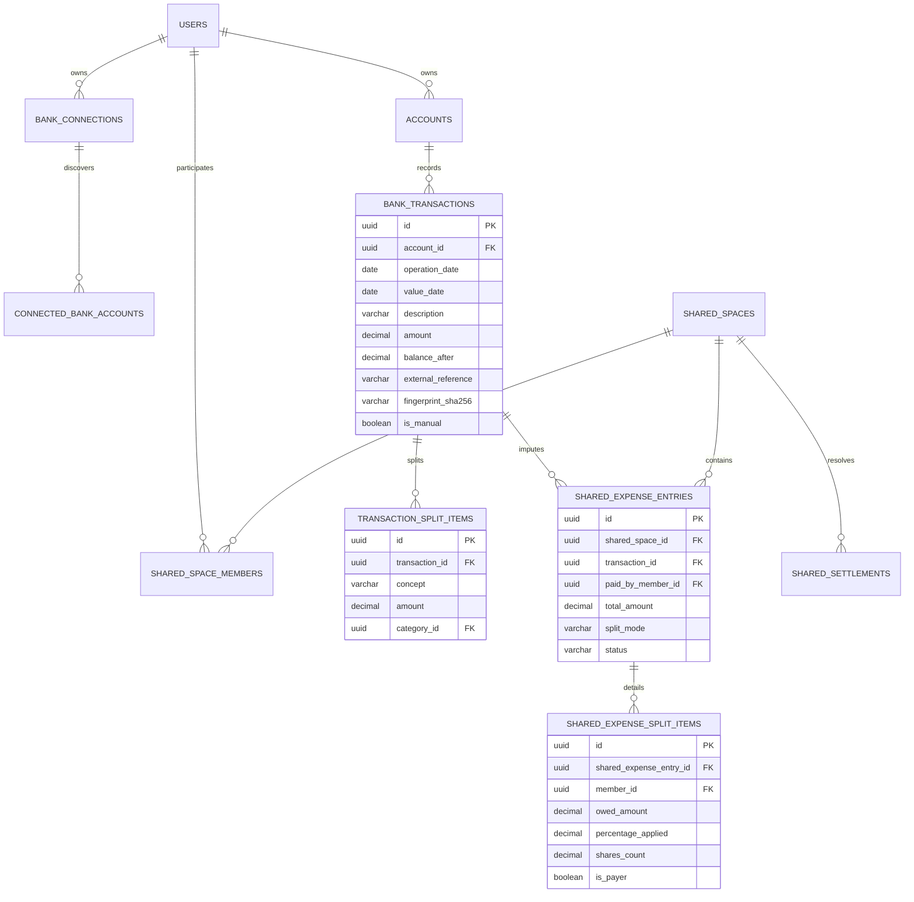
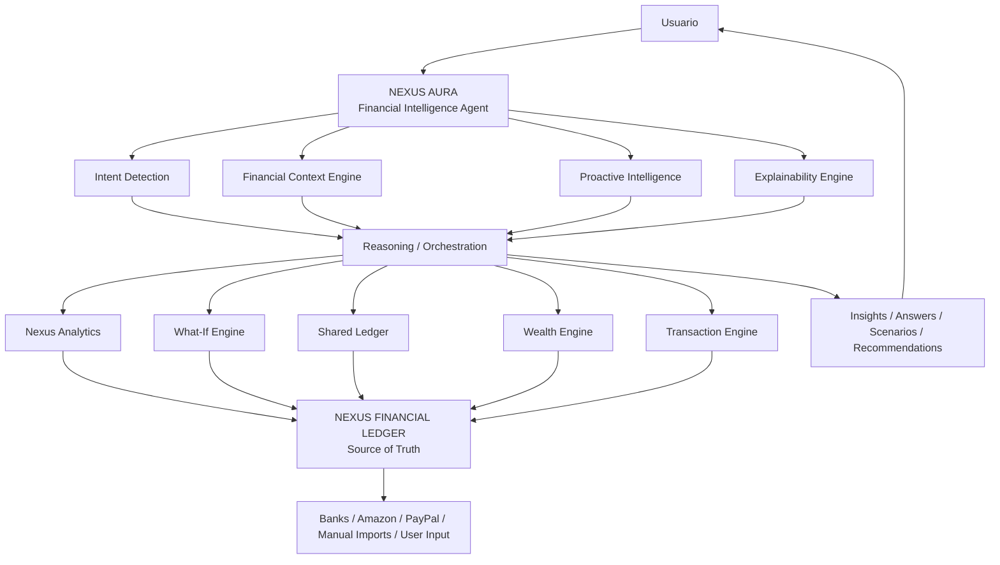

# Nexus — Documento Funcional Integral (Master Functional Specification)

- **Producto**: **Nexus — Financial Operating System & Shared Ledger**
- **Nivel de Gobernanza**: Especificación Maestra de Producto y Dominio
- **Autor y Especialista de Dominio**: **`@warren`** (Oráculo Financiero de Nexus)
- **Coordinador Técnico**: **`@jarvis`**
- **Estado**: Aprobado / Versión Definitiva de Referencia
- **Fecha**: 2026-10-06

---

## Tabla de Contenidos
1. [Objetivos Estratégicos del Proyecto](#1-objetivos-estratégicos-del-proyecto)
   - 1.1. Misión y Definición de Producto
   - 1.2. La Estrategia del "Océano Azul" (Nexus vs. El Mercado Tradicional)
   - 1.3. Principios Inviolables de Dominio
2. [Alcance Global del Sistema](#2-alcance-global-del-sistema)
   - 2.1. Dentro del Alcance (In-Scope)
   - 2.2. Fuera del Alcance (Out-of-Scope)
3. [Pilares y Funcionalidades con Diagramas de Flujo](#3-pilares-y-funcionalidades-con-diagramas-de-flujo)
   - 3.1. Ingesta Universal y Open Banking (Enable Banking)
   - 3.2. Motor de Transacciones, Normalización y Clasificación de Bizum
   - 3.3. Reconciliación de E-Commerce (Amazon y PayPal)
   - 3.4. Espacio Compartido, Reparto Fair-Share y Muro de Privacidad
   - 3.5. Consolidación Patrimonial Multiactivo (Net Worth Real)
   - 3.6. Nexus Aura, Índice de Salud Financiera y Simulador "What-If"
4. [Mocks de Pantallas y Experiencia de Usuario (UI/UX)](#4-mocks-de-pantallas-y-experiencia-de-usuario-uiux)
   - 4.1. Mock 1: Dashboard Principal (Visión Consolidada)
   - 4.2. Mock 2: Transacciones, Filtros y Drawer de Split Contable
   - 4.3. Mock 3: Espacio Compartido (Pareja/Hogar), Fair-Share y Settle Up Bizum
   - 4.4. Mock 4: Hub de Conexión Bancaria (Open Banking & Extractos)
   - 4.5. Mock 5: Simulador de Vida "What-If" y Nexus Health Score
5. [Invariantes Matemáticas y Modelo de Datos](#5-invariantes-matemáticas-y-modelo-de-datos)
6. [Estrategia Multiplataforma (Web y Móvil con Capacitor)](#6-estrategia-multiplataforma-web-y-móvil-con-capacitor)
7. [Nexus Aura — Agente de Inteligencia Financiera](#7-nexus-aura--agente-de-inteligencia-financiera)
   - 7.1. Identidad y Responsabilidades
   - 7.2. Financial Context Engine
   - 7.3. Detección de Intención Financiera
   - 7.4. Inteligencia Proactiva
   - 7.5. Razonamiento de Escenarios y What-If
   - 7.6. Explicabilidad y Trazabilidad
   - 7.7. Límites, Seguridad y Soberanía del Usuario
   - 7.8. Evolución Futura del Agente

---

## 1. Objetivos Estratégicos del Proyecto

### 1.1. Misión y Definición de Producto
**Nexus** es un **Sistema Operativo Financiero (Financial OS)** integral diseñado para devolver al usuario la soberanía, visibilidad absoluta y gobierno de su patrimonio personal y sus finanzas compartidas.

A diferencia de los bancos tradicionales o neobancos transaccionales (que operan en silos cerrados) y de las plataformas PFM obsoletas (que monetizan vendiendo créditos o seguros de terceros), **Nexus no custodia dinero ni coloca productos comerciales**. Su propósito es constituirse como la **capa superior e imparcial de inteligencia patrimonial**, orquestando y unificando en una experiencia única:
1. El **seguimiento patrimonial multiactivo real** (cuentas, fondos, inmuebles, hipotecas, criptomonedas).
2. El **flujo de caja operativo** con categorización autónoma y desgloses contables exactos.
3. La **gestión compartida del hogar y pareja** con conciliación automática de deudas y aislamiento de privacidad.



---

### 1.2. La Estrategia del "Océano Azul" (Nexus vs. El Mercado Tradicional)

La industria fintech ha obligado históricamente al usuario a fragmentar su vida financiera en aplicaciones incompatibles:
- **PFM Tradicional (Fintonic, Copilot, Monarch)**: Tienen una perspectiva 100% individual y ciega. Si pagas una cena de $120\text{ \euro}$ entre amigos, registran un gasto de $-120\text{ \euro}$ que distorsiona tu presupuesto mensual. Cuando tus amigos te pagan por Bizum, la app lo computa erróneamente como un "nuevo ingreso", inflando artificialmente tu ahorro.
- **Gestores de Gastos en Grupo (Splitwise, Tricount)**: Son libretas de notas manuales desconectadas de los bancos. El usuario tiene que acordarse de teclear los gastos a mano, las deudas se olvidan y no hay conexión con la tesorería real.

#### La Solución Disruptiva de Nexus:
Nexus fusiona ambos universos creando un **Ledger Financiero Unificado**:
1. **Del movimiento bancario al Split en 1 tap**: Al pagar un gasto común, el importe correspondiente a la otra persona se reclasifica inmediatamente como un **Activo a Corto Plazo (Cuentas por Cobrar / Receivables)** en tu balance patrimonial, reflejando tu gasto neto real.
2. **Conciliación pasiva de Bizums**: Cuando recibes el Bizum de liquidación, Nexus lo casa contra la deuda pendiente, amortizándola a $0.00\text{ \euro}$ sin computarlo jamás como ingreso salarial.
3. **Muro de Privacidad Zero-Knowledge**: Permite compartir los gastos de convivencia de forma transparente sin que tu pareja o compañeros vean tu nómina, tus cuentas privadas ni tus inversiones personales.
4. **Independencia absoluta**: Sin publicidad, sin venta de datos y sin colocación sesgada de créditos.

---

### 1.3. Principios Inviolables de Dominio
- **RN-01 Prevalencia de la Soberanía del Usuario**: Cualquier edición manual realizada por el usuario (`IsManual = true`) tiene prioridad jerárquica absoluta sobre cualquier deducción automática, regla o sincronización posterior.
- **RN-02 Invariante de Balance Cero**: En cualquier división contable (*split*) o reparto compartido, la suma de las partidas hijas debe igualar con precisión de $0.00\text{ \euro}$ al importe original. Prohibidos los redondeos con céntimos huérfanos.
- **RN-03 Pureza Aritmética**: Todas las operaciones monetarias se calculan en tipo `decimal` mediante *Banker's Rounding* (`MidpointRounding.ToEven`).
- **RN-04 Cero Conocimiento de Credenciales**: Nexus nunca solicita, procesa ni almacena contraseñas o PINs de banca online.

---

## 2. Alcance Global del Sistema



### 2.1. Dentro del Alcance (In-Scope)
1. **Ingesta Multicanal**:
   - Conexión desatendida mediante **Open Banking AISP (Enable Banking)** con consentimiento de 180 días.
   - Procesamiento de extractos tabulares históricos (CSV, XLSX) de bancos españoles (BBVA, ING, Santander...).
   - Conectores de compras detalladas de **Amazon** (Order Reports CSV) y pasarelas **PayPal**.
2. **Motor de Transacciones e Inteligencia**:
   - Deduplicación determinista basada en huella criptográfica SHA-256 e ID bancario externo.
   - Normalización de conceptos comerciales y limpieza de prefijos de TPV (`MerchantNormalizer`).
   - Clasificación inteligente de conceptos Bizum (`BizumConceptClassifier`).
   - Motor jerárquico de categorías y reglas definidas por el usuario.
   - *Split Engine* con desglose de tickets mixtos a balance cero.
3. **Espacios Compartidos Dinámicos y Finanzas Multigrupo (Hogar, Viajes, Amigos, Proyectos)**:
   - Coexistencia de $N$ espacios independientes: permanentes de convivencia (hogar/pareja/piso) vs. temporales de ocio (viajes en pareja, escapadas con amigos, eventos).
   - Soporte para $N$ participantes ($N \ge 2$) con miembros registrados y miembros sombra/invitados (con teléfono para Bizum).
   - Modalidades avanzadas de reparto: equitativo ($1/M$), porcentajes, importes exactos, partes/shares, exclusiones y Fair-Share proporcional a ingresos.
   - Algoritmo de minimización de transferencias (*Debt Simplification*) para liquidar deudas colectivas con el menor número de pagos.
   - Desacoplamiento contable: las partidas de un viaje no contaminan el presupuesto ordinario del hogar.
   - Liquidación en un tap vía Bizum con extinción de balance a $0.00\text{ \euro}$.
4. **Patrimonio Neto Multiactivo (Wealth Tracking)**:
   - Consolidación de cuentas corrientes, depósitos, inversiones y planes de pensiones.
   - Módulo inmobiliario y vehículos con amortización.
   - Criptoactivos con valoración spot y trazabilidad fiscal de plusvalías/minusvalías bajo criterio FIFO.
   - Pasivos: Hipotecas (capital, cuota, amortización) y préstamos personales.
   - Ponderación porcentual por cotitularidad ($0\%$ a $100\%$).
5. **Nexus Aura & Simulador "What-If"**:
   - Auditoría de ineficiencias (dinero ocioso sin remunerar, gastos vampiro, suscripciones duplicadas).
   - Índice de Salud Financiera (**Nexus Health Score** de 0 a 100) ponderando Runway, DTI, Ahorro y Diversificación.
   - Simulador de escenarios de vida: compra de vivienda, compra de coche o pérdida temporal de ingresos.
6. **Multiplataforma Web y Móvil**:
   - Aplicación web responsive (React 19 + TypeScript).
   - App móvil nativa para iOS y Android mediante Capacitor con soporte para Deep Links seguros.

### 2.2. Fuera del Alcance (Out-of-Scope)
- **Custodia o captación de depósitos**: Nexus nunca mantiene saldos ni actúa como banco custodio.
- **Iniciación de Pagos salientes (PISP)**: Nexus no emite transferencias ni mueve dinero desde las cuentas bancarias del usuario.
- **Ejecución automática de órdenes bursátiles o trading cripto**: El sistema realiza seguimiento y auditoría, pero no cursa órdenes de compra/venta en brokers.
- **Monetización publicitaria de créditos**: Cero colocación de préstamos comisionados o seguros de terceros.
- **Extensiones de navegador propietarias**: Queda excluida cualquier solución que no sea 100% portable a móviles.

---

## 3. Pilares y Funcionalidades con Diagramas de Flujo

### 3.1. Ingesta Universal y Open Banking (Enable Banking)

Permite la sincronización bancaria automática sin licencia PSD2 propia mediante la integración con la API de Enable Banking.



---

### 3.2. Motor de Transacciones, Normalización y Clasificación de Bizum

Convierte extractos crudos e incomprensibles en registros contables limpios y comprensibles:



---

### 3.3. Reconciliación de E-Commerce (Amazon y PayPal)

Resuelve el problema de los cargos opacos en la cuenta corriente (ej. `AMZN Mktp ES 84,30 €`) cruzándolos con los extractos detallados de las tiendas:



---

### 3.4. Espacios Compartidos Dinámicos, N-Grupos, Fair-Share y Simplificación de Deudas

Permite gestionar de forma desacoplada tanto la convivencia cotidiana como los proyectos temporales (viajes en pareja, vacaciones con amigos o eventos puntuales) sin invadir la privacidad individual ni mezclar balances:



---

### 3.5. Consolidación Patrimonial Multiactivo (Net Worth Real)

Calcula el patrimonio neto exacto del usuario integrando la fórmula contable:
$$\text{Patrimonio Neto Real} = \sum (\text{Activos} \times \text{Participación}) - \sum (\text{Pasivos} \times \text{Participación})$$



#### Ponderación por Titularidad y Régimen de Custodia Familiar (RN-12)
1. **Cotitularidad Ponderada (`HolderRole.JointOwner`)**:
   - Para cuentas compartidas (ej. cuenta corriente conjunta con la pareja), el saldo total es visible para extractos y operativa, pero el cómputo en el patrimonio neto individual suma únicamente la cuota asignada:
   $$\text{UserNetWorthShare} = \text{CurrentBalance} \times \frac{\text{OwnershipPercentage}}{100}$$
   - Por defecto: $50\%$, configurable entre $1\%$ y $99\%$.
2. **Cuentas Supervisadas y de Menores (`HolderRole.LegalGuardian` / `Authorized`)**:
   - Cuentas de hijos menores u otros familiares donde el usuario actúa como tutor o autorizado legal.
   - **Cómputo Patrimonial: 0%**: El saldo pertenece al menor y jamás infla el patrimonio neto del progenitor ($\text{UserNetWorthShare} = 0.00\text{ €}$).
   - **Observabilidad Plena**: El tutor puede vincular extractos, consultar movimientos, categorizar gastos escolares y seguir metas de ahorro infantil.
3. **Evolución en Backlog (`BKLOG-001`)**:
   - Endpoint `PATCH /api/bank-accounts/{id}` para actualizar titularidad y porcentaje tras la sincronización automática de Open Banking (Enable Banking).

---

### 3.6. Nexus Aura, Índice de Salud Financiera y Simulador "What-If"

El **What-If Engine** y el **Nexus Health Engine** proporcionan los cálculos deterministas que utiliza **Nexus Aura — Agente de Inteligencia Financiera** para interpretar la situación del usuario, explicar los resultados y emitir un dictamen imparcial:



---

## 4. Mocks de Pantallas y Experiencia de Usuario (UI/UX)

A continuación se presentan los esquemas visuales (*wireframes*) interactivos de las pantallas principales del sistema, detallando los elementos y comportamientos de cada una.

---

### 4.1. Mock 1: Dashboard Principal (Visión Consolidada)

```text
┌──────────────────────────────────────────────────────────────────────────────────────────────────┐
│  [NEXUS LOGO]   [Dashboard]  [Transacciones]  [Espacio Compartido]  [Patrimonio]   (EUR ▼) [👤 Sergio]│
├──────────────────────────────────────────────────────────────────────────────────────────────────┤
│  PANEL PATRIMONIAL CONSOLIDADO                                         [🔄 Sincronizar Bancos]    │
│                                                                                                  │
│  ┌────────────────────────┐ ┌────────────────────────┐ ┌───────────────────────┐ ┌───────────────┐ │
│  │ PATRIMONIO NETO REAL   │ │ FLUJO DE CAJA (OCT)    │ │ RUNWAY DE LIQUIDEZ    │ │ HEALTH SCORE  │ │
│  │ 173.450,20 €           │ │ +1.420,50 €            │ │ 8,4 Meses             │ │ 84 / 100      │ │
│  │ ▲ +2,4% vs mes anterior│ │ Ing: 3.800€ | Gasto:2.380│ │ Objetivo: > 6 meses   │ │ Excelente ⭐  │ │
│  └────────────────────────┘ └────────────────────────┘ └───────────────────────┘ └───────────────┘ │
│                                                                                                  │
│  ┌───────────────────────────────────────────────────┐ ┌────────────────────────────────────────┐ │
│  │ EVOLUCIÓN HISTÓRICA DEL PATRIMONIO (12 MESES)      │ │ NEXUS AURA — INSIGHTS PROACTIVOS       │ │
│  │                                                   │ │                                        │ │
│  │  200k ─ ─ ─ ─ ─ ─ ─ ─ ─ ─ ─ ─ ─ ─ ─ ─ ─╭───────────│ │ 💡 Tienes 14.200 € al 0% en cuenta   │ │
│  │  150k ─ ─ ─ ─ ─ ─ ─ ─ ─ ─╭───────╭─────╯  Activos │ │    corriente. Supera tu runway de      │ │
│  │  100k ─ ─ ─ ─ ─ ─ ─╭─────╯───────╯                │ │    seguridad. Mover 8.000 € a cuenta   │ │
│  │   50k ─ ─ ─ ─ ─ ─ ─╰───────────────────── Pasivos │ │    remunerada generaría ~280 €/año.    │ │
│  │       Ene Feb Mar Abr May Jun Jul Ago Sep Oct     │ │                                        │ │
│  │       [Ver desglose detallado de activos ➔]       │ │ ⚠️ Suscripción Netflix subió de 12 a 17€│ │
│  └───────────────────────────────────────────────────┘ └────────────────────────────────────────┘ │
│                                                                                                  │
│  ┌─────────────────────────────────────────────────────────────────────────────────────────────┐ │
│  │ ESPACIO COMPARTIDO (SERGIO & ELENA)               [Reparto Fair-Share: 55/45]  [Saldar Bizum]│ │
│  │ Elena te debe actualmente:  170,61 €              Última liquidación: 30 Sep (0,00 €)        │ │
│  └─────────────────────────────────────────────────────────────────────────────────────────────┘ │
└──────────────────────────────────────────────────────────────────────────────────────────────────┘
```

#### Explicación de Componentes del Dashboard:
1. **Top Bar con Balance de Pareja**: Muestra el selector de divisa base, el widget de estado bilateral rápido y el botón global de refresco.
2. **KPI Cards Superiores**: Cuatro indicadores objetivos inmutables: Patrimonio Neto Real, Flujo de Caja mensual, Runway de supervivencia ante imprevistos y el Nexus Health Score.
3. **Gráfico Evolutivo de Patrimonio**: Curvas desacopladas de Activos totales vs. Pasivos exigibles.
4. **Nexus Aura Feed**: Capa de inteligencia proactiva con diagnósticos, explicaciones y oportunidades detectadas a partir de datos financieros verificables.
5. **Widget Rápido de Finanzas Compartidas**: Resumen del balance bilateral con acceso directo al modal de liquidación.

---

### 4.2. Mock 2: Transacciones, Filtros y Drawer de Split Contable

```text
┌──────────────────────────────────────────────────────────────────────────────────────────────────┐
│  TRANSACCIONES & MOVIMIENTOS                             [🔍 Buscar concepto...] [Filtrar ▼]     │
├──────────────────────────────────────────────────────────────────────────────────────────────────┤
│  [Todos los bancos ▼]  [Todas las categorías ▼]  [Estado: Todos ▼]         [+ Importar Extracto] │
├──────────────────────────────────────────────────────────────────────────────────────────────────┤
│  FECHA      CONCEPTO / COMERCIO          BANCO      CATEGORÍA          IMPORTE      ESTADO       │
│  ─────────  ───────────────────────────  ─────────  ─────────────────  ───────────  ───────────  │
│  06/10/2026 MERCADONA MADRID             BBVA       Supermercado       -68,40 €     [Booked]     │
│  05/10/2026 IBERDROLA SUMINISTROS        ING Direct Hogar / Luz        -110,61 €    [Shared 55%] │
│  04/10/2026 AMAZON EU (3 artículos)      BBVA       [Split Dividido]   -84,30 €     [Reconciled] │
│  03/10/2026 BIZUM DE ELENA               BBVA       Settle Up Pareja   +140,00 €    [Bizum Match]│
│  02/10/2026 NÓMINA EMPRESA               BBVA       Ingreso Salarial   +2.850,00 €  [Verified]   │
└──────────────────────────────────────────────────────────────────────────────────────────────────┘

                       ┌──────────────────────────────────────────────────┐
                       │ DRAWER: SPLIT DE TRANSACCIÓN COMPUESTA            │
                       │ Original: AMAZON EU — Total: -84,30 €            │
                       ├──────────────────────────────────────────────────┤
                       │ Invariante Contable: 84,30 € = 84,30 € (Dif: 0€) │
                       │                                                  │
                       │ Partida 1:                                       │
                       │ Concepto: Libro Clean Code Arquitectura         │
                       │ Importe:  24,30 €   Categoría: [Formación ▼]     │
                       │                                                  │
                       │ Partida 2:                                       │
                       │ Concepto: Filtro Purificador de Aire Hogar       │
                       │ Importe:  60,00 €   Categoría: [Hogar ▼]         │
                       │ [x] Imputar al Espacio Compartido (Elena)        │
                       │                                                  │
                       │ [ + Añadir otra partida ]                        │
                       │                                                  │
                       │ [Cancelar]                [Guardar Split Exacto] │
                       └──────────────────────────────────────────────────┘
```

#### Explicación de Componentes de Transacciones:
1. **Badges de Inteligencia Transaccional**:
   - `[Booked]`: Transacción bancaria firme y confirmada.
   - `[Shared 55%]`: Transacción imputada al espacio colaborativo con reparto Fair-Share.
   - `[Reconciled]`: Transacción bancaria cruzada con éxito con reporte de pedido de Amazon o PayPal.
   - `[Bizum Match]`: Abono reconocido como amortización de deuda, no como ingreso inflado.
2. **Drawer Lateral de Split Contable**: Permite desglosar un ticket compuesto en múltiples categorías e imputar partidas individuales al espacio de pareja, garantizando la **Invariante RN-02 de Balance Cero ($0.00\text{ \euro}$ de descuadre)**.

---

### 4.3. Mock 3: Espacios Compartidos Dinámicos (Hub Multigrupo, N-Miembros y Settle Up)

```text
┌──────────────────────────────────────────────────────────────────────────────────────────────────┐
│  ESPACIOS COMPARTIDOS & GRUPOS DE GASTO                                  [+ Crear Nuevo Espacio] │
├──────────────────────────────────────────────────────────────────────────────────────────────────┤
│  SELECTOR DE ESPACIO ACTIVO:                                                                     │
│  [🏡 Hogar Pareja (+170,61 €)]  [✈️ Viaje a Roma (+45,00 €) ●]  [🍻 Cena Amigos (0 €)]  [Ver Todos]│
│  💰 Saldo neto global en todos tus grupos: +215,61 € a tu favor (Receivables totales)            │
├──────────────────────────────────────────────────────────────────────────────────────────────────┤
│  ESPACIO ACTIVO: ✈️ VIAJE A ROMA (4 MIEMBROS)              [⚙️ Configuración] [👥 Ver Participantes]│
│  Participantes: 👤 Sergio (Tú) · 👤 Elena · 👤 Carlos · 👤 Marcos (Invitado)                     │
│                                                                                                  │
│   ┌───────────────────────────────────────────────────────────────────────────────────────────┐  │
│   │  POSICIÓN NETA EN ESTE GRUPO:   +45,00 € (A tu favor)                                      │  │
│   │  PLAN DE LIQUIDACIÓN SIMPLIFICADA (Min-Cash-Flow Graph):                                  │  │
│   │  • Elena te debe: 45,00 €   ─────────── [ 📲 Enviar Recordatorio Bizum ]                 │  │
│   │  • Carlos debe 30,00 € a Marcos (Liquidación interna entre otros miembros)                │  │
│   │  (Deudas minimizadas: 2 pagos en lugar de 6 transferencias cruzadas)                      │  │
│   └───────────────────────────────────────────────────────────────────────────────────────────┘  │
│                                                                                                  │
│  HISTORIAL DE PARTIDAS DEL VIAJE:                                       [ + Imputar Nuevo Gasto ]│
│  ──────────────────────────────────────────────────────────────────────────────────────────────  │
│  FECHA       CONCEPTO              PAGADO POR     TOTAL      REPARTO / EXCLUSIONES    TU CUOTA   │
│  06/10/2026  Hotel Trastevere 3N   Sergio         360,00 €   4 miembros (90 € c/u)    90,00 €    │
│  05/10/2026  Cena Pizzería Roma    Carlos         120,00 €   3 miembros (Excl. Marcos)40,00 €    │
│  04/10/2026  Entradas Coliseo      Sergio          80,00 €   4 miembros (20 € c/u)    20,00 €    │
│  ──────────────────────────────────────────────────────────────────────────────────────────────  │
│  GASTO TOTAL DEL VIAJE: 560,00 € | TÚ HAS PAGADO: 440,00 € | TU CONSUMO REAL: 150,00 €          │
└──────────────────────────────────────────────────────────────────────────────────────────────────┘

                       ┌──────────────────────────────────────────────────┐
                       │ MODAL: PLAN DE LIQUIDACIÓN SIMPLIFICADA          │
                       ├──────────────────────────────────────────────────┤
                       │ Grupo: ✈️ Viaje a Roma                            │
                       │ Pagos necesarios para cerrar cuentas a 0.00 €:   │
                       │                                                  │
                       │ 1. Elena ➔ Sergio:  45,00 €                     │
                       │    [ 📲 Generar Bizum a Sergio ] (Ref: ROMA-01)  │
                       │                                                  │
                       │ 2. Carlos ➔ Marcos: 30,00 €                     │
                       │    [ 📲 Generar Bizum a Marcos ] (Ref: ROMA-02)  │
                       │                                                  │
                       │ [Archivar grupo tras liquidación completa]       │
                       └──────────────────────────────────────────────────┘
```

#### Explicación de Componentes de Espacios Multigrupo:
1. **Selector Rápido de Contexto**: Permite alternar entre los gastos permanentes del hogar, viajes acotados en pareja y salidas con amigos con un clic, conociendo el saldo neto de cada uno de un vistazo.
2. **Repartos con Exclusión**: Si un participante no consume un ticket concreto (ej. Marcos no fue a la cena), la cuota se recalcula automáticamente entre los restantes respetando la Invariante RN-01 de suma exacta ($0.00\text{ \euro}$).
3. **Algoritmo Min-Cash-Flow de Simplificación**: Reduce el número de transferencias entre los $N$ participantes al mínimo matemático posible, evitando deudas circulares.
4. **Miembros Invitados / Sombra**: Soporta participantes que no tienen la aplicación instalada pero reciben el recordatorio con el importe exacto y teléfono de Bizum.

---

### 4.4. Mock 4: Hub de Conexión Bancaria (Open Banking & Extractos)

```text
┌──────────────────────────────────────────────────────────────────────────────────────────────────┐
│  HUB DE CONEXIONES BANCARIAS & FUENTES DE DATOS                            [+ Conectar Nuevo Banco]│
├──────────────────────────────────────────────────────────────────────────────────────────────────┤
│                                                                                                  │
│  ENTIDADES CONECTADAS MEDIANTE OPEN BANKING (ENABLE BANKING AISP)                                │
│                                                                                                  │
│  ┌────────────────────────────────────────────────────────────────────────────────────────────┐  │
│  │ [LOGO BBVA]  BBVA España                                                    [🟢 ACTIVA]     │  │
│  │ Cuentas: Cuenta Online (ES76 **** **** 4912)                                               │  │
│  │ Saldo sincronizado: 4.820,15 €                                                             │  │
│  │ Última sincronización automática: Hoy, 06:00 UTC (hace 4 horas)                           │  │
│  │ Consentimiento PSD2: Válido hasta 28/03/2027 (Quedan 172 días)                             │  │
│  │ [🔄 Sincronizar Ahora]           [Renovar SCA]           [Desconectar]                     │  │
│  └────────────────────────────────────────────────────────────────────────────────────────────┘  │
│                                                                                                  │
│  ┌────────────────────────────────────────────────────────────────────────────────────────────┐  │
│  │ [LOGO ING]   ING Direct España                                              [🟡 POR RENOVAR]│  │
│  │ Cuentas: Cuenta Nómina + Cuenta Naranja (2 cuentas)                                        │  │
│  │ Saldo sincronizado: 12.340,80 €                                                            │  │
│  │ Consentimiento PSD2: Expira en 6 días (Obligatorio renovar SCA cada 180 días)              │  │
│  │ [ ⚠️ Renovar Consentimiento en 1 Tap ]                   [🔄 Sincronizar Ahora]             │  │
│  └────────────────────────────────────────────────────────────────────────────────────────────┘  │
│                                                                                                  │
│  IMPORTACIÓN MANUAL DE RESPALDO (EXTRACTOS CSV / XLSX)                                           │
│  ┌────────────────────────────────────────────────────────────────────────────────────────────┐  │
│  │ Arrastra y suelta extractos bancarios de BBVA o ING para cargas históricas de años pasados  │  │
│  │ [📂 Seleccionar archivo .xlsx o .csv]           (Detección automática de entidad bancaria) │  │
│  └────────────────────────────────────────────────────────────────────────────────────────────┘  │
└──────────────────────────────────────────────────────────────────────────────────────────────────┘
```

#### Explicación de Componentes de Conexión Bancaria:
1. **Gestión Transparente de Sesiones PSD2**: Muestra el reloj de caducidad del consentimiento regulatorio de 180 días con alertas visuales preventivas a partir de los 15 días restantes.
2. **Sincronización Híbrida**: Permite la actualización desatendida mediante el worker en segundo plano cada 12 horas, junto con un botón de refresco bajo demanda (*cooldown* de 15 minutos).
3. **Respaldo de Extractos Tradicionales**: Mantiene accesible la zona de carga de ficheros tabulares para rescatar históricos de años anteriores no cubiertos por la ventana de Open Banking.

---

### 4.5. Mock 5: Simulador de Vida "What-If" y Nexus Health Score

```text
┌──────────────────────────────────────────────────────────────────────────────────────────────────┐
│  SIMULADOR DE VIDA PATRIMONIAL ("WHAT-IF ENGINE") & SALUD FINANCIERA                             │
├──────────────────────────────────────────────────────────────────────────────────────────────────┤
│                                                                                                  │
│  ┌────────────────────────────────────────────────────────────────────────────────────────────┐  │
│  │ NEXUS HEALTH SCORE:  84 / 100   (Salud Financiera Excelente ⭐)                            │  │
│  │ • Runway Liquidez:  8,4 meses (Óptimo > 6m)    • Ratio Endeudamiento (DTI): 22% (< 30%)    │  │
│  │ • Tasa Ahorro Mensual: 32% (Óptimo > 20%)      • Diversificación: Liquidez + Indexados + RE │  │
│  └────────────────────────────────────────────────────────────────────────────────────────────┘  │
│                                                                                                  │
│  SIMULADOR DE ESCENARIOS VITALES                                                                 │
│  Selecciona una decisión futura para proyectar su impacto en tu balance patrimonial:             │
│  [🏡 Compra de Vivienda e Hipoteca]   [🚗 Compra de Vehículo]   [💼 Parón Laboral / Excedencia]  │
│                                                                                                  │
│  PARÁMETROS DEL ESCENARIO: COMPRA DE VIVIENDA HABITUAL                                           │
│  Precio de compra:        [ 280.000 € ] ────────●────────────────────                            │
│  Ahorro aportado entrada: [  70.000 € ] ──────────────●────────────── (Gastos ITP/Notaría: 28k€) │
│  Tipo de interés hipoteca:   Fijo [x]   Variable [ ]   Interés: [ 2,75 % ]                       │
│  Plazo amortización:      [ 30 Años ]                                                            │
│                                                                                                  │
│  PROYECCIÓN DE IMPACTO INMEDIATO:                                                                │
│  • Liquidez posterior: 18.200 € (Runway resultante: 5,2 meses ➔ Sigue en rango seguro)           │
│  • Nueva cuota mensual: 858,40 € / mes                                                           │
│  • Nuevo DTI (Endeudamiento): 28,5% (Cerca del límite recomendado del 30%)                       │
│                                                                                                  │
│  PROYECCIÓN PATRIMONIAL A 10 AÑOS (PATRIMONIO NETO CON COMPRA VS. ALQUILER + INVERSIÓN):          │
│                                                                                                  │
│  350k ─ ─ ─ ─ ─ ─ ─ ─ ─ ─ ─ ─ ─ ─ ─ ─ ─ ─ ─ ─ ─ ─ ─ ─╭─────────── Escenario Compra Vivienda      │
│  280k ─ ─ ─ ─ ─ ─ ─ ─ ─ ─ ─ ─ ─ ─ ─ ─ ─ ─╭───────────╯                                           │
│  210k ─ ─ ─ ─ ─ ─ ─ ─ ─ ─ ─ ─ ─ ─╭───────╯─ ─ ─ ─ ─ ─ ─ ─ ─ ─ ─  Escenario Alquiler Continuado  │
│       Hoy     Año 2     Año 4     Año 6     Año 8     Año 10                                     │
│                                                                                                  │
│  Dictamen de Nexus Aura: "La compra es patrimonialmente viable y preserva tu fondo de emergencia.│
│  Sin embargo, tu cuota hipotecaria consumirá el 28,5% de tus ingresos, reduciendo tu capacidad   │
│  de ahorro mensual para fondos indexados en 420 €/mes."                                          │
└──────────────────────────────────────────────────────────────────────────────────────────────────┘
```

#### Explicación de Componentes del Simulador:
1. **Desglose Multidimensional del Health Score**: No se limita a una nota abstracta; audita los cuatro pilares objetivos de la estabilidad económica personal.
2. **Controles Paramétricos Interactivos**: Sliders reactivos que recalculan en tiempo real impuestos (ITP, notaría, tasación), cuotas de amortización y descapitalización.
3. **Proyección Comparativa a Largo Plazo**: Gráficas predictivas que comparan la evolución patrimonial real entre ejecutar la decisión o mantener la estrategia actual.
4. **Dictamen Imparcial de Nexus Aura**: Interpretación explicable de los cálculos del What-If Engine, sin sesgo comercial ni recomendaciones patrocinadas.

---

## 5. Invariantes Matemáticas y Modelo de Datos

Nexus implementa un modelo de datos relacional estricto sobre **PostgreSQL 17** con Entity Framework Core 10:



### Invariantes Contables Obligatorias:
1. **Invariante de Continuidad de Saldo (`BALANCE_DISCONTINUITY`)**:
   $$\text{Saldo}_{t} = \text{Saldo}_{t-1} + \text{Movimiento}_{t}$$
2. **Invariante de Split Exacto ($0.00\text{ \euro}$)**:
   $$\text{Importe Original} = \sum_{i=1}^{n} \text{Importe Partida}_i$$
3. **Invariante de Reparto Multimiembro**:
   $$\text{Total Gasto} = \sum_{i=1}^{M} \text{Cuota}_i \quad (\text{Tolerancia: } 0.00\text{ \euro})$$
4. **Invariante de Balance Cero Colectivo**:
   $$\sum_{m \in \text{Miembros}} \text{Balance Neto}(m) \equiv 0.00\text{ \euro}$$
5. **Invariante de Extinción Bilateral / Grupal**:
   $$\text{Matriz de Deuda Resuelta} + \sum \text{Liquidaciones Bizum} = 0.00\text{ \euro}$$

---

## 6. Estrategia Multiplataforma (Web y Móvil con Capacitor)

Nexus opera bajo una arquitectura de **Núcleo Universal Único**:
- **Frontend desacoplado**: Diseñado en React 19 con Tailwind CSS y componentes modulares tipo Glassmorphism.
- **Shell Nativo con Capacitor**: El mismo código se empaqueta sin bifurcaciones para la web de escritorio, navegadores móviles y aplicaciones nativas en **Google Play (Android)** y **Apple App Store (iOS)**.
- **Deep Linking Nativo**: Redirecciones seguras OAuth y Open Banking mediante esquemas universales `nexus://banking/callback`.
- **Almacenamiento Criptográfico Adaptativo**: Tokens de sesión en memoria y cookies `HttpOnly` en web; persistencia en *Android Keystore* e *iOS Keychain* en aplicaciones nativas móviles.


---

## 7. Nexus Aura — Agente de Inteligencia Financiera

### 7.1. Identidad y Responsabilidades

**Nexus Aura** es el **Agente de Inteligencia Financiera de Nexus**. No es un chatbot accesorio ni una simple capa conversacional: es la capa de razonamiento que interpreta el estado financiero del usuario, detecta oportunidades y riesgos, explica sus conclusiones y permite explorar decisiones futuras.

Nexus se encarga de **registrar y calcular los hechos financieros**; Aura se encarga de **interpretarlos y convertirlos en inteligencia accionable**.

La separación conceptual es obligatoria:

| Capa | Responsabilidad | Ejemplo |
|---|---|---|
| **Nexus Core / Financial Ledger** | Fuente de verdad financiera | "Tienes 14.230 € en cuentas." |
| **Nexus Analytics** | Cálculos deterministas | "Tu runway es de 8,4 meses." |
| **Nexus Aura** | Interpretación y razonamiento | "Tu liquidez actual está por encima de tu colchón objetivo." |
| **Aura Agent** | Propuesta de acciones o exploraciones | "Podrías analizar qué ocurre si destinas 5.000 € a una cuenta remunerada." |
| **Execution Layer** | Ejecución financiera | **Fuera del alcance actual de Nexus**. |

Aura nunca debe inventar datos financieros ni sustituir al Ledger como fuente de verdad.

### 7.2. Financial Context Engine

Aura dispone de un **Contexto Financiero Unificado** construido exclusivamente a partir de información disponible y verificable dentro de Nexus.

El contexto puede incluir:

1. **Liquidez**
   - saldos de cuentas y depósitos;
   - flujo de caja;
   - ingresos y gastos recurrentes;
   - runway de liquidez.

2. **Patrimonio**
   - patrimonio neto;
   - distribución de activos y pasivos;
   - porcentaje de titularidad;
   - evolución histórica.

3. **Gasto**
   - categorías;
   - tendencias;
   - gastos recurrentes;
   - suscripciones;
   - gastos compartidos;
   - anomalías y cambios de comportamiento.

4. **Finanzas compartidas**
   - balances bilaterales;
   - deudas pendientes;
   - Fair-Share configurado;
   - liquidaciones históricas.

5. **Inversiones y activos**
   - fondos e inversiones;
   - planes de pensiones;
   - inmuebles y vehículos;
   - criptoactivos;
   - concentración y diversificación.

6. **Pasivos**
   - hipotecas;
   - préstamos;
   - deuda de tarjetas;
   - impacto de las cuotas sobre el flujo de caja.

7. **Objetivos y escenarios**
   - objetivos financieros definidos por el usuario;
   - escenarios What-If;
   - restricciones de liquidez;
   - horizonte temporal.

Aura debe distinguir siempre entre:

- **Dato verificado**: procede directamente del Ledger o de una fuente conectada.
- **Cálculo**: resultado de una fórmula determinista de Nexus.
- **Inferencia**: conclusión razonada a partir de datos disponibles.
- **Hipótesis**: supuesto introducido por el usuario o por un escenario.
- **Recomendación**: posible acción derivada del análisis.

### 7.3. Detección de Intención Financiera

Aura interpreta la intención del usuario y selecciona la capacidad adecuada del sistema.

Ejemplos:

| Intención | Capacidad Aura |
|---|---|
| "¿Cómo está mi situación financiera?" | Diagnóstico financiero |
| "¿Por qué he gastado más este mes?" | Análisis de cash flow |
| "¿Tengo demasiado dinero parado?" | Análisis de liquidez |
| "¿Qué suscripciones han subido?" | Detección de anomalías |
| "¿Cuánto le debo / me debe mi pareja?" | Consulta del Shared Ledger |
| "¿Puedo comprar una casa de 300.000 €?" | What-If + análisis patrimonial |
| "¿Qué pasa si pierdo mi sueldo durante 6 meses?" | Stress Test |
| "¿Estoy suficientemente diversificado?" | Análisis patrimonial |
| "¿Por qué ha bajado mi Health Score?" | Explicación del Score |
| "¿Qué ha cambiado respecto al mes pasado?" | Análisis temporal |
| "¿Qué puedo mejorar?" | Diagnóstico + oportunidades |

Aura debe poder responder tanto mediante **conversación** como mediante **insights estructurados dentro de la interfaz**.

### 7.4. Inteligencia Proactiva

Aura no debe limitarse a responder preguntas. Puede detectar situaciones relevantes y generar **insights proactivos**, siempre que exista evidencia suficiente.

Tipos iniciales:

#### A. Dinero Ocioso

Detectar exceso de liquidez respecto al runway objetivo.

Ejemplo:

> "Tienes 14.200 € en una cuenta sin remuneración. Manteniendo tu colchón objetivo, aproximadamente 8.000 € están por encima de la liquidez que necesitas. ¿Quieres explorar escenarios para ese excedente?"

#### B. Gastos Vampiro

Detectar servicios recurrentes poco utilizados, duplicados o con incrementos significativos.

#### C. Cambios de Comportamiento

Comparar periodos y detectar variaciones relevantes:

- alimentación;
- ocio;
- transporte;
- hogar;
- suscripciones;
- gastos compartidos.

#### D. Riesgo de Liquidez

Alertar cuando el runway cae por debajo del objetivo definido.

#### E. Concentración Patrimonial

Detectar dependencia excesiva de una clase de activo.

#### F. Cambios de Endeudamiento

Detectar aumentos relevantes del DTI o de la carga mensual de deuda.

#### G. Oportunidades de Optimización

Identificar oportunidades basadas en datos reales:

- reducción de gastos recurrentes;
- exceso de liquidez;
- duplicidades;
- cambios en tarifas;
- desequilibrios en finanzas compartidas.

Cada insight debe incluir:

1. **Qué ha detectado Aura.**
2. **Qué datos lo justifican.**
3. **Por qué es relevante.**
4. **Qué podría hacer el usuario.**
5. **Nivel de confianza.**
6. **Acceso al detalle o cálculo subyacente.**

### 7.5. Razonamiento de Escenarios y What-If

Aura actúa como capa de interpretación sobre el motor determinista **What-If Engine**.

El motor calcula; Aura interpreta.

Por ejemplo:

```text
Usuario:
"¿Me puedo permitir comprar una vivienda de 300.000 €?"

             ↓

Aura identifica intención
             ↓
What-If Engine calcula escenarios
             ↓
┌──────────────────────────────────────┐
│ Entrada                              │
│ Gastos asociados                     │
│ Nueva hipoteca                       │
│ Cuota mensual                        │
│ DTI                                  │
│ Liquidez restante                    │
│ Runway                               │
│ Patrimonio neto proyectado           │
│ Coste de oportunidad                 │
└──────────────────────────────────────┘
             ↓
Aura interpreta resultados
             ↓
Dictamen explicable
```

Aura debe poder comparar escenarios como:

- comprar vs. alquilar;
- amortizar deuda vs. mantener liquidez;
- aumentar ahorro vs. mantener consumo;
- cambiar distribución patrimonial;
- pérdida temporal de ingresos;
- compra de vehículo;
- modificación del Fair-Share del hogar.

El dictamen **no debe reducirse a "sí/no"**. Debe explicar:

- qué variables favorecen la decisión;
- qué variables la penalizan;
- qué riesgos aparecen;
- qué margen de seguridad queda;
- qué supuestos condicionan el resultado;
- qué tendría que cambiar para mejorar el escenario.

### 7.6. Explicabilidad y Trazabilidad

Toda conclusión financiera relevante de Aura debe poder rastrearse hasta sus datos y cálculos.

Aura debe evitar respuestas del tipo:

> "Creo que deberías comprar."

Y priorizar:

> "Con los parámetros actuales, la compra mantiene tu runway por encima del mínimo definido, pero eleva tu DTI hasta el 28,5% y reduce tu capacidad mensual de inversión. El resultado cambia significativamente si la entrada aumenta o si el tipo hipotecario supera el 3,5%."

Cuando sea posible, cada conclusión deberá permitir navegar hacia:

- transacciones origen;
- cuentas utilizadas;
- activos/pasivos considerados;
- fórmula o métrica utilizada;
- parámetros del escenario;
- fecha de actualización de los datos.

**Principio de trazabilidad:**

```text
Insight Aura
    ↓
Conclusión
    ↓
Métricas / cálculos
    ↓
Datos financieros
    ↓
Fuente original
```

### 7.7. Límites, Seguridad y Soberanía del Usuario

Aura hereda todos los principios inviolables de Nexus y añade los siguientes:

- **RA-01 — El Ledger es la fuente de verdad**: Aura no modifica hechos financieros sin una acción explícita del usuario.
- **RA-02 — Sin alucinaciones financieras**: si no existe información suficiente, Aura debe indicarlo y solicitar los datos necesarios o declarar la incertidumbre.
- **RA-03 — Separación entre hecho y opinión**: toda recomendación debe diferenciar datos, cálculos, inferencias y supuestos.
- **RA-04 — Sin ejecución financiera automática**: Aura no realiza transferencias, pagos, compras, ventas ni operaciones bursátiles.
- **RA-05 — Sin sesgo comercial**: Aura no prioriza productos por comisión, publicidad o acuerdos comerciales.
- **RA-06 — Privacidad por contexto**: Aura solo puede utilizar información a la que el usuario tenga permiso de acceso. El Muro de Privacidad del Shared Ledger también aplica a la capa de inteligencia.
- **RA-07 — Confirmación antes de acciones sensibles**: cualquier futura capacidad de ejecución deberá requerir consentimiento explícito y verificable.
- **RA-08 — Incertidumbre visible**: cuando una conclusión dependa de datos incompletos, estimaciones o hipótesis, Aura debe mostrarlo claramente.
- **RA-09 — Aislamiento estricto de cuentas tuteladas y de menores (BKLOG-002)**: las cuentas asociadas a figuras de tutela legal (`HolderRole.LegalGuardian` o `Authorized`) no se consolidarán en la métrica patrimonial del tutor ni afectarán a su cálculo de colchón de emergencia o recomendaciones de inversión, garantizando una esfera analítica independiente para la custodia familiar.

Aura es, por tanto, un **agente de inteligencia y decisión asistida**, no un custodio, banco, broker ni ejecutor financiero.

### 7.8. Evolución Futura del Agente

La arquitectura de Aura debe permitir evolucionar progresivamente desde inteligencia descriptiva hacia asistencia financiera avanzada.

#### Nivel 1 — Observe

Aura comprende el estado financiero:

- "Esto es lo que tienes."
- "Esto es lo que has gastado."
- "Esto es lo que ha cambiado."

#### Nivel 2 — Explain

Aura explica causas y relaciones:

- "Tu ahorro ha bajado porque..."
- "Tu Health Score ha cambiado debido a..."
- "Este Bizum no se considera ingreso porque..."

#### Nivel 3 — Predict

Aura anticipa posibles consecuencias:

- "A este ritmo, tu runway bajará a 5 meses."
- "Si mantienes este gasto, tu objetivo se retrasa X meses."

#### Nivel 4 — Advise

Aura propone alternativas:

- "Podrías explorar..."
- "Estas son las tres estrategias con menor impacto sobre tu liquidez."
- "Este escenario parece más robusto bajo estas hipótesis."

#### Nivel 5 — Act

**Fuera del alcance actual.**

En una futura evolución, Aura podría orquestar acciones financieras mediante integraciones autorizadas, pero siempre bajo:

- consentimiento explícito;
- límites configurables;
- trazabilidad completa;
- confirmación de operaciones sensibles;
- separación estricta entre recomendación y ejecución.

### Arquitectura conceptual de Nexus Aura



**Principio arquitectónico final:**

> **Nexus conoce tu dinero. Nexus Analytics lo calcula. Nexus Aura lo entiende. El usuario decide.**

---


---

*Documento aprobado y sellado por `@warren` y `@jarvis` para gobernar el desarrollo y ciclo de vida de **Nexus**.*
