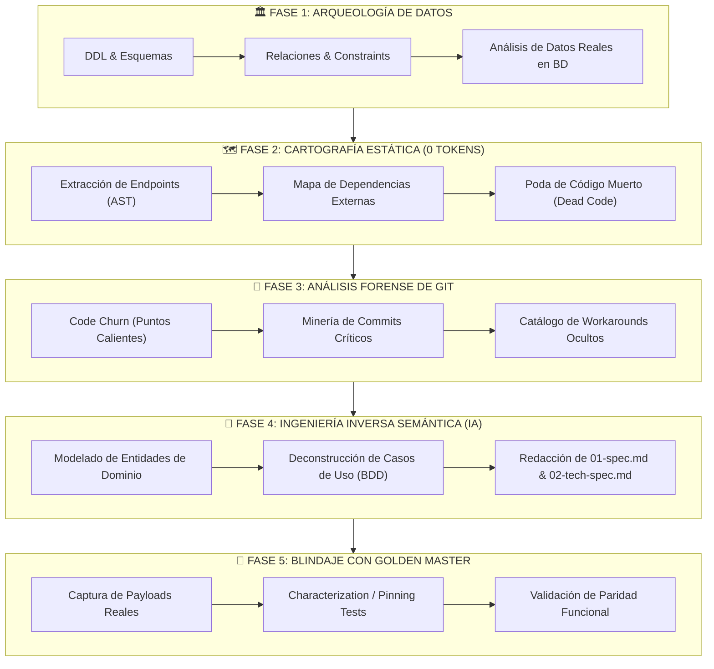
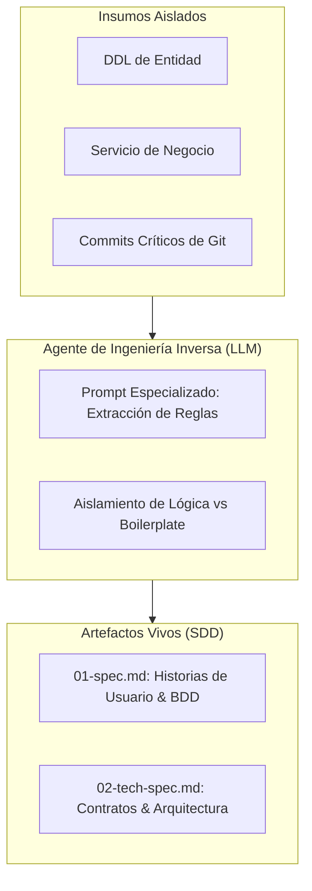
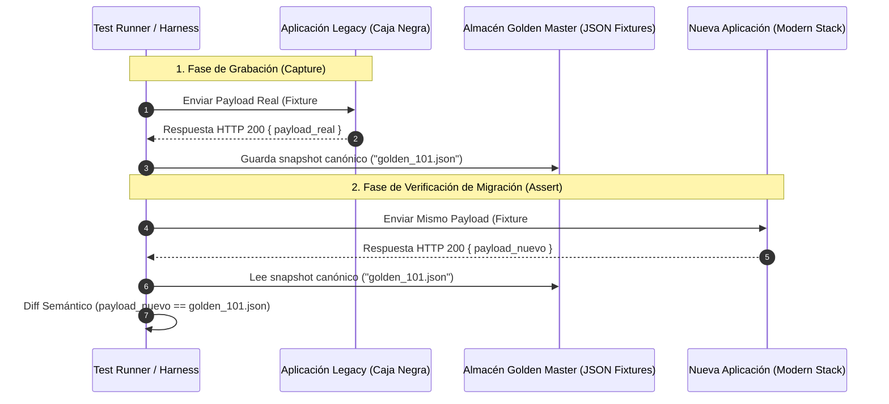

# Marco Metodológico: Arqueología de Software e Ingeniería Inversa
## Modernización de Sistemas Legacy Asistida por Inteligencia Artificial y Análisis Determinista

> **Propósito**: Guía técnica y metodológica para equipos de arquitectura y desarrollo encargados de auditar, deconstruir y migrar aplicaciones heredadas (*legacy*) que carecen de documentación formal, especificaciones de requisitos o pruebas automatizadas, preservando las reglas de negocio reales y minimizando el riesgo operativo.

---

## 1. Resumen Ejecutivo y Planteamiento del Problema

El mayor desafío al abordar una aplicación heredada (*legacy*) no radica en el lenguaje de programación en que está escrita, sino en la **pérdida del conocimiento tácito**:
* Los desarrolladores originales ya no están en la compañía.
* La documentación no existe o quedó desactualizada hace años.
* El código fuente es la única fuente de información superviviente.

### La Falacia del "Big Bang Rewrite"
El impulso natural de los equipos suele ser *"tirar todo a la basura y reescribirlo desde cero"*. Históricamente, este enfoque fracasa en más del 70% de los casos debido a que el software legacy acumula cientos de casos límite (*edge cases*), soluciones a incidencias regulatorias y peculiaridades de negocio que nadie recuerda pero que son vitales para la operativa diaria.

### La Trampa del "Prompt Dumping" con Modelos de Lenguaje (LLMs)
Con la llegada de la IA, el nuevo error común es volcar miles de líneas de código fuente directamente en la ventana de contexto de un modelo. Esto resulta contraproducente:
1. **Saturación y Alucinación**: Los LLMs pierden fidelidad (*attention drift*) ante contextos desmesurados y empiezan a inventar intenciones.
2. **Coste Desorbitado**: Quemar millones de tokens leyendo archivos de utilidades, boilerplate y librerías muertas es ineficiente.
3. **Incapacidad de discernir Código Muerto**: El modelo analiza con igual peso un módulo crítico que un prototipo abandonado en 2018.

### La Solución: El Embudo de Arqueología de Software
Este marco propone un enfoque híbrido y quirúrgico: **primero herramientas deterministas de bajo coste (CLI / AST / Bases de Datos), luego análisis forense de Git, y finalmente agentes de IA aplicados de forma modular (Bottom-Up) para redactar las especificaciones formales de negocio**.



---

## 2. Fase 1: Arqueología de Datos y Persistencia (La Base de Datos No Miente)

> **Axioma 1**: *El código miente y acumula cadáveres; la base de datos es el único reflejo fáctico de lo que ocurre en producción.*

En cualquier sistema legado, muchas ramas de código jamás se ejecutan o pertenecen a experimentos abandonados. Sin embargo, los datos persistidos en PostgreSQL, SQL Server u Oracle representan las transacciones reales de los clientes.

### 2.1. Pasos de Ejecución
1. **Extracción Exhaustiva del DDL**:
   - Tablas, vistas materializadas, procedimientos almacenados (*stored procedures*), triggers y funciones.
   - Restricciones (`NOT NULL`, `CHECK`, `UNIQUE`, claves foráneas).
2. **Descubrimiento de Relaciones Ocultas e Implícitas**:
   - En bases de datos legacy es habitual encontrar relaciones lógicas no forzadas por claves foráneas físicas (ej. columnas `user_id` sin foreign key a `users`, o columnas compuestas `entity_type` + `entity_id`).
   - Se debe auditar el código SQL en repositorios para identificar los `JOIN` más habituales.
3. **Análisis de Volumetría y Nulabilidad Real**:
   - Consultar columnas que están al 100% con valores `NULL` en producción: **son candidatas directas a descarte o refactorización**.
   - Identificar tablas con cero escrituras en los últimos 12 meses (módulos inactivos).
4. **Mapeo de Tipos Polimórficos y Flags de Estado**:
   - Descubrir columnas numéricas o de texto que operan como máquinas de estados (`status = 1, 2, 3` o `type = 'A', 'B'`). Estas columnas revelan los enums y las transiciones del ciclo de vida del negocio.

### 2.2. Entregables de la Fase 1
* **Diagrama Entidad-Relación (ERD) Normalizado**: Representación gráfica de los modelos de persistencia activos.
* **Diccionario de Datos del Dominio**: Catálogo con la definición de cada entidad, sus estados válidos y sus invariantes de persistencia.

---

## 3. Fase 2: Cartografía Estática y Reducción del Radio de Explosión (Cero Tokens)

> **Axioma 2**: *Nunca uses un modelo de lenguaje para hacer lo que un analizador de sintaxis (AST) o un script en terminal puede resolver en 2 segundos.*

Antes de involucrar modelos de IA, es imprescindible "despejar la maleza" mediante herramientas de análisis estático de código (*Static Analysis*) que consumen **cero tokens** de cómputo cognitivo.

### 3.1. Pasos de Ejecución
1. **Extracción Automatizada de la Superficie de la API**:
   - Utilizar parsers de árbol sintáctico (AST) según el stack (Roslyn en .NET, Babel/TypeScript Compiler API en JS/TS, `ast` en Python):
   - Extraer una matriz con:
     - Ruta de cada endpoint (`/api/v1/...`).
     - Verbo HTTP (`GET`, `POST`, `PUT`, `DELETE`).
     - Parámetros de entrada (Query, Route, Body).
     - Formato de respuesta.
2. **Auditoría de Fronteras y Efectos Colaterales (Side Effects)**:
   - Rastrear en el código todos los puntos de salida del sistema mediante búsqueda regex o AST:
     - Llamadas HTTP salientes (clientes REST, SOAP, webhooks).
     - Envío de correos o notificaciones (servidores SMTP, SendGrid, Twilio).
     - Procesamiento en segundo plano (workers, cron jobs, consumidores de colas RabbitMQ / Kafka / Azure Service Bus).
     - Generación o lectura de archivos (SFTP, AWS S3, discos locales).
3. **Poda Rigurosa de Código Muerto (*Dead Code Elimination*)**:
   - Ejecutar analizadores de dependencias (Knip, ts-prune, ReSharper CLI, Roslyn Analyzers):
   - Eliminar del alcance de la auditoría:
     - Clases o componentes sin referencias cruzadas.
     - Rutas o controladores comentados o inaccesibles desde el enrutador principal.
     - Paquetes de dependencias no utilizados.

### 3.2. Entregables de la Fase 2
* **Matriz de Superficie de Entrada y Salida**: Tabla exhaustiva con todos los endpoints activos y sus integraciones externas.
* **Lista Negra de Código Muerto**: Listado de archivos excluidos del análisis para no saturar al equipo ni a los agentes de IA.

---

## 4. Fase 3: Análisis Forense de Git (Buscar el Dolor Real)

> **Axioma 3**: *El código muestra la estructura actual; el historial de Git revela las cicatrices del negocio y los casos límite no documentados.*

Los manuales de producto suelen describir el "camino feliz" (*happy path*). Sin embargo, los requisitos más complejos del negocio nacen de incidencias graves en producción, disputas legales o cambios normativos. Estos nunca están en la documentación, pero **están sellados en los commits de Git**.

### 4.1. Pasos de Ejecución
1. **Análisis de Frecuencia de Cambio (*Code Churn*)**:
   - Ejecutar métricas de churn sobre el repositorio:
     ```bash
     git log --pretty=format: --name-only | sort | uniq -c | sort -rg | head -n 30
     ```
   - **La Ley de Pareto del Legacy**: El 20% de los archivos acumula el 80% de los commits. Esos archivos son los **Hotspots (Puntos Calientes)**: allí se concentra la lógica de negocio más volátil, crítica y llena de excepciones.
2. **Minería de Palabras Clave Forenses**:
   - Filtrar el historial de commits buscando intenciones correctivas:
     ```bash
     git log --grep="hotfix" --grep="edge case" --grep="workaround" --grep="legal" --grep="hack" --oneline
     ```
   - Cada commit encontrado señala un comportamiento anómalo que el nuevo sistema DEBE contemplar para no romper compatibilidad en producción.
3. **Mapeo de Autores y Pérdida de Conocimiento**:
   - Analizar qué desarrolladores escribieron las partes críticas y verificar si siguen en la organización para entrevistas dirigidas.

### 4.2. Entregables de la Fase 3
* **Mapa de Calor de Complejidad y Churn**: Identificación de los 10 archivos más modificados históricamente.
* **Catálogo de Casos Límite Ocultos**: Documento con las excepciones de negocio documentadas en los mensajes de commit y PRs históricas.

---

## 5. Fase 4: Ingeniería Inversa Semántica con Agentes IA (De Código a Specs)

> **Axioma 4**: *No le pidas a la IA que reescriba el código; pídele que extraiga la intención funcional y redacte la especificación que nunca existió.*

Una vez aislados los archivos vivos (Fases 1 y 2) y localizados los puntos críticos (Fase 3), entran los agentes de IA bajo una estrategia **Modular y Bottom-Up (de abajo hacia arriba)**.



### 5.1. Protocolo de Ejecución por Capas
Queda terminantemente prohibido cargar carpetas completas. Se trabaja por **Vertical Slice** (ej. "Módulo de Facturación" o "Módulo de Conciliación Bancaria"):

1. **Paso A: Deconstrucción de Entidades (Nivel Dominio)**:
   - Se alimenta al agente con el modelo C#/Java/Python y el DDL de la tabla correspondiente.
   - *Instrucción*: "Identifica todas las invariantes de negocio (campos obligatorios, rangos numéricos, restricciones mutuas) y los estados posibles del ciclo de vida. Redacta el modelo de dominio en lenguaje ubicuo."
2. **Paso B: Deconstrucción de Algoritmos y Servicios (Nivel Aplicación)**:
   - Se alimenta al agente con el método de servicio o caso de uso.
   - *Instrucción*: "Traduce este método a formato BDD (Given-When-Then). Ignora llamadas de logging, capturas de excepciones genéricas y detalles del framework; concéntrate exclusivamente en qué condiciones disparan qué resultados."
3. **Paso C: Síntesis en Especificación Viva (Spec-Driven Development)**:
   - El agente compila la información en dos documentos oficiales:
     - **`01-spec.md` (Especificación Funcional)**: Define qué problema resuelve el módulo, los casos de uso principales y alternativos, y los criterios de aceptación Gherkin.
     - **`02-tech-spec.md` (Especificación Técnica)**: Define los contratos de entrada/salida (DTOs), esquemas de base de datos e integraciones externas.

### 5.2. Entregables de la Fase 4
* **Especificaciones Vivas Formales (`01-spec.md` y `02-tech-spec.md`)** de cada módulo crítico de la app legacy. Ahora el equipo tiene la documentación canónica para alimentar a los desarrolladores o a los agentes de construcción moderna.

---

## 6. Fase 5: Blindaje con Tests de Caracterización (The Golden Master Pattern)

> **Axioma 5**: *Antes de tocar una sola línea de código nuevo, debes tener una forma automatizada de probar que el nuevo sistema produce los mismos resultados que el viejo.*

En una migración, los tests unitarios tradicionales del sistema legacy (si existen) suelen estar desactualizados o probar detalles de implementación obsoletos. La técnica estándar en la industria son los **Tests de Caracterización (Pinning Tests)** con el patrón **Golden Master**.

### 6.1. ¿Cómo funciona el Golden Master Pattern?
Un test de caracterización no juzga si el comportamiento legacy es "correcto" o "bonito"; **fija el comportamiento observable actual como la verdad aceptada** (incluso con sus peculiaridades).



### 6.2. Pasos de Ejecución
1. **Selección de Casos Representativos**:
   - Extraer de los logs de producción o de la base de datos entre 20 y 50 casos reales por cada endpoint crítico (cubriendo usuarios normales, casos límite, valores negativos y caracteres especiales).
2. **Grabación de Snapshots (Harness de Grabación)**:
   - Ejecutar la batería contra la aplicación legacy levantada en un entorno de pruebas controlado y persistir las respuestas completas (cabeceras, payloads JSON/XML y cambios en BD) como archivos de referencia (*Golden Masters*).
3. **Aserción Semántica contra el Nuevo Sistema**:
   - Al implementar el nuevo servicio en la arquitectura moderna (ej. FastEndpoints, Clean Architecture), el harness de tests invoca al nuevo endpoint y compara el resultado con el Golden Master.
   - Cualquier discrepancia es señalada de inmediato:
     - Si es un bug introducido por la migración: se corrige.
     - Si es una corrección deliberada de un bug legacy: se actualiza el Golden Master de forma justificada y documentada.

### 6.3. Entregables de la Fase 5
* **Suite de Pruebas de Caracterización Automatizada**: Batería de tests de caja negra que se ejecutan contra la suite legacy y la moderna para certificar paridad del 100%.

---

## 7. Estrategia de Migración: Strangler Fig Pattern (Cero Big-Bang)

Una vez completadas las 5 fases de arqueología para un conjunto de módulos, la migración a producción debe realizarse siguiendo el patrón del **Higo Estrangulador (*Strangler Fig Pattern*)**:

```mermaid
flowchart LR
    Client([📱 Clientes / Frontend]) --> Proxy["🔀 API Gateway / Reverse Proxy (YARP / Nginx)"]
    
    Proxy -->|Rutas Nuevas Migradas (ej. /api/banking)| NewApp["🚀 Nueva Arquitectura Moderna"]
    Proxy -->|Rutas Legacy Pendientes (ej. /api/legacy/*)| OldApp["🏚️ Sistema Legacy"]
    
    NewApp <--> ModernDB[(Nueva BD / Schema)]
    OldApp <--> LegacyDB[(BD Legacy)]
    
    ModernDB -.->|CDC / Sincronización Temporal| LegacyDB
```

1. **Proxy Inverso en la Frontera**: Un gateway (como YARP, Envoy o Nginx) se coloca delante de ambas aplicaciones.
2. **Migración Vertical Slice a Slice**: Se migra endpoint por endpoint. El proxy redirige el tráfico al nuevo servicio conforme cada feature pasa los Gates de SDD y la auditoría de regresión.
3. **Retirada Progresiva**: La aplicación legacy se va apagando gradualmente sin necesidad de "fines de semana de despliegue traumático" ni paradas de servicio.

---

## 8. Matriz Comparativa: Enfoque Tradicional vs. Arqueología con IA

| Dimensión | Enfoque Tradicional ("Reescritura a Ciegas") | Enfoque de las 5 Fases de Arqueología de Software |
| :--- | :--- | :--- |
| **Punto de Partida** | Asunciones del equipo nuevo y reuniones interminables. | **La Base de Datos real** y el análisis estático de código. |
| **Uso de IA** | Prompts masivos de miles de líneas que alucinan o fallan. | **Agentes modulares por capa** sobre código pre-filtrado por AST. |
| **Casos Límite** | Se descubren cuando los clientes reclaman bugs en producción. | **Identificados en Fase 3 (Git Forensics)** antes de picar código. |
| **Garantía de Paridad** | Pruebas manuales superficiales. | **Golden Master Pattern** (pruebas automatizadas de caja negra). |
| **Riesgo Operativo** | Crítico (Catástrofe potencial en el día del despliegue). | **Bajo y Gradual** (Strangler Fig con rollback transparente). |
| **Consumo de Tokens** | Millones de tokens desperdiciados en boilerplate. | **Mínimo**: Se reserva la IA exclusivamente para síntesis semántica. |

---

## 9. Checklist de Aprobación para Equipos Técnicos

Antes de comenzar a escribir código para el nuevo sistema, el equipo debe poder marcar todas las casillas:

- [ ] **Fase 1 (Datos)**: Se dispone del DDL canónico y se han identificado todas las relaciones lógicas y columnas obsoletas.
- [ ] **Fase 2 (Estática)**: Se han inventariado todos los endpoints y dependencias externas mediante scripts AST; el código muerto ha sido podado.
- [ ] **Fase 3 (Git)**: Se han analizado los 20 archivos con mayor *churn* y se han extraído las reglas de negocio de los commits de *hotfixes*.
- [ ] **Fase 4 (Specs)**: Existen documentos `01-spec.md` con criterios de aceptación BDD generados a partir de los módulos legacy.
- [ ] **Fase 5 (Blindaje)**: Existe una batería de fixtures Golden Master con respuestas reales grabadas listas para comparar.
