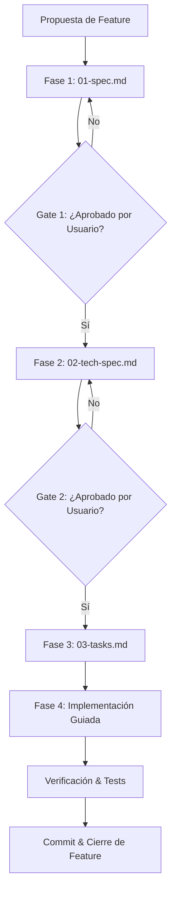

# Nexus Spec-Driven Development (SDD) Framework

Este documento establece el marco de trabajo para el desarrollo de software en **Nexus**.

---

## 🎯 Visión y Filosofía

El desarrollo en Nexus se rige por el principio de **Especificación Previa**:
> *"El código es la consecuencia natural de una especificación clara, nunca el medio para descubrir los requerimientos."*

### Beneficios Clave
1. **Claridad Absoluta**: Evita ambigüedades entre la intención del usuario y la ejecución técnica.
2. **Cero Retrabajo**: Detecta inconsistencias conceptuales en la fase de diseño, donde el coste de corrección es mínimo.
3. **Mantenibilidad a Largo Plazo**: Las especificaciones sirven como documentación viva y fuente de verdad histórica del proyecto.
4. **Verificabilidad**: Cada criterio de aceptación tiene una correspondencia directa con pruebas automatizadas y comprobaciones manuales.

---

## 📁 Estructura del Directorio `specs/`

```text
specs/
├── SDD_FRAMEWORK.md                    # Este documento
├── templates/                          # Plantillas reutilizables
│   ├── 01-functional-spec.template.md  # Plantilla para requerimientos funcionales
│   ├── 02-technical-spec.template.md   # Plantilla para diseño de arquitectura y contratos
│   └── 03-tasks.template.md            # Plantilla para desglose de tareas y seguimiento
└── features/                           # Directorio de funcionalidades vivas
    └── <ID>-<nombre-feature>/
        ├── 01-spec.md
        ├── 02-tech-spec.md
        └── 03-tasks.md
```

---

## 🔄 Los Gates de Calidad y Ciclo de Vida



### Protocolo de Modificación (Change Management)
Si durante la implementación en la Fase 4 se descubre una restricción no prevista o surge una nueva necesidad:
1. **Se pausa la codificación.**
2. Se actualiza `01-spec.md` o `02-tech-spec.md` reflejando el cambio y su justificación.
3. Se solicita la aprobación del usuario.
4. Una vez aprobado el cambio en la especificación, se reanuda la implementación.
