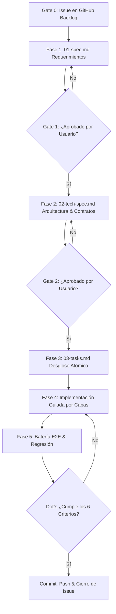

# Nexus Spec-Driven Development (SDD) Framework

Este documento establece el marco metodológico innegociable para el desarrollo de software en **Nexus**.

---

## 🎯 1. Visión y Filosofía de Desarrollo

El desarrollo en Nexus se rige por el principio de **Especificación Previa**:
> *"El código es la consecuencia natural de una especificación clara, nunca el medio para descubrir los requerimientos."*

### Regla de Oro Innegociable
> **Queda estrictamente prohibido escribir una sola línea de código de producción sin haber superado de forma explícita el Gate 2 (`02-tech-spec.md`).**

### Beneficios Clave
1. **Claridad Absoluta**: Elimina ambigüedades entre la intención del usuario y la ejecución técnica.
2. **Cero Retrabajo**: Detecta inconsistencias conceptuales en la fase de diseño, donde el coste de corrección es mínimo.
3. **Mantenibilidad a Largo Plazo**: Las especificaciones sirven como documentación viva y fuente de verdad histórica del proyecto.
4. **Verificabilidad Total**: Cada criterio de aceptación tiene una correspondencia directa con pruebas automatizadas y comprobaciones verificables.

---

## 📁 2. Estructura del Directorio `specs/`

```text
specs/
├── SYSTEM_VISION.md                    # Visión macro, pilares e invariantes de negocio (Nivel 0)
├── SDD_FRAMEWORK.md                    # Este marco de gobernanza y ciclo de vida (Nivel 0)
├── templates/                          # Plantillas reutilizables
│   ├── 01-functional-spec.template.md  # Plantilla para requerimientos funcionales
│   ├── 02-technical-spec.template.md   # Plantilla para diseño de arquitectura y contratos
│   └── 03-tasks.template.md            # Plantilla para desglose de tareas y seguimiento
└── features/                           # Directorio de funcionalidades vivas por Vertical Slice
    └── <ID>-<nombre-feature>/
        ├── 01-spec.md
        ├── 02-tech-spec.md
        └── 03-tasks.md
```

---

## 🔄 3. Los Gates de Calidad y Ciclo de Vida



### Definición de los Gates

#### Gate 0: Trazabilidad en GitHub Backlog
- Toda nueva funcionalidad debe originarse o mapearse a una **Issue formal en el repositorio de GitHub** antes de redactar la especificación.
- Asegura visibilidad permanente del backlog y registro histórico de decisiones.

#### Gate 1: Especificación Funcional (`01-spec.md`)
- Define el problema de negocio, los casos de uso principales y alternativos, los modelos conceptuales y la matriz de criterios de aceptación con ejemplos numéricos reales.
- **Validación**: El usuario debe aprobar explícitamente el alcance funcional antes de pasar al diseño técnico.

#### Gate 2: Especificación Técnica y Contratos (`02-tech-spec.md`)
- Define los contratos de endpoints (rutas, verbos, payloads JSON), DTOs, entidades de dominio, esquemas y migraciones EF Core, algoritmos deterministas y análisis de riesgos.
- **Validación**: Aprobación obligatoria del usuario antes de abrir el editor para escribir código.

#### Gate 3: Desglose de Tareas de Implementación (`03-tasks.md`)
- Checklist de tareas atómicas estructurado siguiendo la arquitectura hexagonal/Clean Architecture:
  1. **Domain**: Entidades, Value Objects, Enums, Interfaces de Repositorio y Servicios de Dominio.
  2. **Infrastructure**: Configuraciones EF Core, Repositorios, Migraciones y Clientes Externos.
  3. **Application**: Comandos, Consultas, Validadores, Parsers y Scoped Handlers.
  4. **API**: Endpoints FastEndpoints, contratos de entrada/salida y registros DI.
  5. **Frontend**: Tipos TypeScript, Hooks React Query y Componentes React.
  6. **Testing**: Pruebas unitarias y script E2E de verificación.

---

## 🏆 4. Definición de Hecho (Definition of Done - DoD)

Una Feature o Vertical Slice **solo y exclusivamente** se considera finalizada cuando satisface los **6 criterios innegociables**:

1. **Documentación Viva Completa**:
   - `01-spec.md`, `02-tech-spec.md` y `03-tasks.md` están actualizados reflejando el código real y marcados al 100%.
2. **Cobertura Unitaria Exhaustiva**:
   - 100% de la lógica de dominio, parsers, normalizadores y algoritmos de conciliación cuentan con tests unitarios pasando en verde (`dotnet test`).
3. **Prueba End-to-End Verificada**:
   - Existe un script E2E automatizado (`tests/e2e_<feature>_test.ps1`) que valida el flujo completo contra los servicios reales levantados.
4. **Política de Cero Regresiones (Zero-Regression Policy)**:
   - Se ejecuta la totalidad de las suites E2E de las features previas (ej. `e2e_statements_test.ps1`, `e2e_categorization_test.ps1`, etc.) garantizando cero roturas colaterales.
5. **Compilación Limpia y Cero Warnings Críticos**:
   - Backend compila limpiamente (`dotnet build`).
   - Frontend compila limpiamente sin errores de tipos TypeScript ni bundling (`tsc -b && vite build`).
6. **Sincronización con GitHub**:
   - Commit formal referenciando la issue correspondiente.
   - Publicación de comentario técnico de cierre en la Issue de GitHub y cambio de estado a `closed (completed)`.

---

## 🐛 5. Protocolo de Resolución de Incidencias (Bug Protocol)

Cuando se detecta un error o fallo inesperado durante una demo o prueba:
1. **Test-First (Reproducción en Rojo)**:
   - Antes de modificar una sola línea de código productivo, se escribe un test unitario o script de prueba aislado que reproduzca fielmente el error y falle (`Red`).
2. **Corrección Quirúrgica**:
   - Se implementa la corrección mínima y necesaria para solucionar la causa raíz.
3. **Pase a Verde y Protección Permanente**:
   - Se verifica que el test de reproducción pasa a verde (`Green`) y se integra de forma definitiva en la suite de pruebas automatizadas para prevenir regresiones futuras.
4. **Verificación de Impacto**:
   - Se ejecutan las suites de regresión existentes para confirmar que la corrección no altera comportamientos previos.

---

## ⚠️ 6. Protocolo de Gestión de Cambios (Change Management)

Si durante la implementación en la Fase 4 se descubre una restricción imprevista o surge una nueva necesidad del usuario (ejemplo: descarte de extensiones de navegador a favor de parsers universales):
1. **Se pausa inmediatamente la codificación.**
2. Se actualiza `01-spec.md` o `02-tech-spec.md` documentando la restricción, el cambio de diseño y su justificación técnica.
3. Se solicita la validación y visto bueno explícito del usuario.
4. Una vez aprobado formalmente el cambio en la especificación, se reanuda la implementación.
