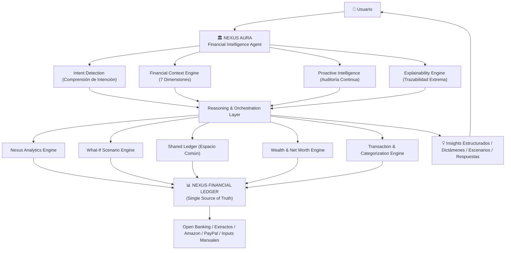

# Nexus — Visión General del Sistema (System Vision & Context)

- **Documento**: Documento de Visión Macro y Contexto de Negocio
- **Nivel de Gobernanza**: Nivel 0 (Marco General de Referencia — No genera código directo)
- **Estado**: Aprobado
- **Última Actualización**: 2026-10-03

---

## 1. Visión y Definición del Producto: El "Financial OS"

**Nexus** es un **Sistema Operativo Financiero (Financial OS)** integral diseñado para la gestión del patrimonio personal y la orquestación colaborativa de finanzas compartidas.

A diferencia de los neobancos transaccionales (Revolut), los brokers de inversión (Trade Republic, MyInvestor) o los agregadores obsoletos viciados por la colocación publicitaria de créditos y seguros (Fintonic), **Nexus no busca custodiar el dinero ni vender productos financieros**. Su propósito es situarse como la **capa superior e imparcial de inteligencia, gobernanza y orquestación** de todo el ecosistema patrimonial del usuario.

El sistema converge en una única plataforma dos realidades cotidianas que el software tradicional mantiene fragmentadas:
1. **El Seguimiento y Optimización Patrimonial Consolidado (PFM & Wealth Tracking)**.
2. **La Administración de Partidas Compartidas (Hogar, Pareja y Grupos)** con aislamiento estricto de privacidad.

---

## 2. Propósito Core y Principios de Diseño

El objetivo central de Nexus es otorgar al usuario **visibilidad y gobierno total de su salud financiera de un solo vistazo**, permitiéndole monitorear de forma simultánea:
- Su **Patrimonio Neto Real** ($\text{Activos} - \text{Pasivos}$).
- Su **Flujo de Caja Operativo** (ingresos, gastos recurrentes y discrecionales).
- La **Salud Financiera Cuantificada** mediante indicadores objetivos.
- Las **Decisiones Futuras** mediante simulación de escenarios de vida.

### 2.1. Principio Arquitectónico: Universal Core & Mobile-Ready
Nexus opera bajo un paradigma **100% API-First y agnóstico del cliente**:
- **Prohibición de Extensiones Propietarias**: Queda descartada cualquier dependencia de extensiones de navegador web, scripts DOM o tecnologías no portables a dispositivos móviles.
- **Paridad Multiplataforma Total**: Todas las capacidades (ingesta de extractos, sincronización de comercio, categorización y analítica patrimonial) operan con idéntica fidelidad en Web de escritorio y en apps móviles nativas (iOS / Android mediante Capacitor / PWA).
- **Formatos Abiertos y Conectores Universales**: Ingesta universal mediante APIs estándar abiertas o procesamiento directo de archivos estándar (CSV, XLSX, PDF, JSON).

---

## 3. Pilares Funcionales del Sistema

```text
                                  ┌────────────────────────────────────────┐
                                  │               NEXUS                    │
                                  │      (Financial Operating System)      │
                                  └──────────────────┬─────────────────────┘
                                                     │
         ┌───────────────────┬───────────────────────┼───────────────────────┬───────────────────┐
         ▼                   ▼                       ▼                       ▼                   ▼
   [PILAR 1 & 5]         [PILAR 2]               [PILAR 3]               [PILAR 4]           [PILAR 6 & 7]
 Ingesta Universal    Patrimonio Neto        Modelo Dual del Gasto    Categorización     Nexus Aura & What-If
 & Conectores         Multiactivo Real       & Espacio Compartido     & Splits Contables     Simulador Vida
 (Bancos, Amazon,     (Activos - Pasivos)    (Muro de Privacidad      (Merchant Normalizer, (Copiloto IA Imparcial,
  PayPal)                                     Zero-Knowledge)          Invariante 0.00 €)    Salud Financiera)
```

---

### Pilar 1: Ingesta Universal de Datos y Extractos
- Ingesta multiformato periódica (XLSX, CSV, PDF) de entidades bancarias (BBVA, Santander, ING, CaixaBank, Openbank, etc.).
- Detección determinista de duplicados mediante fingerprint criptográfico (`SHA256`).
- Previsualización atómica en memoria (`previewToken`) con detección previa de saltos cronológicos de saldo (`BALANCE_DISCONTINUITY`) o discrepancias de tarjetas (`CARD_MISMATCH`).
- Capacidad de deshacer importaciones erróneas (*batch rollback*) con restauración atómica de saldos.

---

### Pilar 2: Consolidación Patrimonial Multiactivo Real (Activos y Pasivos)
Nexus calcula y proyecta el **Patrimonio Neto Real** del usuario satisfaciendo la ecuación contable:
$$\text{Patrimonio Neto} = \sum \text{Activos Ponderados} - \sum \text{Pasivos Ponderados}$$

#### 2.1. Activos
- **Líquidos y Ahorro**: Cuentas corrientes operativas, depósitos y cuentas de ahorro remuneradas.
- **Inversión Financiera**: Fondos indexados, carteras gestionadas, ETFs, acciones y planes de pensiones.
- **Criptoactivos**: Activos digitales en custodia propia o exchanges.
- **Bienes Físicos / Ilíquidos**: Valoración de inmuebles (vivienda habitual, segundas residencias) y vehículos, con estimación de amortización o plusvalía.
- **Metas y Huchas de Ahorro**: Asignación de liquidez a objetivos concretos (*Fondo de Emergencia*, *Entrada Piso*, *Vacaciones*) con estimación automática de fecha de consecución según ritmo de ahorro real.

#### 2.2. Pasivos (Deudas)
- **Hipotecas**: Capital pendiente, tipo de interés (fijo/variable), cuota mensual y fecha de vencimiento.
- **Préstamos Personales / Auto**: Compromiso de deuda y amortización restante.
- **Deuda de Consumo**: Tarjetas de crédito revolving y líneas aplazadas.

#### 2.3. Ponderación por Cotitularidad
- Soporte de roles de titularidad (`SoleOwner`, `PrimaryJoint`, `SecondaryJoint`) con porcentaje explícito de participación ($0\%$ a $100\%$) para no distorsionar el patrimonio neto real en activos o deudas compartidas.

---

### Pilar 3: Modelo Dual del Gasto y Espacios Compartidos Dinámicos (Privacidad Asimétrica y N-Grupos)
Nexus resuelve la fricción de las finanzas compartidas mediante un modelo de **doble espacio con muro de privacidad estricto y soporte para N grupos independientes**:

- **Espacio Individual (100% Privado / Soberanía Personal)**:
  - Salario, cuentas personales, inversiones, compras privadas y patrimonio particular son **totalmente invisibles** para otros miembros del grupo.
- **Espacios Compartidos Dinámicos ($N$ Espacios y $N$ Miembros)**:
  - **Tipologías de Espacios Desacoplados**:
    - *Permanentes de Convivencia*: Gastos ordinarios de pareja o piso compartido (supermercado, luz, alquiler) con reparto 50/50 o *Fair-Share* proporcional a ingresos.
    - *Temporales / Proyectos*: Viajes de pareja (ej. "Vacaciones Japón"), viajes con amigos o familia aislados del presupuesto habitual para no falsear las métricas de gasto corriente del hogar.
    - *Eventos Efímeros*: Cenas, barbacoas o botes puntuales que se liquidan y se archivan.
  - **Repartos Flexibles Multimiembro**: División a partes iguales ($1/M$), porcentajes explícitos, importes fijos, partes/shares o exclusión de miembros no participantes en un ticket concreto.
  - **Miembros Sombra (Guest Members)**: Participación de amigos y familiares sin cuenta en Nexus mediante teléfono para Bizum.
  - **Algoritmo de Simplificación de Deudas**: Minimización del grafo de transferencias a un máximo de $N-1$ pagos, resolviendo deudas colectivas sin transferencias circulares.
  - **Extinción Contable a 0.00 €**: Liquidación ágil vía Bizum sin computar cobros de deudas como ingresos ordinarios.

---

### Pilar 4: Categorización Autónoma, Merchant Intelligence y Desglose de Gastos
- Clasificación autónoma en árbol jerárquico de 2 niveles (Categoría Raíz y Subcategoría).
- **Merchant Intelligence**: Normalización de conceptos de TPV eliminando ruidos, códigos postales, fechas y prefijos de pasarelas (`SUMUP*`, `PAYPAL*`, `TPV`, `REDYS`).
- **Invariante Contable de Desglose (Split Transactions)**: Capacidad de dividir compras compuestas en múltiples partidas respetando estrictamente el balance cero (RN-02).
- Prevalencia absoluta de reglas de usuario sobre deducciones automáticas del sistema (RN-01).

---

### Pilar 5: Conectores de Comercio y Pasarelas de Pago Online (Amazon, PayPal)
- Reconciliación cruzada entre cargos bancarios opacos (ej. `AMZN Mktp ES`, `PAYPAL *EBAY`) y el detalle real de pedidos de plataformas externas.
- Ingesta de reportes oficiales de pedidos de Amazon (CSV) y extractos o APIs de PayPal.
- Motor de reconciliación temporal ($\pm 7$ días) y combinatoria de artículos (1:1 y 1:N), convirtiendo automáticamente compras complejas en *splits* clasificados con exactitud matemática.

---

### Pilar 6: Nexus Aura — Agente de Inteligencia Financiera y Copiloto Patrimonial

**Nexus Aura** es el **Agente de Inteligencia Financiera de Nexus**. A diferencia de chatbots genéricos o asistentes conversacionales accesorios, Aura es la capa de razonamiento que interpreta el estado financiero del usuario, detecta oportunidades y riesgos, explica sus conclusiones con rigor matemático y permite explorar decisiones futuras con base empírica verificable.

> **Principio Arquitectónico Rector:**
> *"Nexus conoce tu dinero. Nexus Analytics lo calcula. Nexus Aura lo entiende. El usuario decide."*

#### 6.1. Identidad y Separación Estricta de Responsabilidades
Nexus se encarga de **registrar y calcular los hechos financieros**; Aura se encarga de **interpretarlos y convertirlos en inteligencia accionable**. Esta separación de capas es inviolable:

| Capa | Responsabilidad | Ejemplo |
| :--- | :--- | :--- |
| **Nexus Core / Financial Ledger** | Fuente única de verdad contable inmutable | *"Tienes 14.230 € en cuentas bancarias."* |
| **Nexus Analytics / What-If Engine** | Fórmulas deterministas y proyecciones numéricas | *"Tu runway es de 8,4 meses. Tu DTI es del 22%."* |
| **Nexus Aura (Intelligence)** | Interpretación contextual y razonamiento financiero | *"Tu liquidez supera en 8.000 € tu colchón de seguridad."* |
| **Aura Agent (Copiloto)** | Propuesta de acciones, auditorías y simulaciones | *"Podrías evaluar remunerar ese excedente al 3,2% TAE."* |
| **Execution Layer** | Ejecución bancaria o movimiento directo de fondos | **Fuera de alcance absoluto de Nexus (No PISP).** |

Aura nunca inventa datos financieros ni sustituye al Ledger como fuente de verdad.



#### 6.2. Financial Context Engine (Las 7 Dimensiones)
Aura opera sobre un **Contexto Financiero Unificado** construido exclusivamente a partir de información disponible y verificable en Nexus:
1. **Liquidez**: Saldos reales, cash flow mensual, ingresos/gastos recurrentes y runway disponible.
2. **Patrimonio**: Net worth real, distribución de activos y pasivos, cotitularidad ponderada y evolución histórica.
3. **Consumo y Gastos**: Categorías, tendencias estacionales, suscripciones fijas y anomalías de comportamiento.
4. **Finanzas Compartidas**: Balances bilaterales, deudas activas, ratio Fair-Share y liquidaciones Bizum históricas.
5. **Inversiones y Activos**: Fondos indexados, acciones, inmuebles, vehículos, planes y criptoactivos (criterio FIFO).
6. **Pasivos y Carga Financiera**: Hipotecas, cuotas, amortización pendiente y porcentaje de absorción de ingresos (DTI).
7. **Objetivos y Supuestos**: Metas de ahorro, colchón mínimo objetivo y horizontes temporales.

**Tipología Epistémica Obligatoria:** Aura distingue siempre en sus razonamientos:
- **Dato verificado**: Hecho objetivo proveniente del Ledger o extracto bancario.
- **Cálculo**: Resultado de una fórmula matemática determinista de Nexus.
- **Inferencia**: Conclusión razonada a partir de patrones contables observables.
- **Hipótesis**: Supuesto condicional introducido por el usuario en una simulación.
- **Recomendación**: Alternativa prudente propuesta para la toma de decisión del usuario.

#### 6.3. Detección de Intenciones Financieras (Natural Language Queries)
Aura interpreta el lenguaje natural del usuario y lo vincula con la capacidad analítica adecuada:

| Intención del Usuario | Capacidad Analítica de Aura |
| :--- | :--- |
| *"¿Cómo está mi salud financiera general?"* | Diagnóstico integral (Nexus Health Score multidimensional). |
| *"¿Por qué he gastado tanto este mes?"* | Desglose comparativo de cash flow y variaciones por categoría. |
| *"¿Tengo demasiado dinero parado en cuenta?"* | Análisis de coste de oportunidad de liquidez ociosa vs. inflación. |
| *"¿Qué suscripciones me han subido de precio?"* | Detección de anomalías en cargos recurrentes periódicos. |
| *"¿Cuánto le debo o me debe mi pareja?"* | Consulta bilateral del Shared Ledger y propuesta de liquidación. |
| *"¿Me puedo comprar un piso de 300.000 €?"* | Orquestación del What-If Engine con proyección patrimonial a 25 años. |
| *"¿Qué ocurre si me quedo en paro 6 meses?"* | Stress Test de supervivencia según gastos fijos y fondo de emergencia. |
| *"¿Estoy diversificado correctamente?"* | Análisis de concentración multiactivo y exposición por categoría. |

#### 6.4. Inteligencia Proactiva (Auditoría Continua de 7 Patrones)
Aura no espera pasivamente a que el usuario pregunte. Si existe evidencia matemática verificable, genera **Insights Proactivos Estructurados**:
- **A. Dinero Ocioso**: Alerta de saldos en cuentas al 0% que exceden holgadamente el colchón objetivo de 6 meses.
- **B. Gastos Vampiro y Fugas**: Detección de suscripciones zombi no utilizadas, servicios duplicados o incrementos silenciosos de tarifas.
- **C. Cambios de Comportamiento**: Desviaciones significativas en partidas clave respecto a la media de los últimos 3–6 meses.
- **D. Riesgo de Runway**: Advertencia temprana si el colchón de liquidez cae por debajo del umbral mínimo de seguridad.
- **E. Concentración de Riesgo**: Alerta de sobreexposición excesiva a un único activo, divisa o vehículo de inversión.
- **F. Tensión de Deuda (DTI)**: Advertencia si la carga financiera mensual se acerca o supera el límite prudencial del 30%–35%.
- **G. Oportunidades de Optimización**: Detección de asimetrías contables, saldos cruzados o deducciones no aprovechadas.

**Estructura Contractual de cada Insight Proactivo:**
1. **Qué ha detectado** (el hecho observable).
2. **Datos que lo justifican** (evidencia y cálculos del Ledger).
3. **Por qué es relevante** (impacto patrimonial o coste de oportunidad).
4. **Opciones sugeridas** (posibles cursos de acción para el usuario).
5. **Nivel de confianza algorítmica** (`ConfidenceScore`).
6. **Enlace a la transacción o cálculo subyacente**.

#### 6.5. Razonamiento de Escenarios y Copiloto de Vida (What-If)
Aura no emite juicios binarios simplistas (*"Sí, cómpralo"* o *"No, es mala idea"*). Actúa como un consejero patrimonial que audita pros, contras, márgenes de seguridad y compensaciones (*trade-offs*):
- Desglosa las variables que favorecen o penalizan la decisión.
- Mide la caída del runway de supervivencia y el nuevo DTI.
- Cuantifica el coste de oportunidad a largo plazo (ej. capital detraído de la inversión indexada).
- Define qué supuestos condicionan el resultado y qué margen de tolerancia existe ante subidas de tipos de interés o caídas de ingresos.

#### 6.6. Principio Inviolable de Trazabilidad y Explicabilidad
Toda conclusión de Aura debe poder rastrearse en orden inverso hasta la fuente primaria:
$$\text{Insight Aura} \longrightarrow \text{Conclusión} \longrightarrow \text{Fórmula / Cálculo} \longrightarrow \text{Datos Financieros} \longrightarrow \text{Transacción / Extracto Origen}$$
Quedan terminantemente prohibidas las respuestas de "caja negra" o justificaciones opacas.

#### 6.7. Reglas Inviolables de Aura (RA-01 a RA-08)
- **RA-01 Fuente de Verdad Inmutable**: El Ledger es la única fuente de verdad; Aura jamás altera un registro contable sin orden explícita del usuario.
- **RA-02 Tolerancia Cero a la Alucinación Financiera**: Si faltan datos para responder con certeza, Aura declara su incertidumbre y solicita los datos necesarios.
- **RA-03 Separación Hecho / Opinión**: Diferenciación tipográfica y semántica estricta entre hechos, cálculos, inferencias y recomendaciones.
- **RA-04 Cero Ejecución Automática (No PISP)**: Aura nunca inicia transferencias, compra activos ni mueve fondos.
- **RA-05 Imparcialidad Absoluta (Anti-Comisión)**: Cero sesgo publicitario o comisiones de entidades terceras.
- **RA-06 Muro de Privacidad por Contexto**: Aura respeta el aislamiento del Shared Ledger; jamás filtra a un cónyuge o tercero datos del espacio individual.
- **RA-07 Consentimiento Explícito**: Cualquier ajuste de configuración sugerido por Aura requiere confirmación consciente del usuario.
- **RA-08 Incertidumbre Visible**: Toda proyección de futuro o cálculo condicional expone sus márgenes de error e hipótesis de cálculo.

#### 6.8. Modelo de Madurez y Evolución Progresiva
- **Nivel 1 — Observe (Observar)**: Comprensión y consolidación de la situación actual (*"Esto es lo que tienes y gastas"*).
- **Nivel 2 — Explain (Explicar)**: Determinación de causas y relaciones contables (*"Tu ahorro cayó porque la cuota de la luz subió un 42%"*).
- **Nivel 3 — Predict (Predecir)**: Proyección determinista de trayectorias (*"A este ritmo, tu fondo de emergencia bajará de 6 a 4 meses en junio"*).
- **Nivel 4 — Advise (Asesorar)**: Propuesta ponderada de alternativas estratégicas (*"Estas son las 3 opciones de optimización con menor impacto en tu calidad de vida"*).
- **Nivel 5 — Act (Actuar)**: *(Fuera de alcance actual)*. Solo abordable en el futuro bajo estricto consentimiento explícito, límites de gasto inviolables y trazabilidad criptográfica total.

---

### Pilar 7: Índice de Salud Financiera y Simulador de Vida ("What-If Engine")

#### 7.1. Índice de Salud Financiera (Nexus Health Score)
Indicador numérico unificado (0 a 100) compuesto por 4 métricas financieras objetivas:
1. **Cojín de Emergencia (Runway)**: Meses de gastos esenciales cubiertos con liquidez inmediata (objetivo saludable: 3–6 meses).
2. **Ratio de Endeudamiento (Debt-to-Income / DTI)**: Porcentaje del ingreso mensual neto absorbido por el pago de deudas (objetivo saludable $< 30\%$).
3. **Tasa de Ahorro / Inversión Mensual**: Porcentaje del flujo mensual retenido para acumulación patrimonial (objetivo saludable $> 20\%$).
4. **Diversificación Patrimonial**: Ausencia de concentración excesiva en un único activo o plataforma.

#### 7.2. Simulador de Escenarios de Vida (Motor "What-If")
Herramienta de proyección que simula el impacto patrimonial de decisiones vitales antes de ejecutarlas:
- **Compra de Vehículo**: Comparativa de descapitalización al contado vs. coste total de financiación.
- **Adquisición de Vivienda / Hipoteca**: Impacto en la liquidez disponible, ratio de endeudamiento y proyección de patrimonio neto a 5, 10 y 25 años.
- **Escenario de Estrés (Pérdida de Ingresos / Cambio Profesional)**: Cálculo del tiempo exacto de supervivencia financiera según los gastos fijos actuales y el fondo de emergencia.

---

## 4. Invariantes de Negocio y Seguridad

### 4.1. Invariante de Balance Cero (RN-02)
Toda división o desglose contable (*Split Transaction* o reconciliación de compras) debe satisfacer una **discrepancia matemática estricta de $0.00\ €$**:
$$\sum \text{Partidas} = \text{Importe Total de la Transacción}$$
Queda terminantemente prohibido cualquier redondeo permisivo o tolerancia de descuadre en persistencia.

### 4.2. Prevalencia de la Soberanía del Usuario (RN-01)
Cualquier transacción, categoría, desglose o ajuste verificado o editado manualmente por el usuario (`IsManual = true`) es **inviolable e inmutable** ante automatismos del sistema, motores heurísticos o ejecuciones retroactivas de reglas.

### 4.3. Cifrado en Reposo y Soberanía de Datos
- **Cifrado Simétrico Fuerte (AES-256-GCM)**: Obligatorio para cualquier credencial, clave secreta o token de pasarelas externas almacenado en base de datos.
- **Enmascaramiento de Datos Financieros**: Los números de tarjeta de crédito/débito (PAN) deben enmascararse irreversiblemente en la ingesta (`**** **** **** 1234`).
- **Sanitización de Privacidad**: Eliminación de datos postales personales y domicilios que no aportan valor financiero.

### 4.4. Explicabilidad y Determinismo de la Inteligencia
Toda deducción realizada por el sistema (clasificación de comercios, detección de gastos fijos o propuestas de reconciliación) debe ser **explicable**, informando al usuario el nivel de confianza (`ConfidenceScore`) y la razón del emparejamiento (`MatchReason`).

### 4.5. Muro de Privacidad en Espacios Compartidos (RN-07)
En el modelo colaborativo, el espacio individual de un usuario es hermético: ninguna transacción, cuenta, saldo o inversión personal es accesible para los demás integrantes del grupo sin una asignación explícita e inequívoca al espacio compartido.

### 4.6. Imparcialidad Algorítmica y Gobernanza de Nexus Aura (RN-08 / Reglas RA-01 a RA-08)
El copiloto Nexus Aura se rige por una política de cero conflictos de interés y soberanía del usuario:
- **Sin comisiones ni patrocinadores (RN-08 / RA-05)**: Queda prohibida la recomendación sesgada de productos bancarios, créditos o seguros de terceros.
- **Inviolabilidad del Ledger (RA-01 / RA-04)**: Aura no altera registros contables ni ejecuta transacciones de forma autónoma.
- **Trazabilidad contra alucinaciones (RA-02 / RA-03 / RA-08)**: Toda conclusión expone su cadena de evidencia y declara explícitamente sus hipótesis e incertidumbres.
- **Muro de Privacidad Contextual (RA-06)**: Las deducciones y análisis de Aura respetan el aislamiento estricto entre el espacio privado y los espacios compartidos.

---

## 5. Límites y Filosofía de Evolución (SDD)

Este documento actúa como el **Norte Estratégico** del producto. 
A partir de estos siete pilares e invariantes, el desarrollo técnico se ejecutará mediante **especificaciones incrementales por Vertical Slice** (carpeta `specs/features/`), abordando cada capacidad de forma aislada, autocontenida y verificable antes de proceder a la siguiente.
