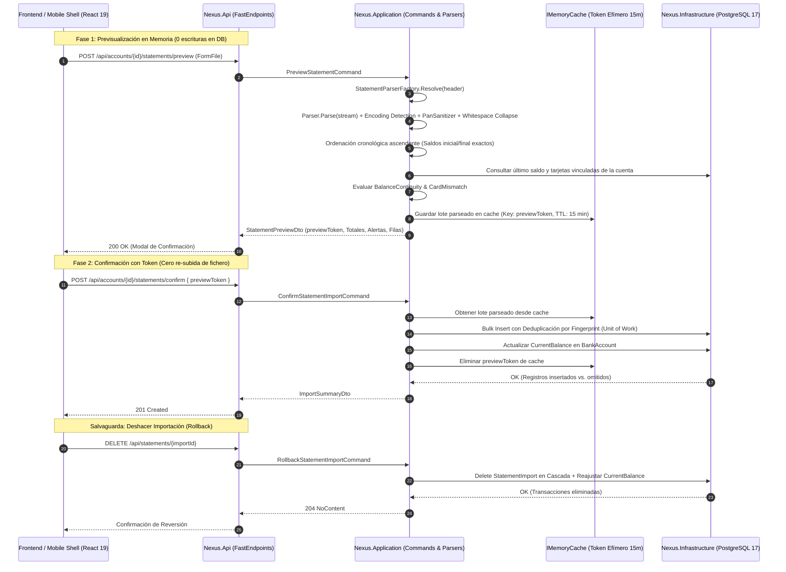

# Especificación Técnica: Ingesta y Almacenamiento Inmutable de Extractos Multi-Banco

- **ID de la Feature**: `001-raw-statements-storage`
- **Estado**: Aprobado (Gate 2 - Con Refinamiento Crítico y Optimizaciones)
- **Especificación Funcional Asociada**: [01-spec.md](./01-spec.md)
- **Fecha de Creación**: 2026-09-27
- **Última Actualización**: 2026-09-27

---

## 1. Arquitectura General y Flujo de Datos

El sistema implementa una arquitectura desacoplada en 4 capas (.NET 10 Clean Architecture) complementada con el **Patrón Strategy** para el procesamiento multi-banco y un **Flujo Seguro en 2 Fases con Token Efímero (Preview ➔ Confirm)** para optimizar el rendimiento móvil y evitar errores de asignación de cuenta:



---

## 2. Modelo de Dominio (`Nexus.Domain`)

### 2.1 Enums del Dominio
```csharp
namespace Nexus.Domain.Enums;

public enum AccountType
{
    Checking = 1,       // Cuenta Corriente / Operativa
    Savings = 2,        // Cuenta de Ahorro
    Investment = 3,     // Inversión / Valores
    Custody = 4         // Custodia / Fondos familiares
}

public enum HolderRole
{
    Owner = 1,          // Titular Único (100% cómputo patrimonial)
    JointOwner = 2,     // Cotitular (computa OwnershipPercentage, por defecto 50%)
    Authorized = 3,     // Apoderado / Autorizado (0% patrimonial, gestión de gastos)
    LegalGuardian = 4   // Representante Legal de Menor (Custodia familiar)
}

public enum BankType
{
    Generic = 0,
    BBVA = 1,
    ING = 2,
    Santander = 3,
    CaixaBank = 4
}
```

### 2.2 Entidades de Dominio

#### `BankAccount` (Agregado de Cuenta Financiera)
```csharp
namespace Nexus.Domain.Entities;

public class BankAccount : Entity<Guid>, IAuditableEntity, ISoftDeletable
{
    public Guid UserId { get; set; }
    public string Name { get; set; } = string.Empty;
    public BankType BankType { get; set; } = BankType.Generic;
    public string BankName { get; set; } = string.Empty;
    public string? BankCode { get; set; }                   // 4 dígitos de entidad: 0182, 1465...
    public string? Iban { get; set; }                       // Completo o nulo
    public string Last4Digits { get; set; } = string.Empty; // e.g. "1234"
    public string Currency { get; set; } = "EUR";
    
    // Clasificación Patrimonial
    public AccountType Type { get; set; } = AccountType.Checking;
    public HolderRole HolderRole { get; set; } = HolderRole.Owner;
    public decimal OwnershipPercentage { get; set; } = 100m; // 100, 50, 0...
    
    // Saldo Consolidado Actual (Optimización Dashboard)
    public decimal? CurrentBalance { get; set; }
    public DateTimeOffset? BalanceLastUpdatedAt { get; set; }

    // Tarjetas vinculadas para detección cruzada en extractos
    public List<string> LinkedCardsLast4 { get; set; } = new();

    // Relaciones
    public ICollection<StatementImport> Imports { get; set; } = new List<StatementImport>();
    public ICollection<BankTransaction> Transactions { get; set; } = new List<BankTransaction>();

    // Auditoría & Soft Delete
    public DateTimeOffset CreatedAt { get; set; }
    public DateTimeOffset? UpdatedAt { get; set; }
    public bool IsDeleted { get; set; }
    public DateTimeOffset? DeletedAt { get; set; }
}
```

#### `StatementImport` (Lote de Importación Inmutable)
```csharp
namespace Nexus.Domain.Entities;

public class StatementImport : Entity<Guid>, IAuditableEntity
{
    public Guid BankAccountId { get; set; }
    public BankAccount BankAccount { get; set; } = null!;
    
    public string FileName { get; set; } = string.Empty;
    public string FileHashSha256 { get; set; } = string.Empty; // Bloquea subidas idénticas
    public BankType DetectedBankType { get; set; }
    
    public DateTimeOffset ImportedAt { get; set; }
    public int TotalRecords { get; set; }
    public int ImportedRecords { get; set; }
    public int SkippedDuplicates { get; set; }
    
    public decimal StartingBalance { get; set; }
    public decimal EndingBalance { get; set; }
    public DateOnly StartDate { get; set; }
    public DateOnly EndDate { get; set; }

    public ICollection<BankTransaction> Transactions { get; set; } = new List<BankTransaction>();

    public DateTimeOffset CreatedAt { get; set; }
    public DateTimeOffset? UpdatedAt { get; set; }
}
```

#### `BankTransaction` (Transacción Canónica Normalizada)
```csharp
namespace Nexus.Domain.Entities;

public class BankTransaction : Entity<Guid>, IAuditableEntity
{
    public Guid BankAccountId { get; set; }
    public BankAccount BankAccount { get; set; } = null!;

    public Guid StatementImportId { get; set; } // Clave foránea para rollback atómico
    public StatementImport StatementImport { get; set; } = null!;

    public DateOnly OperationDate { get; set; }
    public DateOnly? ValueDate { get; set; }
    public string Description { get; set; } = string.Empty;
    public decimal Amount { get; set; }
    public string Currency { get; set; } = "EUR";
    public decimal? BalanceAfter { get; set; }

    // Categorización nativa del banco (preservada de ING Direct, etc.)
    public string? BankCategory { get; set; }
    public string? BankSubcategory { get; set; }
    public string? BankMovementType { get; set; }
    public string? Observations { get; set; }

    // Inmutabilidad y Auditoría: Fila original exacta en JSON
    public string RawDataJson { get; set; } = "{}";

    // Deduplicación determinista: SHA256(AccountId + Date + Amount + NormalizedDesc + BalanceAfter)
    public string Fingerprint { get; set; } = string.Empty;

    public DateTimeOffset CreatedAt { get; set; }
    public DateTimeOffset? UpdatedAt { get; set; }
}
```

### 2.3 Value Objects y Algoritmos de Dominio

#### Sanitizador y Normalizador de Textos (`TextSanitizer`)
```csharp
namespace Nexus.Domain.Security;

public static class TextSanitizer
{
    private static readonly Regex PanRegex = new(
        @"\b(?:\d{4}[ -]?){3}\d{4}\b",
        RegexOptions.Compiled);

    private static readonly Regex MultipleWhitespaceRegex = new(
        @"\s+",
        RegexOptions.Compiled);

    /// <summary>
    /// Colapsa espacios consecutivos y enmascara números de tarjeta (PAN de 16 dígitos).
    /// </summary>
    public static string Sanitize(string? text)
    {
        if (string.IsNullOrWhiteSpace(text)) return string.Empty;

        // 1. Colapsar espacios múltiples a un solo espacio
        var collapsed = MultipleWhitespaceRegex.Replace(text.Trim(), " ");

        // 2. Enmascarar números de tarjeta de 16 dígitos
        return PanRegex.Replace(collapsed, match =>
        {
            var digitsOnly = Regex.Replace(match.Value, @"\D", "");
            if (digitsOnly.Length != 16) return match.Value;
            var last4 = digitsOnly[^4..];
            return $"**** **** **** {last4}";
        });
    }

    /// <summary>
    /// Normaliza descripción para cálculo determinista de hash fingerprint.
    /// </summary>
    public static string NormalizeForFingerprint(string? text)
    {
        if (string.IsNullOrWhiteSpace(text)) return string.Empty;
        var clean = MultipleWhitespaceRegex.Replace(text.Trim(), " ").ToUpperInvariant();
        return PanRegex.Replace(clean, match =>
        {
            var digitsOnly = Regex.Replace(match.Value, @"\D", "");
            if (digitsOnly.Length != 16) return match.Value;
            return $"CARD_{digitsOnly[^4..]}";
        });
    }
}
```

#### Generador de Fingerprint Determinista
```csharp
namespace Nexus.Domain.Services;

public static class TransactionFingerprintGenerator
{
    public static string Generate(Guid accountId, DateOnly operationDate, decimal amount, string description, decimal? balanceAfter)
    {
        var normalizedDesc = TextSanitizer.NormalizeForFingerprint(description);
        var rawKey = $"{accountId:N}|{operationDate:O}|{amount:F2}|{normalizedDesc}|{balanceAfter:F2}";
        var hashBytes = SHA256.HashData(Encoding.UTF8.GetBytes(rawKey));
        return Convert.ToHexString(hashBytes).ToLowerInvariant();
    }
}
```

#### Diccionario Oficial de Entidades del Banco de España
```csharp
namespace Nexus.Domain.Services;

public static class BankEntityResolver
{
    private static readonly Dictionary<string, (string BankName, BankType Type)> BankRegistry = new()
    {
        ["0182"] = ("BBVA", BankType.BBVA),
        ["1465"] = ("ING Direct", BankType.ING),
        ["0049"] = ("Banco Santander", BankType.Santander),
        ["2100"] = ("CaixaBank", BankType.CaixaBank),
        ["0081"] = ("Banco Sabadell", BankType.Generic),
        ["0128"] = ("Bankinter", BankType.Generic),
        ["2080"] = ("Abanca", BankType.Generic),
    };

    public static (string BankName, BankType Type) ResolveFromIban(string? iban)
    {
        if (string.IsNullOrWhiteSpace(iban)) return ("Banco Genérico", BankType.Generic);
        var clean = Regex.Replace(iban, @"\s+", "").ToUpperInvariant();
        
        // Formato ESxx EEEE...
        if (clean.StartsWith("ES") && clean.Length >= 8)
        {
            var code = clean.Substring(4, 4);
            if (BankRegistry.TryGetValue(code, out var bank))
            {
                return bank;
            }
        }
        return ("Banco Genérico", BankType.Generic);
    }
}
```

---

## 3. Capa de Aplicación (`Nexus.Application`)

### 3.1 Patrón Strategy para Parseo Multi-Banco y Lectores Excel / CSV

#### Paquetes NuGet en `Nexus.Application` / `Nexus.Infrastructure`:
- **`ExcelDataReader`** y **`ExcelDataReader.DataSet`**: Lectura OpenXML `.xlsx` por streaming ultra-ligero.
- **`System.Text.Encoding.CodePages`**: Soporte de codificación `Windows-1252` y `Latin1`.

#### DTOs y Contratos de Parser:
```csharp
namespace Nexus.Application.Statements.Parsers;

public record ParsedRawTransaction(
    DateOnly OperationDate,
    DateOnly? ValueDate,
    string Description,
    decimal Amount,
    string Currency,
    decimal? BalanceAfter,
    string? BankCategory,
    string? BankSubcategory,
    string? BankMovementType,
    string? Observations,
    string RawDataJson,
    string? DetectedCardLast4
);

public record StatementParseResult(
    BankType BankType,
    List<ParsedRawTransaction> Transactions,
    decimal StartingBalance,
    decimal EndingBalance,
    DateOnly StartDate,
    DateOnly EndDate,
    List<string> DetectedCards
);

public interface IStatementParser
{
    bool CanParse(string headerLine);
    Task<StatementParseResult> ParseAsync(Stream fileStream, CancellationToken ct);
}
```

#### Regla de Ordenación Cronológica Ascendente:
Todo parser ordena internamente las transacciones por `OperationDate` ascendente antes de construir el resultado:
- **`StartingBalance`**: `sortedTransactions.First().BalanceAfter - sortedTransactions.First().Amount` (o saldo disponible de la transacción más antigua).
- **`EndingBalance`**: `sortedTransactions.Last().BalanceAfter` (saldo resultante tras la transacción más reciente).
- **`StartDate` / `EndDate`**: `sortedTransactions.First().OperationDate` y `sortedTransactions.Last().OperationDate`.

#### Implementación: `BbvaStatementParser`
- **Firma de cabecera**: Contiene `F.Valor`, `Concepto`, `Movimiento`, `Disponible`.
- Extrae importes con `CultureInfo.GetCultureInfo("es-ES")`.
- Sanitiza descripciones y observaciones con `TextSanitizer.Sanitize()`.
- Extrae tarjetas de observaciones (`4188...` ➔ `6589`) para alimentar `DetectedCards`.

#### Implementación: `IngDirectStatementParser`
- **Firma de cabecera**: Contiene `F. VALOR`, `CATEGORÍA`, `SUBCATEGORÍA`, `IMPORTE (€)`, `SALDO (€)`.
- Extrae descripciones y comentarios.
- Preserva `CATEGORÍA` ➔ `BankCategory` y `SUBCATEGORÍA` ➔ `BankSubcategory`.

---

### 3.2 Casos de Uso y Handlers (CQRS)

1. **`CreateBankAccountCommand`**:
   - Resuelve el código de 4 dígitos y `BankType` mediante `BankEntityResolver.ResolveFromIban(req.Iban)`.
   - Asigna `HolderRole` y `OwnershipPercentage`.
   - Persiste y devuelve `BankAccountDto`.
2. **`PreviewStatementCommand`**:
   - Lee el fichero en memoria con codificación auto-detectada (`UTF-8`, `Windows-1252`).
   - `StatementParserFactory` resuelve y ejecuta el parser adecuado.
   - Consulta el `CurrentBalance` y `LinkedCardsLast4` de la cuenta en base de datos.
   - Evalúa alertas de seguridad:
     - `BALANCE_DISCONTINUITY`: Si `account.CurrentBalance` existe y difiere de `parseResult.StartingBalance` en más de 0.05 €.
     - `CARD_MISMATCH`: Si `parseResult.DetectedCards` contiene tarjetas no registradas en `account.LinkedCardsLast4`.
   - Genera un `previewToken = Guid.NewGuid()` y almacena en `IMemoryCache` el objeto `CachedPreviewData` por 15 minutos.
   - Devuelve `StatementPreviewDto(previewToken, bankType, startingBalance, endingBalance, startDate, endDate, totalRecords, warnings, previewRows)`.
3. **`ConfirmStatementImportCommand`**:
   - Recibe `{ previewToken }` (o `FormFile` como fallback si el token expiró).
   - Recupera el lote desde `IMemoryCache`.
   - Valida `RN-03` (`FileHashSha256` anti-duplicados).
   - Genera los `Fingerprint` SHA-256 canónicos.
   - Consulta los fingerprints existentes en la cuenta para descartar duplicados en memoria.
   - Inserta `StatementImport` y `BankTransactions` nuevas en una sola transacción.
   - Actualiza `account.CurrentBalance = import.EndingBalance` y `account.BalanceLastUpdatedAt = import.EndDate`.
   - Elimina el `previewToken` de caché.
   - Devuelve `ImportSummaryDto(TotalRecords, ImportedRecords, SkippedDuplicates)`.
4. **`RollbackStatementImportCommand`**:
   - Valida titularidad del usuario sobre el lote `importId`.
   - Elimina `StatementImport` en cascada (EF Core borra todas las transacciones asociadas).
   - Reajusta `CurrentBalance` de la cuenta al saldo del último movimiento restante.
   - Devuelve `204 NoContent`.

---

## 4. Persistencia e Infraestructura (`Nexus.Infrastructure`)

### 4.1 Mapeos EF Core (PostgreSQL 17)

```csharp
// BankAccountConfiguration.cs
builder.ToTable("bank_accounts");
builder.HasKey(x => x.Id);
builder.Property(x => x.Name).HasMaxLength(150).IsRequired();
builder.Property(x => x.BankName).HasMaxLength(100).IsRequired();
builder.Property(x => x.BankCode).HasMaxLength(4);
builder.Property(x => x.Iban).HasMaxLength(34);
builder.Property(x => x.Last4Digits).HasMaxLength(4).IsRequired();
builder.Property(x => x.Currency).HasMaxLength(3).IsRequired().HasDefaultValue("EUR");
builder.Property(x => x.OwnershipPercentage).HasPrecision(5, 2).HasDefaultValue(100.00m);
builder.Property(x => x.CurrentBalance).HasPrecision(18, 2);
builder.Property(x => x.LinkedCardsLast4).HasColumnType("text[]");

builder.HasIndex(x => x.UserId).HasDatabaseName("ix_bank_accounts_user_id");

// Índice condicional: evita duplicar IBAN activo por usuario pero permite soft-delete
builder.HasIndex(x => new { x.UserId, x.Iban })
       .IsUnique()
       .HasFilter("is_deleted = false AND iban IS NOT NULL")
       .HasDatabaseName("ix_bank_accounts_user_iban_unique");

// StatementImportConfiguration.cs
builder.ToTable("statement_imports");
builder.HasKey(x => x.Id);
builder.Property(x => x.FileName).HasMaxLength(255).IsRequired();
builder.Property(x => x.FileHashSha256).HasMaxLength(64).IsRequired();
builder.Property(x => x.StartingBalance).HasPrecision(18, 2);
builder.Property(x => x.EndingBalance).HasPrecision(18, 2);

// Índice Único: Bloquea a nivel de BD re-importar el mismo archivo idéntico
builder.HasIndex(x => new { x.BankAccountId, x.FileHashSha256 })
       .IsUnique()
       .HasDatabaseName("ix_statement_imports_account_hash_unique");

// BankTransactionConfiguration.cs
builder.ToTable("bank_transactions");
builder.HasKey(x => x.Id);
builder.Property(x => x.Description).HasMaxLength(255).IsRequired();
builder.Property(x => x.Amount).HasPrecision(18, 2).IsRequired();
builder.Property(x => x.Currency).HasMaxLength(3).IsRequired().HasDefaultValue("EUR");
builder.Property(x => x.BalanceAfter).HasPrecision(18, 2);
builder.Property(x => x.RawDataJson).HasColumnType("jsonb").IsRequired();
builder.Property(x => x.Fingerprint).HasMaxLength(64).IsRequired();

// Índices Estratégicos de Alto Rendimiento
builder.HasIndex(x => new { x.BankAccountId, x.Fingerprint })
       .IsUnique()
       .HasDatabaseName("ix_bank_transactions_account_fingerprint_unique");

builder.HasIndex(x => x.StatementImportId)
       .HasDatabaseName("ix_bank_transactions_statement_import_id");

builder.HasIndex(x => new { x.BankAccountId, x.OperationDate })
       .HasDatabaseName("ix_bank_transactions_account_date");
```

---

## 5. API REST (`Nexus.Api`) — Endpoints FastEndpoints

| Método | Ruta | Endpoint | Descripción |
| :--- | :--- | :--- | :--- |
| `POST` | `/api/accounts` | `CreateBankAccountEndpoint` | Crea cuenta con autodetección de entidad por IBAN. |
| `GET` | `/api/accounts` | `GetBankAccountsEndpoint` | Listado de cuentas con saldo y ponderación patrimonial. |
| `POST` | `/api/accounts/{id}/statements/preview` | `PreviewStatementEndpoint` | Previsualiza extracto (0 escrituras en BD) y emite `previewToken`. |
| `POST` | `/api/accounts/{id}/statements/confirm` | `ConfirmStatementEndpoint` | Persiste lote canónico enviando `{ previewToken }`. |
| `DELETE` | `/api/statements/{importId}` | `RollbackStatementEndpoint` | Deshace importación en 1 clic (borrado en cascada). |
| `GET` | `/api/accounts/{id}/transactions` | `GetAccountTransactionsEndpoint`| Histórico cronológico paginado de movimientos. |

---

## 6. Frontend y Shell Móvil (`frontend/`)

### Componentes y Flujo UI:
1. **`AccountSelector`**: Selector amigable que muestra el alias, entidad, últimos 4 dígitos, saldo actual y badge de rol (`Titular`, `Cotitular 50%`, `Apoderado`).
2. **`StatementDropzone`**: Zona de drag & drop para subir ficheros `.xlsx`, `.csv` o `.tsv`.
3. **`StatementPreviewModal`**:
   - Muestra banco detectado con icono oficial.
   - Tarjetas de resumen: Saldo Inicial ➔ Saldo Final, Fechas, Total Gastos e Ingresos.
   - Banners de alerta si existen advertencias (`BALANCE_DISCONTINUITY` o `CARD_MISMATCH`).
   - Tabla con vista previa de los primeros 5 movimientos con PANs enmascarados y espacios normalizados.
   - Botones: `[ Cancelar ]`, `[ Cambiar Cuenta ]` y `[ Confirmar e Importar ]` (envía `previewToken`).
4. **`RollbackButton`**: Botón en la vista de historial de importaciones para deshacer el lote con confirmación modal.

---

## 7. Plan de Verificación y Pruebas Técnicas
1. **Pruebas Unitarias (`Nexus.Tests.Unit`)**:
   - `TextSanitizerTests`: Verifica colapso de espacios en blanco y enmascaramiento de PANs.
   - `BbvaStatementParserTests`: Comprueba parseo de las filas reales de BBVA, orden cronológico y extracción de tarjetas.
   - `IngDirectStatementParserTests`: Comprueba parseo de ING Direct, validando que `BankCategory` y `BankSubcategory` se preservan.
   - `TransactionFingerprintTests`: Verifica que variaciones de espacios en blanco generen el mismo hash SHA-256.
2. **Prueba de Integración End-to-End**:
   - Script PowerShell de prueba que ejecuta:
     1. Login dev-mock.
     2. Creación de cuenta BBVA e ING.
     3. Previsualización y validación de `previewToken` y alertas.
     4. Confirmación con `previewToken` con 40 filas.
     5. Comprobación de `CurrentBalance` actualizado en la cuenta.
     6. Re-subida de extracto con solapamiento (verificando que omite duplicados).
     7. Rollback de la importación y comprobación de reajuste de saldo.
