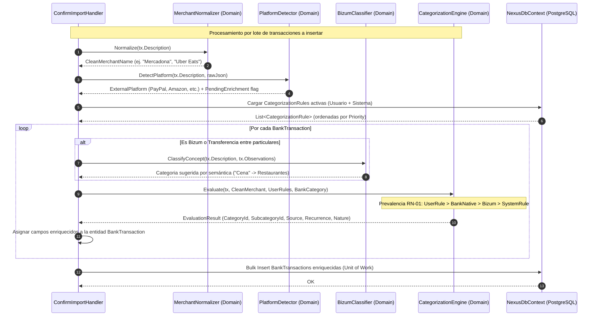
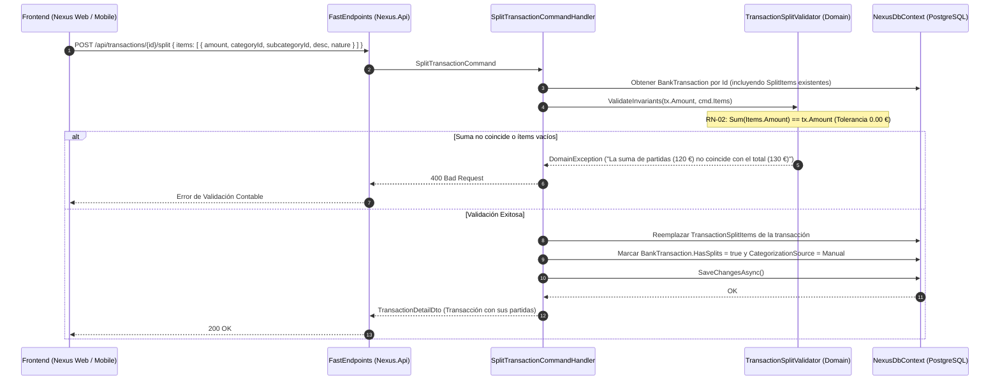

# Especificación Técnica: Motor de Categorización Inteligente, Merchant Intelligence y Desglose de Gastos

- **ID de la Feature**: `002-transaction-categorization`
- **Estado**: Aprobado (Gate 2 - Aprobado y Vinculado a Issues #8-#14)
- **Especificación Funcional Asociada**: [01-spec.md](./01-spec.md)
- **Fecha de Creación**: 2026-09-27
- **Última Actualización**: 2026-09-27

---

## 1. Arquitectura General y Flujo de Procesamiento

El Motor de Categorización e Inteligencia de Transacciones opera en dos momentos clave:
1. **Pipeline Automático en Ingesta**: Al confirmar la importación de un extracto (`ConfirmStatementImportCommand`), cada transacción pasa de forma síncrona y sin latencia externa por el pipeline de enriquecimiento antes de ser persistida.
2. **Ciclo Interactivo de Usuario**: Modificaciones manuales de categoría, división de tickets en partidas (Splits), y creación/edición de reglas con propagación retroactiva controlada.

### 1.1 Diagrama de Secuencia: Pipeline de Auto-Categorización en Ingesta



### 1.2 Diagrama de Secuencia: Desglose de Gasto Mixto (Split Transaction)



---

## 2. Modelo de Dominio (`Nexus.Domain`)

### 2.1 Nuevos Enums

```csharp
namespace Nexus.Domain.Enums;

/// <summary>
/// Tipo de flujo financiero de la categoría.
/// </summary>
public enum FlowType
{
    Expense = 1,     // Gasto / Salida de fondos
    Income = 2,      // Ingreso / Entrada de fondos
    Transfer = 3     // Traspaso entre cuentas propias / Ajuste neutro
}

/// <summary>
/// Naturaleza de imputación del gasto para el modelo dual (personal vs compartido).
/// </summary>
public enum ExpenseNature
{
    Individual = 1,  // Gasto 100% propio y personal
    Shared = 2       // Gasto conjunto/familiar pre-marcado para reparto (Splitwise)
}

/// <summary>
/// Flexibilidad presupuestaria del gasto.
/// </summary>
public enum ExpenseFlexibility
{
    Discretionary = 1, // Gasto variable prescindible (restaurantes, ocio, caprichos)
    Fixed = 2          // Coste de vida basal o comprometido (alquiler, luz, seguros, suscripciones)
}

/// <summary>
/// Periodicidad de recurrencia estimada o confirmada.
/// </summary>
public enum RecurrencePeriod
{
    None = 0,
    Weekly = 1,
    Monthly = 2,
    Quarterly = 3,
    Yearly = 4
}

/// <summary>
/// Origen de la categorización asignada (para trazabilidad y prevalencia RN-01).
/// </summary>
public enum CategorizationSource
{
    None = 0,
    SystemRule = 1,      // Regla heurística global predeterminada
    BankNative = 2,      // Categoría remitida por el banco en el extracto (ej. ING)
    BizumSemantic = 3,   // Motor léxico de conceptos de Bizum
    UserRule = 4,        // Regla explícita creada por el usuario
    Manual = 5           // Asignación directa y deliberada por el usuario (Inmutable contra reglas)
}

/// <summary>
/// Tipo de concordancia para reglas de categorización.
/// </summary>
public enum RuleMatchType
{
    Contains = 1,
    StartsWith = 2,
    Exact = 3,
    Regex = 4
}

/// <summary>
/// Plataformas externas y pasarelas de pago detectadas en la transacción.
/// </summary>
public enum ExternalPlatform
{
    None = 0,
    PayPal = 1,
    Amazon = 2,
    Apple = 3,
    GooglePay = 4,
    Klarna = 5,
    Bizum = 6
}
```

### 2.2 Entidades del Dominio

#### `Category` (Taxonomía Jerárquica Híbrida)
```csharp
namespace Nexus.Domain.Entities;

public class Category : BaseEntity
{
    // Si UserId es null, es una categoría del Sistema (inmutable para el usuario común)
    public Guid? UserId { get; set; }
    public User? User { get; set; }

    // Auto-referencia para jerarquía de 2 niveles (Padre -> Hijas)
    public Guid? ParentCategoryId { get; set; }
    public Category? ParentCategory { get; set; }
    public ICollection<Category> Subcategories { get; set; } = new List<Category>();

    public string Name { get; set; } = string.Empty;
    public string NormalizedName { get; set; } = string.Empty; // Para comparaciones case/accent-insensitive
    public string Icon { get; set; } = "tag";                  // Identificador de icono Lucide (ej. "shopping-cart")
    public string ColorHex { get; set; } = "#64748B";          // Token visual hexadecimal/HSL
    
    public FlowType FlowType { get; set; } = FlowType.Expense;
    public ExpenseNature DefaultExpenseNature { get; set; } = ExpenseNature.Individual;
    
    public bool IsSystem { get; set; } = false;
    public int DisplayOrder { get; set; } = 0;

    public ICollection<BankTransaction> Transactions { get; set; } = new List<BankTransaction>();
    public ICollection<TransactionSplitItem> SplitItems { get; set; } = new List<TransactionSplitItem>();
}
```

#### `CategorizationRule` (Reglas de Aprendizaje y Mapeo)
```csharp
namespace Nexus.Domain.Entities;

public class CategorizationRule : BaseEntity
{
    public Guid UserId { get; set; }
    public User User { get; set; } = null!;

    public string Name { get; set; } = string.Empty;
    public string Pattern { get; set; } = string.Empty;
    public string NormalizedPattern { get; set; } = string.Empty;
    public RuleMatchType MatchType { get; set; } = RuleMatchType.Contains;

    public Guid TargetCategoryId { get; set; }
    public Category TargetCategory { get; set; } = null!;

    public Guid? TargetSubcategoryId { get; set; }
    public Category? TargetSubcategory { get; set; }

    // Prioridad de evaluación (mayor número = mayor precedencia)
    public int Priority { get; set; } = 100;

    // Enriquecimientos opcionales forzados por la regla
    public ExpenseNature? SetExpenseNature { get; set; }
    public bool? SetIsRecurring { get; set; }
    public ExpenseFlexibility? SetExpenseFlexibility { get; set; }

    public bool IsActive { get; set; } = true;
}
```

#### `TransactionSplitItem` (Partidas de Desglose de Gastos Mixtos)
```csharp
namespace Nexus.Domain.Entities;

public class TransactionSplitItem : BaseEntity
{
    public Guid BankTransactionId { get; set; }
    public BankTransaction BankTransaction { get; set; } = null!;

    public Guid CategoryId { get; set; }
    public Category Category { get; set; } = null!;

    public Guid? SubcategoryId { get; set; }
    public Category? Subcategory { get; set; }

    public decimal Amount { get; set; }
    public string? Description { get; set; } // Ej. "Comida semanal", "Sartenes cocina"
    
    public ExpenseNature ExpenseNature { get; set; } = ExpenseNature.Individual;
}
```

#### Modificaciones a la Entidad Existente: `BankTransaction`
Se añaden a `BankTransaction.cs` los siguientes campos de enriquecimiento financiero sin romper la inmutabilidad de los campos contables de la Feature 001:

```csharp
// --- Enriquecimiento Feature 002 ---
public string? CleanMerchantName { get; set; }

public Guid? CategoryId { get; set; }
public Category? Category { get; set; }

public Guid? SubcategoryId { get; set; }
public Category? Subcategory { get; set; }

public CategorizationSource CategorizationSource { get; set; } = CategorizationSource.None;
public bool IsManual { get; set; } = false; // RN-01: Si true, blindada contra reglas automáticas

public bool IsRecurring { get; set; } = false;
public RecurrencePeriod RecurrencePeriod { get; set; } = RecurrencePeriod.None;
public ExpenseFlexibility ExpenseFlexibility { get; set; } = ExpenseFlexibility.Discretionary;
public ExpenseNature ExpenseNature { get; set; } = ExpenseNature.Individual;

public ExternalPlatform ExternalPlatform { get; set; } = ExternalPlatform.None;
public bool PendingPlatformEnrichment { get; set; } = false;

public bool HasSplits { get; set; } = false;
public ICollection<TransactionSplitItem> SplitItems { get; set; } = new List<TransactionSplitItem>();
```

---

## 3. Servicios Puros del Dominio (`Nexus.Domain.Services`)

### 3.1 `MerchantNormalizer`
Elimina el ruido de los terminales bancarios españoles e internacionales, prefijos TPV, códigos postales, fechas en descripción y sufijos legales societarios:

- **Expresiones de Limpieza**:
  - Prefijos TPV / Pasarelas: `^(TPV\s*\d*|SUMUP\s*\*?|PAYPAL\s*\*?|STRIPE\s*\*?|REDYS\s*\*?|COMPRA\s+EN\s+|PAGO\s+EN\s+|RECIBO\s+DE\s+)`
  - Plataformas: `^(AMZN\s*MKTP\s*ES\*?|AMAZON\.ES|AMZN\s*)`
  - Sufijos de forma societaria: `\b(S\.?A\.?|S\.?L\.?|S\.?L\.?U\.?|S\.?A\.?U\.?|S\.?C\.?P\.?|SOCIEDAD ANONIMA|SOCIEDAD LIMITADA)\b`
  - Códigos postales y localidades repetidas: `\b\d{5}\b`, ciudades en mayúsculas al final (ej. `MADRID ES`, `BARCELONA`).
  - Fechas intercaladas en texto de tarjeta: `\b\d{2}[\/\.-]\d{2}([\/\.-]\d{2,4})?\b`.
- **Formateo**: Limpieza de dobles espacios + conversión a Title Case respetando marcas conocidas (`"MERCADONA S.A."` $\rightarrow$ `"Mercadona"`, `"PAYPAL *NETFLIX 9238"` $\rightarrow$ `"Netflix"`).

### 3.2 `BizumConceptClassifier`
Motor léxico especializado en transacciones de Bizum y transferencias inmediatas:
- **Detección**: `Description` contiene `"BIZUM"` o `BankMovementType` indica Bizum.
- **Diccionario Semántico**:
  - **Restauración**: `"cena"`, `"comida"`, `"desayuno"`, `"copas"`, `"cervezas"`, `"tapeo"`, `"cumpleaños"`, `"restaurante"`, `"pizzas"`, `"hamburguesas"` $\rightarrow$ *Alimentación / Restaurantes y Bares*.
  - **Deportes**: `"padel"`, `"pádel"`, `"futbol"`, `"fútbol"`, `"gym"`, `"tenis"`, `"partido"`, `"pista"` $\rightarrow$ *Ocio / Hobbies y Deporte*.
  - **Viajes**: `"hotel"`, `"gasolina"`, `"peaje"`, `"vuelo"`, `"casa rural"`, `"apartamento"`, `"airbnb"` $\rightarrow$ *Ocio / Viajes y Vacaciones* o *Transporte*.
  - **Hogar**: `"alquiler"`, `"luz"`, `"agua"`, `"internet"`, `"wifi"`, `"limpieza"` $\rightarrow$ *Hogar / [Subcategoría correspondiente]*.
  - **Regalos**: `"regalo"`, `"bote"`, `"boda"`, `"comunión"` $\rightarrow$ *Ocio / Ocio y Estilo de Vida*.
- **Fallback**: Si no hay match léxico $\rightarrow$ Categoría *Transferencias / Bizum*.

### 3.3 `CategorizationEngine`
Aplica el algoritmo de prevalencia **RN-01**:
1. Si `tx.IsManual == true`: **Omitir** (protección de edición del usuario).
2. Evaluar `UserRules` activas del usuario ordenadas por `Priority DESC`:
   - Si coincide `rule.Pattern` con `CleanMerchantName` o `RawDescription`:
     - Asignar `rule.TargetCategoryId`, `rule.TargetSubcategoryId`.
     - Aplicar `rule.SetExpenseNature`, `rule.SetIsRecurring`, `rule.SetExpenseFlexibility` si fueron definidos.
     - `CategorizationSource = CategorizationSource.UserRule`.
     - Retornar.
3. Si es Bizum $\rightarrow$ Evaluar `BizumConceptClassifier`. Si hace match:
   - `CategorizationSource = CategorizationSource.BizumSemantic`.
   - Retornar.
4. Si `tx.BankCategory` viene informada desde el banco (ej. ING) y tiene equivalencia en el catálogo:
   - Asignar mapeo nativo.
   - `CategorizationSource = CategorizationSource.BankNative`.
   - Retornar.
5. Evaluar Reglas Heurísticas del Sistema (marcas conocidas globales: `"Mercadona"`, `"Carrefour"`, `"Lidl"`, `"Renfe"`, `"Repsol"`, `"Iberdrola"`, `"Netflix"`, `"Spotify"`, etc.):
   - Asignar categoría del sistema.
   - Si es servicio de suscripción recurrente conocido $\rightarrow$ Marcar `IsRecurring = true`, `RecurrencePeriod = Monthly`, `ExpenseFlexibility = Fixed`.
   - `CategorizationSource = CategorizationSource.SystemRule`.
6. Si nada coincide $\rightarrow$ `CategoryId = null`, `CategorizationSource = CategorizationSource.None`.

### 3.4 `TransactionSplitValidator`
Garantiza la invariante contable estricta **RN-02**:
$$\left| \text{tx.Amount} - \sum_{i=1}^N \text{items}[i]\text{.Amount} \right| < 0.001$$
- Requiere al menos 2 ítems para considerarse un desglose válido (o 1 ítem si se usa para reasignar la totalidad).
- Cada ítem debe tener un `Amount` con el mismo signo que la transacción original (no se permiten gastos positivos en una transacción de gasto negativo, salvo líneas explícitas de descuento compensadas).

---

## 4. Persistencia e Infraestructura (`Nexus.Infrastructure`)

### 4.1 Nuevas Configuraciones de Entidad EF Core

#### `CategoryConfiguration`
- Tabla: `categories`
- Clave primaria: `id`
- Relaciones:
  - Auto-referencia `parent_category_id` $\rightarrow$ `categories.id` (`OnDelete(DeleteBehavior.Restrict)`)
  - `user_id` nullable con FK a `users.id` (`OnDelete(DeleteBehavior.Cascade)`)
- Índices:
  - `ix_categories_user_parent_normalized` en `(user_id, parent_category_id, normalized_name)` con filtro `is_deleted = false`.
- Seed data: 8 Categorías Padre del Sistema y sus correspondientes subcategorías con Guids deterministas pre-fijados.

#### `CategorizationRuleConfiguration`
- Tabla: `categorization_rules`
- Clave primaria: `id`
- Relaciones:
  - FK a `users.id` (`OnDelete(DeleteBehavior.Cascade)`)
  - FK a `categories.id` para `target_category_id` y `target_subcategory_id` (`OnDelete(DeleteBehavior.Restrict)`)
- Índices:
  - `ix_categorization_rules_user_active_priority` en `(user_id, is_active, priority DESC)`

#### `TransactionSplitItemConfiguration`
- Tabla: `transaction_split_items`
- Clave primaria: `id`
- Relaciones:
  - FK a `bank_transactions.id` (`OnDelete(DeleteBehavior.Cascade)`)
  - FK a `categories.id` para `category_id` y `subcategory_id` (`OnDelete(DeleteBehavior.Restrict)`)
- Campos numéricos: `amount` con `HasPrecision(18, 2)`
- Índices:
  - `ix_transaction_split_items_transaction_id` en `bank_transaction_id`

#### Actualización en `BankTransactionConfiguration`
- Nuevos campos: `clean_merchant_name` (varchar 150), `is_manual` (bool, default false), `is_recurring` (bool, default false), `has_splits` (bool, default false), `pending_platform_enrichment` (bool, default false).
- Nuevos enums almacenados como enteros (o smallint).
- FK a `categories.id` para `category_id` y `subcategory_id` (`OnDelete(DeleteBehavior.SetNull)` para evitar borrados en cascada de transacciones si se eliminase una categoría personalizada).
- Índices adicionales:
  - `ix_bank_transactions_category_id` en `category_id`
  - `ix_bank_transactions_clean_merchant` en `(bank_account_id, clean_merchant_name)`

### 4.2 Catálogo Semilla de Categorías del Sistema (Seed Data)

Se declaran los siguientes identificadores fijos (Guids deterministas) para que el frontend y las reglas del sistema puedan referenciarlos sin ambigüedad:

| Categoría Padre | Color Hex | Icono Lucide | Subcategorías Incluidas |
| :--- | :--- | :--- | :--- |
| **Alimentación** | `#10B981` | `utensils` | Supermercados, Restaurantes y Bares, Cafeterías, Comida a Domicilio |
| **Hogar y Vivienda** | `#3B82F6` | `home` | Alquiler e Hipoteca, Electricidad y Gas, Agua, Internet y Teléfono, Menaje y Reformas |
| **Transporte** | `#F59E0B` | `car` | Combustible, Transporte Público, Taxi y VTC, Parking y Peajes, Mantenimiento Vehículo |
| **Suscripciones y Servicios** | `#8B5CF6` | `tv` | Streaming Multimedia, Software y Nube, Gimnasio y Membresías |
| **Ocio y Estilo de Vida** | `#EC4899` | `sparkles` | Viajes y Vacaciones, Cine y Teatro, Ropa y Calzado, Hobbies y Deporte |
| **Salud y Bienestar** | `#06B6D4` | `heart-pulse` | Farmacia, Médicos y Dentista, Óptica y Cuidado Personal |
| **Finanzas e Ingresos** | `#22C55E` | `wallet` | Nómina y Salario, Dividendos e Intereses, Transferencias Recibidas, Devoluciones |
| **Impuestos y Tasas** | `#64748B` | `receipt` | IRPF, IBI y Tasas Municipales, Seguros Generales, Comisiones Bancarias |

---

## 5. Capa de Aplicación (`Nexus.Application`)

### 5.1 DTOs

```csharp
namespace Nexus.Application.Categories.DTOs;

public record CategoryDto(
    Guid Id,
    Guid? ParentCategoryId,
    string Name,
    string Icon,
    string ColorHex,
    FlowType FlowType,
    ExpenseNature DefaultExpenseNature,
    bool IsSystem,
    int DisplayOrder
);

public record CategoryTreeDto(
    Guid Id,
    string Name,
    string Icon,
    string ColorHex,
    FlowType FlowType,
    ExpenseNature DefaultExpenseNature,
    bool IsSystem,
    int DisplayOrder,
    List<CategoryDto> Subcategories
);

public record CategorizationRuleDto(
    Guid Id,
    string Name,
    string Pattern,
    RuleMatchType MatchType,
    Guid TargetCategoryId,
    string TargetCategoryName,
    Guid? TargetSubcategoryId,
    string? TargetSubcategoryName,
    int Priority,
    ExpenseNature? SetExpenseNature,
    bool? SetIsRecurring,
    ExpenseFlexibility? SetExpenseFlexibility,
    bool IsActive
);

public record SplitItemDto(
    Guid Id,
    Guid CategoryId,
    string CategoryName,
    Guid? SubcategoryId,
    string? SubcategoryName,
    decimal Amount,
    string? Description,
    ExpenseNature ExpenseNature
);

public record SplitItemInput(
    Guid CategoryId,
    Guid? SubcategoryId,
    decimal Amount,
    string? Description,
    ExpenseNature ExpenseNature
);

public record TransactionDetailDto(
    Guid Id,
    Guid BankAccountId,
    DateOnly OperationDate,
    DateOnly? ValueDate,
    string Description,
    string? CleanMerchantName,
    decimal Amount,
    string Currency,
    decimal? BalanceAfter,
    Guid? CategoryId,
    string? CategoryName,
    string? CategoryColor,
    string? CategoryIcon,
    Guid? SubcategoryId,
    string? SubcategoryName,
    CategorizationSource CategorizationSource,
    bool IsManual,
    bool IsRecurring,
    RecurrencePeriod RecurrencePeriod,
    ExpenseFlexibility ExpenseFlexibility,
    ExpenseNature ExpenseNature,
    ExternalPlatform ExternalPlatform,
    bool PendingPlatformEnrichment,
    bool HasSplits,
    List<SplitItemDto> SplitItems
);
```

### 5.2 Comandos y Casos de Uso (CQRS)

1. **Gestión de Categorías**:
   - `GetCategoryTreeQuery`: Devuelve el árbol unificado (Categorías del sistema + categorías creadas por el usuario autenticado).
   - `CreateCategoryCommand`: Permite al usuario crear una categoría o subcategoría personalizada (`UserId = CurrentUser`).
   - `UpdateCategoryCommand`: Modifica nombre, icono, color o naturaleza de una categoría propia.
   - `DeleteCategoryCommand`: Soft-delete de categoría propia. Valida que no tenga transacciones activas o las desvincula de forma segura a `CategoryId = null`.

2. **Gestión de Reglas**:
   - `GetRulesQuery`: Lista las reglas del usuario ordenadas por prioridad.
   - `CreateCategorizationRuleCommand`: Crea una regla. Parámetro `ApplyRetroactive` (bool): si es true, ejecuta la regla sobre el histórico de transacciones no manuales del usuario.
   - `UpdateCategorizationRuleCommand`: Modifica patrón, categoría destino o prioridad.
   - `DeleteCategorizationRuleCommand`: Elimina la regla del usuario.
   - `ApplyRulesRetroactiveCommand`: Ejecuta todas las reglas del usuario sobre todas las transacciones sin categorizar o automáticas (`IsManual == false`).

3. **Categorización y Desglose de Transacciones**:
   - `CategorizeTransactionCommand`:
     - Parámetros: `TransactionId`, `CategoryId`, `SubcategoryId?`, `ExpenseNature?`, `ExpenseFlexibility?`, `IsRecurring?`, `CreateRuleForMerchant?` (bool).
     - Si `CreateRuleForMerchant == true`, crea automáticamente una `CategorizationRule` para el `CleanMerchantName` con `ApplyRetroactive = true`.
     - Marca `tx.IsManual = true` y `tx.CategorizationSource = CategorizationSource.Manual`.
   - `SplitTransactionCommand`:
     - Parámetros: `TransactionId`, `List<SplitItemInput> Items`.
     - Invoca `TransactionSplitValidator.Validate(...)`.
     - Elimina desgloses antiguos (si existían) y persiste las nuevas partidas `TransactionSplitItem`.
     - Marca `tx.HasSplits = true`, `tx.IsManual = true`.
   - `ResetTransactionSplitsCommand`:
     - Elimina los splits de la transacción y devuelve la imputación íntegra al `CategoryId` principal.

4. **Consultas Enriquecidas de Transacciones**:
   - `GetTransactionsQuery`: Filtros por `BankAccountId?`, `CategoryId?`, `SubcategoryId?`, `SearchTerm?` (busca en `Description` y `CleanMerchantName`), `FromDate?`, `ToDate?`, `IsRecurring?`, `HasSplits?`, `ExpenseNature?`, paginación (`Page`, `PageSize`).

---

## 6. Endpoints de la API (`Nexus.Api`)

FastEndpoints estructurados con autenticación JWT requerida:

| Método | Ruta | Comando / Caso de Uso | Descripción |
| :--- | :--- | :--- | :--- |
| `GET` | `/api/categories` | `GetCategoryTreeQuery` | Árbol completo de categorías (sistema + usuario) |
| `POST` | `/api/categories` | `CreateCategoryCommand` | Crear categoría o subcategoría personalizada |
| `PUT` | `/api/categories/{id}` | `UpdateCategoryCommand` | Editar categoría personalizada |
| `DELETE` | `/api/categories/{id}` | `DeleteCategoryCommand` | Eliminar categoría personalizada |
| `GET` | `/api/rules` | `GetRulesQuery` | Lista de reglas de categorización del usuario |
| `POST` | `/api/rules` | `CreateCategorizationRuleCommand` | Crear nueva regla (con opción de aplicación retroactiva) |
| `PUT` | `/api/rules/{id}` | `UpdateCategorizationRuleCommand` | Modificar regla existente |
| `DELETE` | `/api/rules/{id}` | `DeleteCategorizationRuleCommand` | Eliminar regla |
| `POST` | `/api/rules/apply-retroactive` | `ApplyRulesRetroactiveCommand` | Re-evaluar todas las reglas sobre movimientos no manuales |
| `GET` | `/api/transactions` | `GetTransactionsQuery` | Lista paginada con filtros avanzados de categorización |
| `GET` | `/api/transactions/{id}` | `GetTransactionByIdQuery` | Detalle completo de una transacción y sus splits |
| `PATCH` | `/api/transactions/{id}/categorize` | `CategorizeTransactionCommand` | Categorización manual (con toggle de auto-regla) |
| `POST` | `/api/transactions/{id}/split` | `SplitTransactionCommand` | Desglosar transacción en partidas mixtas |
| `DELETE` | `/api/transactions/{id}/split` | `ResetTransactionSplitsCommand` | Eliminar desglose y restaurar categoría única |

---

## 7. Estrategia de Pruebas Automatizadas (`Nexus.UnitTests`)

1. **Pruebas de Dominio (`Nexus.UnitTests/Domain`)**:
   - `MerchantNormalizerTests`:
     - `"TPV 49201 BCN MERCADONA S.A. 25/09"` $\rightarrow$ `"Mercadona"`
     - `"SUMUP *CAFETERIA PARIS"` $\rightarrow$ `"Cafeteria Paris"`
     - `"PAYPAL *NETFLIX 9238"` $\rightarrow$ `"Netflix"`
     - `"AMZN MKTP ES*H82Y192"` $\rightarrow$ `"Amazon"`
     - `"RECIBO DE IBERDROLA CLIENTES S.A.U."` $\rightarrow$ `"Iberdrola Clientes"`
     - `"PAGO EN CABIFY MADRID ES 12/03"` $\rightarrow$ `"Cabify"`
   - `BizumConceptClassifierTests`:
     - `"BIZUM CENA EL BODEGON"` $\rightarrow$ Match *Restaurantes y Bares*
     - `"BIZUM PADEL MARTES"` $\rightarrow$ Match *Hobbies y Deporte*
     - `"BIZUM GASOLINA VIAJE VALENCIA"` $\rightarrow$ Match *Combustible*
     - `"BIZUM GRACIAS"` $\rightarrow$ Fallback *Transferencias / Bizum*
   - `TransactionSplitValidatorTests`:
     - Suma exacta: `-120.00 €` con partidas `-80.00 €` y `-40.00 €` $\rightarrow$ Válido.
     - Suma errónea: `-120.00 €` con partidas `-80.00 €` y `-39.99 €` $\rightarrow$ Arroja `DomainValidationException`.
     - Partidas con signo invertido no compensado $\rightarrow$ Rechazado.
   - `CategorizationEngineTests`:
     - Comprueba el orden de prevalencia RN-01: Manual > UserRule > BankNative > SystemRule.
     - Detección de suscripciones (Netflix $\rightarrow$ `IsRecurring = true`, `RecurrencePeriod = Monthly`, `ExpenseFlexibility = Fixed`).

2. **Pruebas de Aplicación (`Nexus.UnitTests/Application`)**:
   - `SplitTransactionCommandHandlerTests`: Verifica persistencia atómica de splits y actualización de `HasSplits = true`.
   - `ApplyRulesRetroactiveCommandHandlerTests`: Verifica que las transacciones con `IsManual = true` jamás sean sobrescritas por reglas retroactivas.
   - `ConfirmStatementImportCommandHandlerTests`: Verifica que las nuevas transacciones insertadas adquieran automáticamente su `CleanMerchantName` y categoría calculada.

---

## 8. Estrategia de Migración de Base de Datos

1. **Migración EF Core**: `AddTransactionCategorizationAndSplits`.
2. **Backfill de Transacciones Existentes**:
   - El script de migración o un servicio de inicialización aplicará `MerchantNormalizer` a las transacciones existentes en la base de datos que tengan `clean_merchant_name IS NULL`.
   - Ejecutará el `CategorizationEngine` sobre los registros existentes para categorizar el histórico ya importado.

---

## 9. Decisiones Técnicas y de UI

1. **Visualización de Splits en Tabla de Movimientos**:
   - Se adopta la **Opción A (Recomendada)**: La fila de la transacción bancaria muestra el importe global (`-120,00 €`), y una píldora interactiva `[2 partidas]`. Al pulsarla, se expande un subpanel acordeón mostrando las 2 líneas desglosadas con sus respectivas categorías e importes. Esto preserva la lectura limpia de saldos bancarios y extractos sin duplicar filas virtuales.
2. **Precisión Decimal**:
   - Todos los importes de splits utilizan `decimal(18, 2)` con redondeo a 2 decimales para eliminar cualquier imprecisión de coma flotante.
3. **Aislamiento Multi-inquilino (Multi-tenant)**:
   - Las reglas y categorías de usuario están estrictamente filtradas por `UserId`. Las categorías del sistema (`UserId == null`) son de solo lectura para los usuarios.
