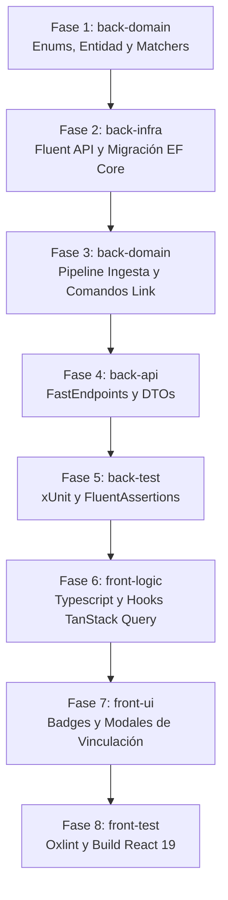

# Desglose de Tareas: Contra-partidas de Gasto, Devoluciones y Reembolsos Bizum

- **ID de la Feature**: `002-transaction-categorization`
- **Tipo de Documento**: Checklist de Ejecución Atómica (Change Tasks)
- **Especificaciones**: [01-change-spec-refunds-and-reimbursements.md](./01-change-spec-refunds-and-reimbursements.md) | [02-change-tech-spec-refunds-and-reimbursements.md](./02-change-tech-spec-refunds-and-reimbursements.md)
- **Orquestador Asignado**: `@jarvis`
- **Estado**: Completado (Verificado 100% verde en Backend & Frontend)

---

## Matriz de Fases de Implementación por Agente Especialista

---

### 🔹 Fase 1: Dominio (`back-domain`)
- [x] **Tarea 1.1**: Crear enum `TransactionNature` en `Nexus.Domain.Enums` (`StandardExpense`, `ExpenseReimbursement`, `TrueIncome`, `InternalTransfer`).
- [x] **Tarea 1.2**: Extender entidad `BankTransaction` con `TransactionNature`, `LinkedTransactionId` y `LinkedTransaction`.
- [x] **Tarea 1.3**: Actualizar `BizumClassifier` para clasificar abonos (`Amount > 0`) con conceptos de consumo como `ExpenseReimbursement` en la categoría correspondiente.
- [x] **Tarea 1.4**: Crear servicio de dominio `InternalTransferMatcher` para detección de traspasos propios por importe idéntico y fechas cercanas ($\pm 2$ días).

### 🔹 Fase 2: Infraestructura y Persistencia (`back-infra`)
- [x] **Tarea 2.1**: Mapear `TransactionNature` y la relación autoreferenciada `LinkedTransaction` con `OnDelete(DeleteBehavior.SetNull)` en `BankTransactionConfiguration`.
- [x] **Tarea 2.2**: Generar y aplicar migración EF Core `AddTransactionNatureAndLinkedTransaction`.

### 🔹 Fase 3: Casos de Uso y Aplicación (`back-domain`)
- [x] **Tarea 3.1**: Modificar el pipeline de categorización en ingesta para auto-asignar `TransactionNature` según signo, categoría y resultado de matchers.
- [x] **Tarea 3.2**: Implementar `LinkTransactionCommand` y su handler (vinculación de devoluciones y traspasos con validación de importes).
- [x] **Tarea 3.3**: Implementar `UpdateTransactionNatureCommand` y su handler (cambio manual de naturaleza por el usuario).

### 🔹 Fase 4: API y FastEndpoints (`back-api`)
- [x] **Tarea 4.1**: Actualizar DTOs `TransactionDto` y `TransactionDetailDto` exponiendo `TransactionNature` y datos de la contraparte enlazada.
- [x] **Tarea 4.2**: Implementar endpoint `POST /api/transactions/{id}/link`.
- [x] **Tarea 4.3**: Implementar endpoint `PATCH /api/transactions/{id}/nature`.

### 🔹 Fase 5: Pruebas Backend (`back-test`)
- [x] **Tarea 5.1**: Pruebas unitarias de `BizumClassifier` verificando abonos clasificados como `ExpenseReimbursement`.
- [x] **Tarea 5.2**: Pruebas unitarias de `InternalTransferMatcher`.
- [x] **Tarea 5.3**: Pruebas unitarias de `LinkTransactionCommandHandler`.
- [x] **Tarea 5.4**: Ejecutar suite completa `dotnet test` y verificar 100% verde (67/67 tests).

### 🔹 Fase 6: Lógica Frontend (`front-logic`)
- [x] **Tarea 6.1**: Añadir tipo `TransactionNature` en `frontend/src/types/`.
- [x] **Tarea 6.2**: Crear hooks en `frontend/src/hooks/` para `useLinkTransactionMutation` y `useUpdateTransactionNatureMutation`.

### 🔹 Fase 7: Interfaz de Usuario (`front-ui`)
- [x] **Tarea 7.1**: Incorporar badges visuales diferenciados en la tabla de transacciones para `Reembolso / Contrapartida` (verde suave), `Ingreso` (verde esmeralda) y `Traspaso` (gris neutro).
- [x] **Tarea 7.2**: Añadir acción contextual para vincular una devolución a su cargo original.

### 🔹 Fase 8: Testing y Verificación Frontend (`front-test`)
- [x] **Tarea 8.1**: Ejecutar `npm run lint` (`oxlint`) y verificar cero advertencias.
- [x] **Tarea 8.2**: Ejecutar `npm run build` y verificar bundle de producción limpio.
