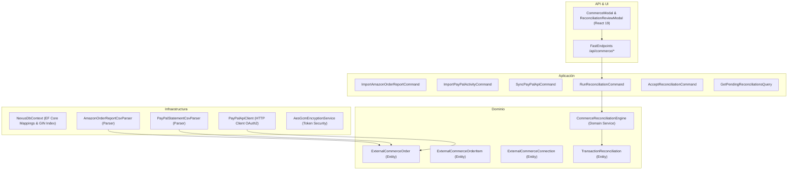

# Especificación Técnica: Conectores de Comercio & Reconciliación Externa (Amazon & PayPal Sync)

- **ID de la Feature**: `003-commerce-connectors-and-reconciliation`
- **Estado**: Completado con Éxito (Gate 2 - Alineado con SYSTEM_VISION.md)
- **Especificación Funcional Asociada**: [01-spec.md](./01-spec.md)
- **Documento Macro de Referencia**: [SYSTEM_VISION.md](../../SYSTEM_VISION.md) (Pilar 5, Pilar 6 y RN-07)
- **Fecha de Creación**: 2026-09-29
- **Última Actualización**: 2026-10-03
- **Issue en GitHub**: [#15](https://github.com/serchodm/Nexus/issues/15)

---

## 1. Arquitectura General y Flujo de Procesamiento

El subsistema de conectores y reconciliación externa se estructura siguiendo los principios de **Clean Architecture**:



---

## 2. Modelo de Dominio

### 2.1 Enums del Dominio

```csharp
namespace Nexus.Domain.Enums;

public enum CommerceProvider
{
    Amazon = 1,
    PayPal = 2
}

public enum ReconciliationStatus
{
    Candidate = 1,     // Coincidencia sugerida por el motor
    Accepted = 2,      // Reconciliación confirmada (Splits creados)
    Rejected = 3,      // Descartada por el usuario
    AutoApplied = 4    // Aplicada automáticamente con confianza 100%
}

public enum MatchConfidence
{
    Exact100 = 1,      // Importe exacto, fecha dentro de ±2 días y referencia idéntica
    High = 2,          // Importe exacto y ventana de ±5 días
    Medium = 3,        // Combinatoria de ítems de pedido que suman el importe
    Low = 4            // Posible coincidencia que requiere revisión humana
}
```

### 2.2 Entidades de Dominio

#### `ExternalCommerceOrder`
Representa un pedido realizado en Amazon o una transacción registrada en PayPal.

```csharp
namespace Nexus.Domain.Entities;

public class ExternalCommerceOrder : BaseEntity
{
    public Guid UserId { get; set; }
    public CommerceProvider Provider { get; set; }
    public string ExternalOrderId { get; set; } = string.Empty; // ej. Amazon Order ID: 402-1234567-8901234
    public DateTime OrderDate { get; set; }
    public DateTime? ShipmentDate { get; set; }
    public decimal TotalAmount { get; set; }
    public decimal ShippingFee { get; set; }
    public decimal TaxAmount { get; set; }
    public decimal RefundAmount { get; set; }
    public string Currency { get; set; } = "EUR";
    public string? CounterpartyName { get; set; } // Nombre del comercio en PayPal (ej. "Spotify", "Steam")
    public string? RawDataJson { get; set; }
    public bool IsFullyReconciled { get; set; }

    // Relaciones
    public ICollection<ExternalCommerceOrderItem> Items { get; set; } = new List<ExternalCommerceOrderItem>();
    public ICollection<TransactionReconciliation> Reconciliations { get; set; } = new List<TransactionReconciliation>();
}
```

#### `ExternalCommerceOrderItem`
Representa un artículo o partida individual dentro de un pedido de Amazon o PayPal.

```csharp
namespace Nexus.Domain.Entities;

public class ExternalCommerceOrderItem : BaseEntity
{
    public Guid ExternalCommerceOrderId { get; set; }
    public ExternalCommerceOrder Order { get; set; } = null!;

    public string Title { get; set; } = string.Empty;
    public string? Sku { get; set; }               // ASIN en Amazon
    public string? CategoryHint { get; set; }      // Categoría sugerida por Amazon
    public int Quantity { get; set; } = 1;
    public decimal UnitPrice { get; set; }
    public decimal TotalPrice { get; set; }
    public string? Condition { get; set; }

    // Seguimiento de reconciliación (RN-04: 1 ítem solo puede vincularse a un cargo bancario)
    public Guid? BankTransactionId { get; set; }
    public BankTransaction? BankTransaction { get; set; }
    public bool IsReconciled => BankTransactionId.HasValue;
}
```

#### `TransactionReconciliation`
Registra el emparejamiento entre un movimiento bancario y un pedido/ítem externo.

```csharp
namespace Nexus.Domain.Entities;

public class TransactionReconciliation : BaseEntity
{
    public Guid UserId { get; set; }
    public Guid BankTransactionId { get; set; }
    public BankTransaction BankTransaction { get; set; } = null!;

    public Guid ExternalCommerceOrderId { get; set; }
    public ExternalCommerceOrder ExternalCommerceOrder { get; set; } = null!;

    public ReconciliationStatus Status { get; set; } = ReconciliationStatus.Candidate;
    public MatchConfidence Confidence { get; set; }
    public string MatchReason { get; set; } = string.Empty;
    
    // IDs de ítems específicos de la orden que componen este cargo bancario
    public List<Guid> MatchedOrderItemIds { get; set; } = new();

    public DateTime ReconciledAt { get; set; } = DateTime.UtcNow;
    public bool AppliedAsSplits { get; set; }
}
```

#### `ExternalCommerceConnection`
Almacena credenciales seguras cifradas para la conexión API con PayPal.

```csharp
namespace Nexus.Domain.Entities;

public class ExternalCommerceConnection : BaseEntity
{
    public Guid UserId { get; set; }
    public CommerceProvider Provider { get; set; } = CommerceProvider.PayPal;
    public string AccountEmail { get; set; } = string.Empty;
    
    // Tokens cifrados con AES-256-GCM (RN-07)
    public string EncryptedAccessToken { get; set; } = string.Empty;
    public string? EncryptedRefreshToken { get; set; }
    public DateTime? TokenExpiresAt { get; set; }

    public bool IsActive { get; set; } = true;
    public DateTime? LastSyncAt { get; set; }
    public string? LastSyncStatus { get; set; }
}
```

---

## 3. Algoritmo del Motor de Reconciliación (`CommerceReconciliationEngine`)

El motor de reconciliación cruza las transacciones bancarias opacas con los pedidos externos:

```csharp
public class CommerceReconciliationEngine
{
    /// <summary>
    /// Evalúa una transacción bancaria candidata frente al catálogo de órdenes externas sin reconciliar.
    /// </summary>
    public ReconciliationCandidate? FindBestMatch(
        BankTransaction bankTx, 
        IEnumerable<ExternalCommerceOrder> candidateOrders)
    {
        var txAmount = Math.Abs(bankTx.Amount);
        var txDate = bankTx.OperationDate.ToDateTime(TimeOnly.MinValue);

        // 1. Filtrar órdenes en la ventana temporal: [txDate - 7 días, txDate + 1 día]
        var eligibleOrders = candidateOrders
            .Where(o => !o.IsFullyReconciled)
            .Where(o => o.OrderDate >= txDate.AddDays(-7) && o.OrderDate <= txDate.AddDays(1))
            .ToList();

        // 2. Coincidencia Exacta 1:1 (Total del pedido == Importe bancario)
        var exactOrder = eligibleOrders.FirstOrDefault(o => o.TotalAmount == txAmount);
        if (exactOrder != null)
        {
            var daysDiff = Math.Abs((txDate - exactOrder.OrderDate).TotalDays);
            var confidence = daysDiff <= 2 ? MatchConfidence.Exact100 : MatchConfidence.High;

            return new ReconciliationCandidate(
                bankTx.Id,
                exactOrder.Id,
                exactOrder.Items.Select(i => i.Id).ToList(),
                confidence,
                $"Coincidencia exacta de importe ({txAmount} €) con desfase de {daysDiff:F0} días."
            );
        }

        // 3. Coincidencia Combinatoria 1:N (Subconjunto de artículos de un pedido que suman el cargo)
        foreach (var order in eligibleOrders)
        {
            var unreconciledItems = order.Items.Where(i => !i.IsReconciled).ToList();
            var subset = FindSubsetSum(unreconciledItems, txAmount);
            if (subset != null && subset.Count > 0)
            {
                return new ReconciliationCandidate(
                    bankTx.Id,
                    order.Id,
                    subset.Select(i => i.Id).ToList(),
                    MatchConfidence.Medium,
                    $"Expedición parcial de {subset.Count} artículos de la orden {order.ExternalOrderId} por {txAmount} €."
                );
            }
        }

        return null;
    }

    private List<ExternalCommerceOrderItem>? FindSubsetSum(
        List<ExternalCommerceOrderItem> items, 
        decimal target)
    {
        // Algoritmo determinista de suma de subconjuntos para N <= 10
        int n = items.Count;
        for (int i = 1; i < (1 << n); i++)
        {
            decimal sum = 0;
            var current = new List<ExternalCommerceOrderItem>();
            for (int j = 0; j < n; j++)
            {
                if ((i & (1 << j)) != 0)
                {
                    sum += items[j].TotalPrice;
                    current.Add(items[j]);
                }
            }
            if (Math.Abs(sum - target) < 0.005m)
            {
                return current;
            }
        }
        return null;
    }
}
```

---

## 4. Ingesta de Reportes Amazon CSV

Amazon genera archivos CSV estructurados con la siguiente estructura de cabecera:
`Order ID,Order Date,Title,Category,ASIN/ISBN,UNSPSC Code,Website,Release Date,Condition,Seller,Seller Credentials,List Price Per Unit,Purchase Price Per Unit,Quantity,Payment Instrument Type,Purchase Order Number,PO Line Number,Ordering Customer Email,Shipment Date,Shipping Address Name,Shipping Address Street 1,Shipping Address Street 2,Shipping Address City,Shipping Address State,Shipping Address Zip,Order Status,Carrier Name & Tracking Number,Item Subtotal,Item Subtotal Tax,Item Total,Tax Exemption Applied,Tax Exemption Type,Exemption Opt-Out,Buyer Name,Currency`

El parser:
1. Agrupa filas por `Order ID`.
2. Suma importes y asocia líneas de compra individuales.
3. Asigna la categoría inferida de Amazon a la taxonomía de Nexus (`CategoryHint` $\rightarrow$ `NexusCategoryId`).

---

## 5. Endpoints FastEndpoints

| Método | Ruta | Descripción |
| :---: | :--- | :--- |
| `POST` | `/api/commerce/amazon/import-report` | Subida de archivo CSV de pedidos de Amazon |
| `POST` | `/api/commerce/paypal/import-activity` | Subida de archivo CSV de actividad de PayPal |
| `POST` | `/api/commerce/paypal/connect` | Registro de credenciales OAuth de PayPal |
| `POST` | `/api/commerce/paypal/sync` | Disparo manual de sincronización vía API de PayPal |
| `GET` | `/api/commerce/reconciliations` | Lista de reconciliaciones candidatas pendientes de aprobación |
| `POST` | `/api/commerce/reconciliations/{id}/accept` | Acepta reconciliación y crea Splits automáticos |
| `POST` | `/api/commerce/reconciliations/{id}/reject` | Descarta la sugerencia de reconciliación |
| `GET` | `/api/commerce/orders` | Explorador paginado de compras externas |
