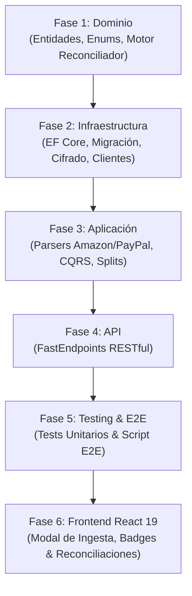

# Desglose de Tareas: Conectores de Comercio & Reconciliación Externa (Amazon & PayPal Sync)

- **ID de la Feature**: `003-commerce-connectors-and-reconciliation`
- **Estado**: Completado con Éxito (100% de Pruebas Unitarias y E2E Verificadas - DoD Cumplido)
- **Especificaciones**: [01-spec.md](./01-spec.md) | [02-tech-spec.md](./02-tech-spec.md)
- **Fecha de Creación**: 2026-09-29
- **Última Actualización**: 2026-10-03
- **Issue en GitHub**: [#15](https://github.com/serchodm/Nexus/issues/15)

---

## Matriz de Fases de Implementación (SDD)

---

### Fase 1: Dominio & Algoritmo de Reconciliación
- [x] **Tarea 1.1**: Crear enums de dominio (`CommerceProvider`, `ReconciliationStatus`, `MatchConfidence`).
- [x] **Tarea 1.2**: Implementar entidades `ExternalCommerceOrder`, `ExternalCommerceOrderItem`, `TransactionReconciliation`, `ExternalCommerceConnection`.
- [x] **Tarea 1.3**: Definir interfaces de repositorios (`IExternalCommerceOrderRepository`, `ITransactionReconciliationRepository`, `IExternalCommerceConnectionRepository`).
- [x] **Tarea 1.4**: Implementar el servicio de dominio `CommerceReconciliationEngine` con algoritmo de matching temporal ($\pm 7$ días) y suma de subconjuntos 1:N (Subset Sum determinista).

### Fase 2: Infraestructura, Persistencia & Seguridad
- [x] **Tarea 2.1**: Mapeos Fluent API en `NexusDbContext` con índices y borrado en cascada controlado.
- [x] **Tarea 2.2**: Generar y aplicar migración PostgreSQL `20260929_AddCommerceConnectorsAndReconciliation`.
- [x] **Tarea 2.3**: Implementar repositorios de infraestructura con EF Core.
- [x] **Tarea 2.4**: Crear servicio de cifrado simétrico en reposo `ISecretEncryptionService` (AES-256-GCM) para tokens de PayPal.
- [x] **Tarea 2.5**: Implementar cliente HTTP resiliente `PayPalApiClient` para OAuth2 y Transaction Reporting API.

### Fase 3: Aplicación, Parsers & Casos de Uso
- [x] **Tarea 3.1**: Implementar parser oficial de Amazon CSV `AmazonOrderReportCsvParser`.
- [x] **Tarea 3.2**: Implementar parser oficial de PayPal CSV `PayPalStatementCsvParser`.
- [x] **Tarea 3.3**: Caso de uso `ImportAmazonOrderReportCommand` (Deduplicación canónica RN-05).
- [x] **Tarea 3.4**: Caso de uso `ImportPayPalActivityCommand` y `SyncPayPalApiCommand`.
- [x] **Tarea 3.5**: Caso de uso `RunReconciliationCommand` (disparo automático post-importación y manual).
- [x] **Tarea 3.6**: Caso de uso `AcceptReconciliationCommand` (convierte el pedido en `SplitItems` bancarios exactos RN-02 y actualiza `CleanMerchantName` RN-06).
- [x] **Tarea 3.7**: Caso de uso `RejectReconciliationCommand` y queries de consulta de órdenes/reconciliaciones.

### Fase 4: API & Endpoints (FastEndpoints)
- [x] **Tarea 4.1**: `POST /api/commerce/amazon/import-report` (multipart CSV).
- [x] **Tarea 4.2**: `POST /api/commerce/paypal/import-activity` (multipart CSV).
- [x] **Tarea 4.3**: `POST /api/commerce/paypal/connect` y `POST /api/commerce/paypal/sync`.
- [x] **Tarea 4.4**: `GET /api/commerce/reconciliations` y `GET /api/commerce/orders`.
- [x] **Tarea 4.5**: `POST /api/commerce/reconciliations/{id}/accept` y `POST /api/commerce/reconciliations/{id}/reject`.

### Fase 5: Pruebas Unitarias & Verificación E2E
- [x] **Tarea 5.1**: Pruebas unitarias de `AmazonOrderReportCsvParser` y `PayPalStatementCsvParser`.
- [x] **Tarea 5.2**: Pruebas unitarias de `CommerceReconciliationEngine` (coincidencias 1:1, combinatorias 1:N, descarte de fechas fuera de ventana, invariante RN-02).
- [x] **Tarea 5.3**: Pruebas unitarias de `AcceptReconciliationCommandHandler` (creación de splits y prevalencia RN-01).
- [x] **Tarea 5.4**: Crear y ejecutar script E2E `tests/e2e_commerce_reconciliation_test.ps1` validando el ciclo completo.
- [x] **Tarea 5.5**: Verificar suites de regresión de Slices 001 y 002 al 100%.

### Fase 6: Frontend React 19 & Experiencia de Usuario
- [x] **Tarea 6.1**: Modelos TypeScript (`types/commerce.ts`) y hooks TanStack Query (`hooks/useCommerce.ts`).
- [x] **Tarea 6.2**: Modal `CommerceIntegrationModal` para subir reportes de Amazon CSV y PayPal CSV o conectar API.
- [x] **Tarea 6.3**: Indicador / Badge de Reconciliación en `TransactionRow` para movimientos emparejados.
- [x] **Tarea 6.4**: Modal `ReconciliationReviewModal` para revisar comparativa entre el cargo bancario y los artículos del pedido antes de aceptar.
- [x] **Tarea 6.5**: Verificación de compilación limpia de frontend (`npm run build`).
