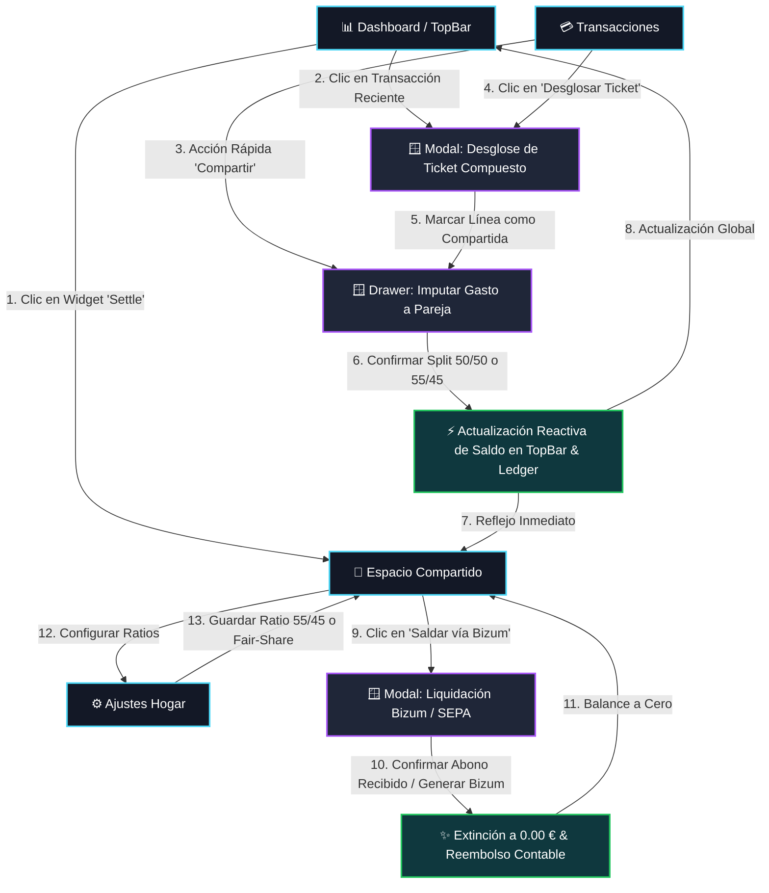

# Especificación Funcional: Espacios Compartidos, Finanzas en Pareja, Reparto Fair-Share y Liquidaciones Bizum

- **ID de la Feature**: `004-shared-expenses`
- **Estado**: Aprobado por el Usuario (Gate 1 de SDD Superado - Pase a `@jarvis`)
- **Fecha de Creación**: 2026-10-06
- **Última Actualización**: 2026-10-06
- **Autor / Rol**: `@warren` (Oráculo Financiero y Estratega de Producto)
- **Documento Macro de Referencia**: [SYSTEM_VISION.md](../../SYSTEM_VISION.md) (Pilar 3: Modelo Dual del Gasto y Espacios Compartidos con Muro de Privacidad; Pilar 4: Invariante Contable RN-02)
- **Dependencias**: `001-raw-statements-storage`, `002-transaction-categorization` (y su extensión de reembolsos/contrapartidas)

---

## 1. Visión Estratégica & "Océano Azul" de Nexus

El software financiero actual obliga a las parejas y convivientes a elegir entre dos extremos deficientes y desconectados:

```text
┌──────────────────────────────────────────┐       ┌──────────────────────────────────────────┐
│        PFM Tradicional (Fintonic)        │       │       Gastos en Grupo (Splitwise)        │
│ • Agregación bancaria individual cerrada │       │ • Bloc de notas manual y desconectado    │
│ • El gasto de 120 € infla tu presupuesto │       │ • Olvidos continuos en registrar deudas  │
│ • El Bizum de vuelta se cuenta como      │       │ • Desconectado de los movimientos reales │
│   "nuevo ingreso" distorsionando el mes  │       │ • Cero impacto en tu Patrimonio Neto     │
│ • Monetización vendiendo préstamos       │       │ • Fricción social y cálculos tediosos    │
└────────────────────┬─────────────────────┘       └────────────────────┬─────────────────────┘
                     │                                                  │
                     └────────────────────┬─────────────────────────────┘
                                          ▼
                       ╔═════════════════════════════════════════════════╗
                       ║           EL OCÉANO AZUL DE NEXUS               ║
                       ║        Shared Ledger & Zero-Knowledge           ║
                       ╚═════════════════════════════════════════════════╝
                       • De movimiento bancario real a Gasto Compartido en 1 tap
                       • Tratamiento contable de deudas como Activos (Receivables)
                       • Conciliación automática de Bizums sin inflar ingresos
                       • Muro de Privacidad Zero-Knowledge (Hogar / Pareja)
                       • Reparto Progresivo Equitativo (Fair-Share por ingresos)
                       • Cero comisiones, cero publicidad, precisión 0.00 €
```

### 1.1. Principios Diferenciadores Inviolables

1. **Del Cargo Bancario Real al Split sin Fricción**:
   Cualquier transacción bancaria real importada (ej. Mercadona 120.00 €) o cualquier *item* de un ticket desglosado puede imputarse directamente al espacio compartido con un toque.
2. **Tratamiento Contable Patrimonial (Cuentas por Cobrar / Receivables)**:
   Si el usuario adelanta un gasto conjunto de 120.00 € al 50/50:
   - Su gasto de consumo real en presupuesto son únicamente **60.00 €**.
   - Los **60.00 €** restantes no son gasto: se reclasifican automáticamente en el balance como un **Activo Corriente (Cuentas por Cobrar / Receivables)**.
   - El Patrimonio Neto del usuario no disminuye en 120 €, sino en sus 60 € de gasto real.
3. **Conciliación Automática de Bizum / Transferencias**:
   Cuando la contraparte realiza la transferencia o Bizum de liquidación (ej. 60.00 €), Nexus empareja el abono con la cuenta por cobrar, amortiza el saldo y deja el balance en **$0.00\ €$**, **sin computarlo jamás como un ingreso salarial o distorsión impositiva**.
4. **Muro de Privacidad Zero-Knowledge (Privacidad Asimétrica)**:
   Los miembros de un espacio compartido (pareja, piso) ven con total transparencia las partidas conjuntas y el balance deudor/acreedor común. **En ningún momento se revelan las nóminas completas, los saldos privados de cuentas, las inversiones bursátiles ni las billeteras cripto individuales**.
5. **Aritmética Exacta de Cero Céntimos Huérfanos**:
   Tolerancia matemática de **$0.00\ €$** en cualquier reparto, redondeado mediante *Banker's Rounding (Round-to-even)*.

---

## 2. Historias de Usuario y Casos de Uso

### Historia 1: Creación de Espacio Compartido y Configuración del Modelo de Reparto
> **Como** usuario que convive en pareja o comparte piso,  
> **Quiero** crear un "Espacio Compartido" e invitar a mi contraparte mediante un enlace o código seguro, definiendo la regla de reparto predeterminada (50/50 o progresiva ponderada por ingresos),  
> **Para que** todas las partidas comunes se liquiden de forma automática y transparente según nuestro acuerdo financiero.

### Historia 2: Imputación Directa de Transacción Bancaria al Espacio Compartido
> **Como** usuario que pagó la factura de la luz (245.80 €) o la compra del supermercado con su tarjeta BBVA,  
> **Quiero** enviar el cargo al Espacio Compartido con un solo clic, seleccionando la regla de reparto (50/50 o 55/45),  
> **Para que** mi presupuesto solo compute mi cuota parte y el saldo de mi pareja refleje de inmediato su deuda pendiente hacia mí.

### Historia 3: Imputación de Partida Desglosada (Itemized Split a Shared Space)
> **Como** usuario que hizo una compra de 120.00 € en Mercadona donde 80.00 € eran provisiones comunes y 40.00 € eran un cable electrónico de uso estrictamente personal,  
> **Quiero** imputar al Espacio Compartido únicamente la partida de 80.00 € (dejando los 40.00 € como gasto 100% individual en mi contabilidad),  
> **Para que** no exista discrepancia entre el desglose detallado de mi extracto y la deuda real exigible a mi pareja.

### Historia 4: Consulta de Balance Dinámico Unificado y Resumen de Deudas
> **Como** usuario de un espacio compartido,  
> **Quiero** ver en todo momento el balance bilateral neto (*"Tu pareja te debe X €"* o *"Debes a tu pareja Y €"*), con el desglose cronológico de partidas pendientes y ya saldadas,  
> **Para que** ninguno de los dos tenga dudas sobre el estado exacto de las cuentas y evitemos conversaciones incómodas sobre dinero.

### Historia 5: Liquidación por Bizum / SEPA con Cierre de Balance en 1 Clic
> **Como** usuario acreedor o deudor que va a liquidar el balance acumulado (ej. 170.61 €),  
> **Quiero** pulsar "Saldar vía Bizum / SEPA", generar la referencia de pago y, al detectar el abono bancario correspondiente, conciliarlo automáticamente extinguiendo la deuda pendiente a $0.00\ €$,  
> **Para que** el ledger compartido quede a cero sin generar duplicidades contables ni inflar métricas de ahorro.

### Historia 6: Muro de Privacidad Zero-Knowledge Garantizado
> **Como** usuario que valora su autonomía y privacidad financiera personal,  
> **Quiero** tener la certeza absoluta de que mi pareja solo puede ver las transacciones que yo he asignado expresamente al espacio compartido,  
> **Para que** mis gastos personales, ahorros privados, criptomonedas y saldo bancario total permanezcan en estricta confidencialidad.

---

## 3. Flujo de Navegación y Movimiento en la App (User Journey & Motion Flow)

### 3.1. Mapa de Navegación Global (State & Screen Transition Diagram)



---

### 3.2. Recorridos Paso a Paso Detallados (Cinemática UI)

#### 🎬 Flujo A: Imputar un Gasto Bancario Directo (De Extracto a Split en 2 Clics)
1. **Punto de Partida**: El usuario se encuentra en [`TransactionsPage`](file:///c:/Projects/Nexus/frontend/src/pages/TransactionsPage.tsx) o en el widget de movimientos recientes de [`DashboardPage`](file:///c:/Projects/Nexus/frontend/src/pages/DashboardPage.tsx).
2. **Disparador**: En la fila de la transacción (ej. *"Iberdrola Suministros 245.80 €"*), el usuario pulsa el botón de acción con icono de pareja `Users` o la opción de menú `"Compartir con Pareja"`.
3. **Transición Visual**:
   - Se abre un **Drawer Lateral Deslizante desde la derecha** con desenfoque de fondo *glassmorphism*.
   - El drawer muestra:
     - Detalle del movimiento bancario (Comercio, Importe bruto 245.80 €).
     - Selector de regla de reparto con botones pill interactivos: `50 / 50`, `55 / 45 (Fair-Share Activo)`, o `Personalizado`.
     - Desglose contable visual en tiempo real:
       - *Tu consumo real*: **135.19 €** (55%).
       - *Deuda de tu pareja*: **110.61 €** (45%).
     - Toggle de privacidad: *"Ocultar detalles bancarios privados (solo mostrar 'Suministros Iberdrola')"* (activado por defecto).
4. **Acción & Cierre**:
   - El usuario pulsa `"Confirmar Imputación"`.
   - **Micro-animación**: La tarjeta pulsa suavemente en color cian (`#4cd7f6`), el badge de la transacción en la tabla pasa a ser `Shared (55/45)`, y el indicador del `TopBar` salta de forma reactiva sumando los `+110.61 €` al saldo pendiente.

#### 🎬 Flujo B: Desglose Mixto de un Ticket Compuesto (Itemized Split a Shared Space)
1. **Punto de Partida**: Usuario abre una compra de supermercado de 120.00 € en Mercadona.
2. **Acción**: Pulsa `"Desglosar Ticket (Split)"`.
3. **Modal de Desglose**:
   - Crea Línea 1: *"Provisiones Supermercado & Cocina"* por 80.00 €, categoría *Alimentación*. Activa el interruptor *"Compartir con Pareja (50/50)"*.
   - Crea Línea 2: *"Cable Electrónica HDMI"* por 40.00 €, categoría *Electrónica*. Mantiene el interruptor apagado (*"Gasto 100% Personal"*).
   - El validador en tiempo real confirma la **Invariante de Balance Cero RN-02** ($80.00 + 40.00 - 120.00 \equiv 0.00\ €$).
4. **Resultado en la App**:
   - En el presupuesto personal del usuario computa: 40.00 € (cable) + 40.00 € (su mitad de comida) = 80.00 € de consumo.
   - En el Espacio Compartido se crea una partida única por 80.00 € donde Elena le debe **40.00 €**.
   - El saldo del `TopBar` y de `Shared Space` se actualiza limpiamente sin discrepancias (resolviendo el bug **FIN-04**).

#### 🎬 Flujo C: Consulta del Ledger y Liquidación Bizum / SEPA
1. **Punto de Partida**: El usuario accede a [`SharedSpacePage`](file:///c:/Projects/Nexus/frontend/src/pages/SharedSpacePage.tsx) mediante el menú lateral o pulsando el botón `"Settle"` en el mini-widget del `TopBar`.
2. **Vista de Mando del Espacio Compartido**:
   - **Tarjeta 1 (Miembros)**: Avatares entrelazados (Sergio & Elena) con el ratio activo visible (`55 / 45 Fair-Share`).
   - **Tarjeta 2 (Balance Neto Central)**: Cifra protagonista con brillo cian: `€170.61` y subtítulo `"Tu pareja te debe"`.
   - **Tarjeta 3 (Progreso Mensual)**: Barra bicolor acumulada mostrando cuánto ha pagado cada uno en el mes corriente.
3. **Sección de Partidas Pendientes**:
   - Tabla cronológica detallada con cada partida pendiente, quién la pagó y la cuota deudora exacta.
4. **Disparador de Liquidación**:
   - El usuario acreedor pulsa `"Saldar vía Bizum / SEPA"` (o el usuario deudor pulsa `"Pagar Deuda Pendiente"`).
   - Se abre el modal `SettleUpModal`:
     - Ofrece botón para copiar el número de teléfono con concepto pre-rellenado: `"Nexus Liq #104 Elena 170.61 EUR"`.
     - Si se accede desde la app móvil, enlace *Deep-Link* universal o generación de código QR SEPA.
     - Botón de confirmación: `"Confirmar Liquidación (Marcar como Saldado)"`.
5. **Cierre de Ciclo**:
   - Al pulsar confirmar o detectarse el abono Bizum en el extracto:
     - El balance neto hace una animación de transición numérica hasta `€0.00`.
     - Todas las partidas pendientes se trasladan a la pestaña colapsable `"Historial de Partidas Saldadas"`.
     - El TopBar muestra el estado `"Cuentas al día (0.00 €)"`.

#### 🎬 Flujo D: Configuración del Ratio Fair-Share y Sueldos en Ajustes
1. **Punto de Partida**: El usuario entra a [`SettingsPage`](file:///c:/Projects/Nexus/frontend/src/pages/SettingsPage.tsx) -> Sección *"Household & Fair-Share Split Engine"*.
2. **Selector de Modalidad**:
   - Opción 1: **Manual Slider**: Arrastre continuo desde 30/70 hasta 70/30 (con ancla en 50/50).
   - Opción 2: **Fair-Share Proporcional**:
     - Campo Usuario: `2.750 € / mes neto`.
     - Campo Pareja: `2.250 € / mes neto`.
     - Indicador dinámico calculado: `55.0% / 45.0%`.
3. **Persistencia**:
   - Clic en `"Guardar Cambios"`.
   - Los valores se envían y persisten en la tabla `shared_spaces` de PostgreSQL (resolviendo el bug **STATE-02**).

---

## 4. Matriz de Contratos de Interacción de la UI (Zero-Dead-Buttons Contract)

Para evitar de raíz botones mudos, maquetas ciegas y pantallas desconectadas, cada elemento interactivo de la interfaz queda sujeto al siguiente contrato vinculante:

| Elemento UI | Pantalla / Ubicación | Evento | Acción / Mutación | Transición de Pantalla & Feedback Visual | Impacto en Otras Vistas |
| :--- | :--- | :--- | :--- | :--- | :--- |
| **Botón "Settle"** | `TopBar` (mini-widget pareja) | `onClick` | Abre el flujo de liquidación con el saldo deudor precargado | Redirige a `/shared-space?action=settle` y despliega automáticamente el `SettleUpModal`. | Enfoca directamente el CTA de liquidación en `SharedSpacePage`. |
| **Botón "Compartir" (Icono Users)** | `TransactionsPage` (fila de tabla) | `onClick` | Abre el drawer lateral de imputación rápida | Se desliza el drawer lateral derecho (`ShareExpenseDrawer`) con las cuotas 55/45 ya calculadas en vivo. | Muestra el importe exacto que se sumará al balance global. |
| **Confirmar Imputación** | `ShareExpenseDrawer` | `onSubmit` | Llama a `useShareExpenseMutation(txId, ratio)` | Micro-animación de destello cian (`cyan-pulse`), cierre suave del drawer y badge `Shared (55/45)` en la fila. | El TopBar incrementa la deuda en vivo (`+110.61 €`) y `SharedSpace` añade la partida a pendientes. |
| **Toggle "Compartir con Pareja"** | `ItemizedSplitModal` (fila de partida) | `onChange` | Marca esa partida específica como imputable al espacio común | La tarjeta de la partida muestra la insignia de pareja y previsualiza la cuota del cónyuge. | Al guardar el desglose, solo esa línea viaja al espacio común (resolviendo FIN-04). |
| **Botón "Saldar vía Bizum / SEPA"** | `SharedSpacePage` (tarjeta central) | `onClick` | Prepara el lote de liquidación de todas las partidas `pending` | Abre `SettleUpModal` con el total exacto a compensar, concepto Bizum copiable y selector de canal. | - |
| **Confirmar Liquidación** | `SettleUpModal` | `onClick` | Ejecuta `useSettleBalanceMutation()`. Marca partidas como `settled` | Animación de cuenta atrás del saldo hasta `0.00 €`, confetti sutil y cierre del modal tras 1.2s. | El TopBar pasa a estado `"Cuentas al día (0.00 €)"` y desaparece la alerta de deuda. |
| **Slider / Inputs de Sueldo** | `SettingsPage` (Household Engine) | `onChange` | Recalcula el ratio Fair-Share dinámico en tiempo real | El indicador numérico se actualiza al milisegundo (ej. `55.0% / 45.0%`). | Al pulsar "Guardar", se envía a PostgreSQL y recalcula las proyecciones futuras. |

---

## 5. Alcance (Scope)

### ✅ Dentro del Alcance (In-Scope)
1. **Modelo de Datos de Espacios Compartidos**:
   - Entidad `SharedSpace` (Hogar, Pareja, etc.) con configuración de ratio base (`FixedSplitRatio`, `ProportionalToIncome`).
   - Entidad `SharedSpaceMember` con roles (`Owner`, `Member`), apodo público, avatar y estado de vinculación (`Active`, `Invited`).
   - Entidad `SharedExpenseEntry` (partida compartida) vinculada opcionalmente a una `BankTransaction` o a un `TransactionSplitItem`.
   - Entidad `SharedSettlement` (registro de liquidación/compensación) con soporte para vínculo a transacción bancaria de reembolso (Bizum/SEPA).
2. **Motor de Reparto Progresivo & Fair-Share**:
   - Soporte para splits estándar (50/50).
   - Soporte para splits asimétricos fijos (ej. 55/45, 60/40).
   - Motor de cálculo *Fair-Share*: cálculo de ratio ponderado basado en los ingresos netos mensuales declarados voluntariamente por cada parte en el espacio común.
3. **Aritmética y Conciliación Contable**:
   - Invariante de balance bilateral: $\text{BalanceNeto} = \sum \text{PagadoPorMi\_ParteAjena} - \sum \text{PagadoPorOtro\_MiParte}$.
   - Tratamiento de la deuda como *Receivable* (Activo en balance personal) o *Payable* (Pasivo).
   - Extinción de partidas pendientes tras liquidación parcial o total.
4. **Resolución de Bugs Detectados en la Auditoría**:
   - Corrección de la discrepancia de saldo en frontend (**FIN-03**: cálculo reactivo exacto entre partidas y saldo global).
   - Integración bidireccional entre *itemized splits* y partidas compartidas (**FIN-04**).
   - Persistencia completa en base de datos PostgreSQL de miembros y settings (**STATE-02**).
   - Soporte completo multiidioma en los 5 idiomas (`en`, `es`, `zh`, `hi`, `fr`) para todos los textos de Shared Space (**I18N-01**).

### 🚫 Fuera del Alcance (Out-of-Scope)
- Grupos multipartitos complejos estilo viaje de 10 personas con deudas triangulares tipo grafo N:M (reservado para fase posterior `005-multi-party-trips`; este slice resuelve el caso central del **95% del uso diario: el Hogar / Pareja bilateral**).
- Integración directa con las APIs privadas de Bizum a nivel de core bancario (Bizum no expone API pública de cobro directo a apps PFM; la conciliación se realiza detectando el movimiento en el extracto y asistiendo al usuario con deep-link o QR SEPA/Bizum).
- Cuentas corrientes mancomunadas automáticas en Open Banking que requieran firma conjunta PSD2.

---

## 6. Reglas de Negocio & Fórmulas Matemáticas

### 6.1. Invariante de Reparto de Gasto Compartido (RN-01 / Balance Cero)
Para cualquier gasto $G$ imputado a un espacio compartido entre el Miembro $A$ (pagador) y el Miembro $B$:
$$G = \text{Cuota}_A + \text{Cuota}_B$$
Donde:
$$\text{Cuota}_A = \text{round\_banker}\left(G \times \frac{r_A}{100}\right)$$
$$\text{Cuota}_B = G - \text{Cuota}_A$$
- **Regla de Cero Céntimos Huérfanos**: La cuota del segundo miembro se calcula siempre por sustracción ($G - \text{Cuota}_A$) para asegurar que jamás exista un céntimo de desvío por redondeo, satisfaciendo estrictamente:
$$\text{Cuota}_A + \text{Cuota}_B - G \equiv 0.00\ €$$

### 6.2. Fórmula del Ratio Fair-Share (Ponderación Progresiva por Ingresos)
Si el espacio compartido utiliza la modalidad `ProportionalToIncome`:
$$r_A = \frac{\text{IngresoDeclarado}_A}{\text{IngresoDeclarado}_A + \text{IngresoDeclarado}_B} \times 100$$
$$r_B = 100 - r_A$$
*Ejemplo*: Si Sergio declara 2.750 € netos y Elena declara 2.250 € netos:
- Total ingresos = 5.000 €.
- Ratio Sergio ($r_A$) = $\frac{2750}{5000} = 55\%$.
- Ratio Elena ($r_B$) = $\frac{2250}{5000} = 45\%$.

### 6.3. Tratamiento Contable del Pagador (Receivable en Balance)
Cuando el Miembro $A$ paga un gasto $G$ íntegramente:
1. **Flujo de Caja Real en Cuenta Bancaria**: $-G$ (salida de dinero efectiva de su cuenta).
2. **Gasto de Consumo en Presupuesto Personal de $A$**: $-\text{Cuota}_A$.
3. **Impacto Patrimonial en Balance de $A$**:
   - Activo Líquido: $-G$.
   - Activo Corriente (Cuentas por Cobrar a Pareja): $+\text{Cuota}_B$.
   - **Variación Neta de Patrimonio**: $-\text{Cuota}_A$ (igual a su consumo real, sin verse penalizado por el adelanto).

### 6.4. Cálculo del Balance Bilateral Neto (Net Settlement Balance)
En cualquier momento temporal $t$, para el usuario activo frente a su contraparte:
$$\text{SaldoNeto} = \sum_{e \in \text{Pendientes}} \left(\mathbb{I}_{(\text{PagadoPorMi})} \times \text{CuotaPareja}_e - \mathbb{I}_{(\text{PagadoPorPareja})} \times \text{MiCuota}_e\right) - \sum_{s \in \text{Liquidaciones}} \text{MontoLiquidado}$$
- Si $\text{SaldoNeto} > 0$: **"Tu pareja te debe |SaldoNeto| €"** (Activo Receivable).
- Si $\text{SaldoNeto} < 0$: **"Debes a tu pareja |SaldoNeto| €"** (Pasivo Payable).
- Si $\text{SaldoNeto} == 0$: **"Cuentas al día (0.00 €)"**.

### 6.5. Regla de Conciliación de Bizum / Transferencia de Liquidación (RN-02)
Cuando se registra o detecta un abono bancario $L$ (Bizum o transferencia) con concepto de liquidación o vinculado manualmente por el usuario:
1. El importe $L$ se imputa a las partidas pendientes más antiguas (*FIFO*).
2. Si $L == |\text{SaldoNeto}|$, todas las partidas pendientes pasan al estado `Settled`.
3. El abono $L$ se marca con `TransactionNature.ExpenseReimbursement` en la contabilidad personal del receptor, asegurando que **no compute como ingreso salarial ni altere las métricas de ahorro**.

### 6.6. Muro de Privacidad Zero-Knowledge (RN-03)
1. Una transacción personal solo es visible en el espacio compartido si existe una entidad `SharedExpenseEntry` asociada a ella.
2. Al crearse la partida compartida, solo se transmiten al espacio común:
   - `Description` (editable por el usuario para anonimizar si lo desea).
   - `Date`.
   - `TotalAmount`.
   - `PaidByMemberId`.
   - `CategoryName` / `Icon`.
3. **Queda terminantemente prohibido exponer a la contraparte**:
   - El IBAN o número de cuenta de origen.
   - El saldo restante tras la transacción (`PostBalance`).
   - Las transacciones de la misma cuenta no compartidas.
   - Las nóminas, inversiones o cualquier otro activo individual.

---

## 7. Criterios de Aceptación (BDD Gherkin)

### Escenario 1: Imputación de transacción de compra al espacio compartido 55/45
- **Dado que** el usuario Sergio tiene configurado un espacio compartido con Elena con ratio 55/45
- **Y** tiene un cargo bancario de 245.80 € correspondiente a "Agua + Luz + Gas"
- **Cuando** Sergio pulsa "Enviar a Espacio Compartido" seleccionando la regla 55/45
- **Entonces** el sistema genera una partida compartida con total 245.80 €
- **Y** calcula la cuota de Sergio en exactamente 135.19 € (55% de 245.80 € con redondeo bancario)
- **Y** calcula la cuota de Elena en exactamente 110.61 € (245.80 € - 135.19 €)
- **Y** el balance del espacio compartido incrementa la deuda de Elena hacia Sergio en exactamente +110.61 €
- **Y** el gasto imputado al presupuesto de Sergio es de 135.19 € y su activo por cobrar aumenta en 110.61 €

### Escenario 2: Imputación de partida desglosada (Itemized Split)
- **Dado que** Sergio realiza una compra de 120.00 € en Mercadona
- **Y** desglosa el ticket en dos partidas: 80.00 € (Alimentación común) y 40.00 € (Electrónica personal)
- **Cuando** Sergio asigna la partida de 80.00 € al espacio compartido al 50/50
- **Entonces** el sistema crea una entrada compartida con base de 80.00 €
- **Y** la cuota de Elena se fija en 40.00 €
- **Y** la partida de 40.00 € permanece en la contabilidad privada de Sergio como gasto 100% individual
- **Y** el balance compartido aumenta únicamente en 40.00 € a favor de Sergio (evitando el error FIN-04)

### Escenario 3: Verificación del balance acumulado de partidas pendientes
- **Dado que** existen 2 partidas pendientes en el espacio compartido:
  - Mercadona común: Elena debe 60.00 €
  - Suministros: Elena debe 110.61 €
- **Cuando** el usuario accede a la vista de Espacio Compartido o consulta el TopBar
- **Entonces** el balance mostrado es exactamente de `170.61 €` a favor del usuario
- **Y** la suma de las filas de la tabla de partidas pendientes coincide exactamente con dicho valor (resolviendo el bug FIN-03)

### Escenario 4: Liquidación por Bizum y extinción del balance
- **Dado que** Elena tiene un saldo deudor acumulado de 170.61 € hacia Sergio
- **Cuando** Sergio recibe un Bizum de 170.61 € de Elena y confirma la liquidación
- **Entonces** el balance del espacio compartido pasa inmediatamente a 0.00 €
- **Y** todas las partidas pendientes asociadas cambian su estado a `Settled`
- **Y** el Bizum recibido se clasifica en la contabilidad de Sergio como `ExpenseReimbursement` con impacto neto de 0.00 € en ingresos

### Escenario 5: Violación del Muro de Privacidad Zero-Knowledge (Rechazo de Seguridad)
- **Dado que** Elena inicia sesión en su cuenta y consulta la API del espacio compartido
- **Cuando** intenta acceder a los detalles bancarios de origen del ticket de Mercadona de Sergio
- **Entonces** la API retorna únicamente los metadatos públicos de la partida compartida
- **Y** omite por diseño el IBAN, el banco emisor, el saldo de la cuenta y los ítems privados no compartidos

---

## 8. Resolución de Discrepancias y Bugs Identificados en la UI

Esta especificación ataja de forma obligatoria los siguientes hallazgos de la auditoría:

1. **Corrección de FIN-03 (Descuadre de Saldo)**:
   - Se elimina cualquier valor mock estático (`totalOwed = 142.50`). El saldo se calcula en tiempo real como la sumatoria exacta de las cuotas deudoras de las partidas en estado `pending`.
2. **Corrección de FIN-04 (Desconexión de Itemized Splits)**:
   - La entidad `SharedExpenseEntry` incluye clave foránea opcional a `TransactionSplitItemId`, permitiendo que un gasto compartido provenga de una subdivisión de un ticket original.
3. **Corrección de STATE-02 (Persistencia)**:
   - Los datos de miembros, configuración de split ratio (ej. 55/45) y registro de partidas se persisten en base de datos PostgreSQL mediante EF Core, eliminando estados volátiles en memoria.
4. **Corrección de I18N-01 (Multiidioma en los 5 Idiomas)**:
   - Todas las etiquetas de interfaz (`"Settle"`, `"Household Members"`, `"Partner owes you"`, etc.) quedan estandarizadas en los diccionarios `en`, `es`, `zh`, `hi`, `fr`.
