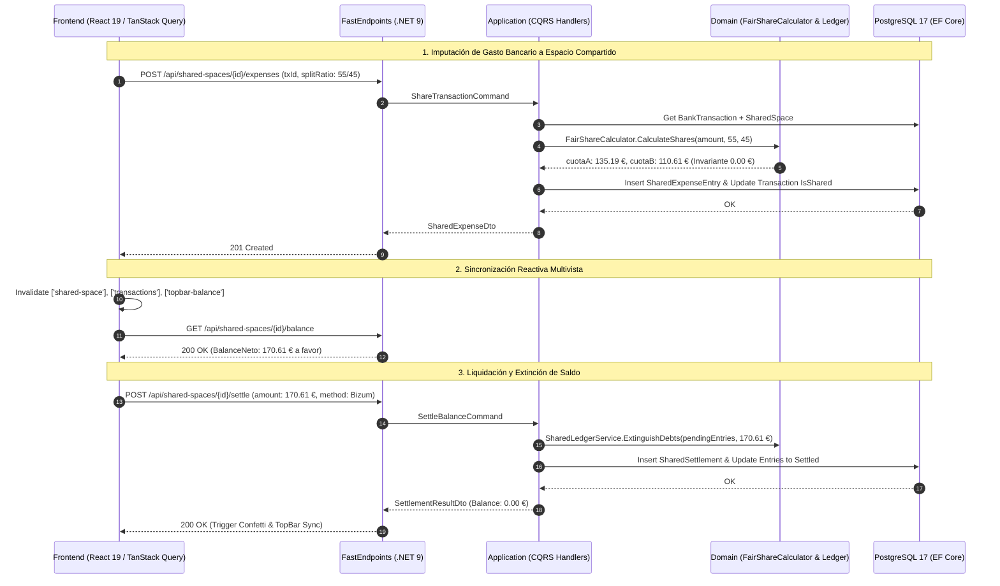

# Especificación Técnica: Espacios Compartidos, Finanzas en Pareja, Reparto Fair-Share y Liquidaciones Bizum

- **ID de la Feature**: `004-shared-expenses`
- **Estado**: Aprobado para Implementación (Pipeline Desatendido SDD)
- **Especificación Funcional Asociada**: [01-spec.md](./01-spec.md)
- **Fecha de Creación**: 2026-10-06
- **Última Actualización**: 2026-10-06
- **Orquestador**: `@jarvis` (Master Pipeline Orchestrator)
- **Stack Técnico**: .NET 9 / FastEndpoints / PostgreSQL 17 / EF Core 9 / React 19 / TanStack Query v5 / Zustand / i18next

---

## 1. Arquitectura General y Flujo de Datos



---

## 2. Modelo de Dominio (`Nexus.Domain`)

### 2.1. Enums de Dominio Financiero (`Nexus.Domain/Enums/`)
- **`SharedSpaceRole`**:
  - `Owner` (creador del espacio, administración de reglas).
  - `Member` (participante activo con derechos de imputación y consulta).
- **`SplitRuleType`**:
  - `Equal5050` (50% / 50% simétrico).
  - `FixedRatio` (ratio asimétrico estático, ej. 55% / 45%).
  - `ProportionalToIncome` (cálculo dinámico basado en ingresos netos mensuales).
- **`SharedExpenseStatus`**:
  - `Pending` (cuota deudora abierta, computa en el balance exigible).
  - `Settled` (deuda extinguida mediante liquidación confirmada).
- **`SettlementMethod`**:
  - `Bizum` (pago entre particulares vía Bizum).
  - `SepaTransfer` (transferencia bancaria inmediata / estándar).
  - `Cash` (compensación física en efectivo).
  - `Offset` (compensación bilateral automática contra gasto posterior).

### 2.2. Entidades de Dominio (`Nexus.Domain/Entities/`)

```csharp
public class SharedSpace : BaseEntity
{
    public Guid Id { get; private set; }
    public string Name { get; private set; } = string.Empty;
    public SplitRuleType DefaultSplitRule { get; private set; }
    public decimal DefaultOwnerPercentage { get; private set; } // Ej. 55.00m
    public decimal DefaultMemberPercentage { get; private set; } // Ej. 45.00m
    public string Currency { get; private set; } = "EUR";
    public DateTimeOffset CreatedAt { get; private set; }
    public bool IsDeleted { get; private set; }

    public ICollection<SharedSpaceMember> Members { get; private set; } = new List<SharedSpaceMember>();
    public ICollection<SharedExpenseEntry> Expenses { get; private set; } = new List<SharedExpenseEntry>();
    public ICollection<SharedSettlement> Settlements { get; private set; } = new List<SharedSettlement>();
}

public class SharedSpaceMember : BaseEntity
{
    public Guid Id { get; private set; }
    public Guid SharedSpaceId { get; private set; }
    public SharedSpace SharedSpace { get; private set; } = null!;
    public Guid? UserId { get; private set; } // Nullable para soporte de miembro simulado en demo
    public string DisplayName { get; private set; } = string.Empty; // "Sergio", "Elena"
    public string Initials { get; private set; } = string.Empty; // "OP", "PT"
    public string AvatarColor { get; private set; } = "var(--primary)";
    public SharedSpaceRole Role { get; private set; }
    public decimal? DeclaredMonthlyIncome { get; private set; } // Para Fair-Share proporcional
    public bool IsActive { get; private set; }
}

public class SharedExpenseEntry : BaseEntity
{
    public Guid Id { get; private set; }
    public Guid SharedSpaceId { get; private set; }
    public SharedSpace SharedSpace { get; private set; } = null!;
    
    // Vínculo opcional a transacción bancaria o a item de split (RN-02)
    public Guid? BankTransactionId { get; private set; }
    public BankTransaction? BankTransaction { get; private set; }
    public Guid? TransactionSplitItemId { get; private set; }
    public TransactionSplitItem? TransactionSplitItem { get; private set; }

    public Guid PaidByMemberId { get; private set; }
    public SharedSpaceMember PaidByMember { get; private set; } = null!;
    
    public string Description { get; private set; } = string.Empty;
    public DateTime TransactionDate { get; private set; }
    public decimal TotalAmount { get; private set; } // Ej. 245.80m
    public decimal PaidByShare { get; private set; } // Ej. 135.19m (55%)
    public decimal OwedShare { get; private set; }   // Ej. 110.61m (45%)
    
    public string CategoryName { get; private set; } = "General";
    public string CategoryIcon { get; private set; } = "tag";
    public SharedExpenseStatus Status { get; private set; } // Pending | Settled
    public Guid? SettlementId { get; private set; }
    public SharedSettlement? Settlement { get; private set; }
}

public class SharedSettlement : BaseEntity
{
    public Guid Id { get; private set; }
    public Guid SharedSpaceId { get; private set; }
    public SharedSpace SharedSpace { get; private set; } = null!;
    public Guid PayerMemberId { get; private set; }
    public Guid ReceiverMemberId { get; private set; }
    public decimal Amount { get; private set; }
    public SettlementMethod Method { get; private set; }
    public string? ReferenceCode { get; private set; }
    public DateTimeOffset SettledAt { get; private set; }
    public Guid? LinkedTransactionId { get; private set; } // Abono bancario conciliado
}
```

### 2.3. Servicios de Dominio Puros (`Nexus.Domain/Services/`)

1. **`FairShareCalculator`**:
   - `(decimal payerShare, decimal debtorShare) CalculateShares(decimal totalAmount, decimal payerPercentage)`
   - Aplica **Banker's Rounding (MidpointRounding.ToEven)**:
     $$\text{payerShare} = \text{Math.Round}(\text{totalAmount} \times (\text{payerPercentage} / 100), 2, \text{MidpointRounding.ToEven})$$
     $$\text{debtorShare} = \text{totalAmount} - \text{payerShare}$$
   - Garantiza que $\text{payerShare} + \text{debtorShare} \equiv \text{totalAmount}$ (0.00 € de tolerancia).
2. **`SharedLedgerBalanceCalculator`**:
   - Calcula el balance neto acumulado de partidas `Pending`:
     $$\text{NetBalance} = \sum (\text{PagadoPorUsuario} \times \text{OwedShare}) - \sum (\text{PagadoPorPareja} \times \text{PaidByShare})$$

### 2.4. Interfaces de Repositorio (`Nexus.Domain/Interfaces/`)
- `ISharedSpaceRepository`: `GetByIdAsync`, `GetActiveForUserAsync`, `AddAsync`, `UpdateAsync`.
- `ISharedExpenseRepository`: `GetPendingBySpaceIdAsync`, `GetSettledHistoryAsync`, `AddAsync`, `UpdateBatchAsync`.
- `ISharedSettlementRepository`: `AddAsync`, `GetHistoryBySpaceIdAsync`.

---

## 3. Capa de Aplicación (`Nexus.Application`)

### 3.1. Comandos y Handlers CQRS
1. **`ShareTransactionCommand`**:
   - Payload: `Guid SharedSpaceId`, `Guid BankTransactionId`, `Guid? SplitItemId`, `decimal PayerPercentage`, `string? CustomDescription`.
   - Lógica: Recupera la transacción, valida que no esté ya compartida, calcula las cuotas con `FairShareCalculator`, inserta `SharedExpenseEntry` y actualiza la bandera `HasSplits` / `IsShared`.
2. **`SettleBalanceCommand`**:
   - Payload: `Guid SharedSpaceId`, `Guid PayerMemberId`, `decimal Amount`, `SettlementMethod Method`, `string? ReferenceCode`.
   - Lógica: Recupera todas las partidas `Pending` más antiguas (FIFO), las marca como `Settled` vinculándolas al nuevo `SharedSettlement`.
3. **`UpdateSplitConfigurationCommand`**:
   - Payload: `Guid SharedSpaceId`, `SplitRuleType RuleType`, `decimal OwnerPercentage`, `decimal? OwnerIncome`, `decimal? MemberIncome`.
   - Lógica: Si `ProportionalToIncome`, calcula el porcentaje ponderado por sueldos y actualiza `DefaultOwnerPercentage` / `DefaultMemberPercentage`.

### 3.2. Queries y Proyecciones DTO
1. **`GetSharedSpaceSummaryQuery`**:
   - Retorna: `SharedSpaceSummaryDto` con miembros, ratio activo, balance neto actual, total compartido en el mes, y lista de partidas pendientes (resolviendo el bug **FIN-03**).
2. **`GetSharedSettlementHistoryQuery`**:
   - Retorna: `List<SharedSettlementDto>` con historial paginado de liquidaciones pasadas.

---

## 4. Persistencia e Infraestructura (`Nexus.Infrastructure`)

### 4.1. Mapeo Fluent API (`snake_case`)
- **`shared_spaces`**: `id`, `name`, `default_split_rule`, `default_owner_percentage`, `default_member_percentage`, `currency`, `created_at`, `is_deleted`.
- **`shared_space_members`**: `id`, `shared_space_id`, `user_id`, `display_name`, `initials`, `avatar_color`, `role`, `declared_monthly_income`, `is_active`.
- **`shared_expense_entries`**: `id`, `shared_space_id`, `bank_transaction_id`, `transaction_split_item_id`, `paid_by_member_id`, `description`, `transaction_date`, `total_amount`, `paid_by_share`, `owed_share`, `category_name`, `category_icon`, `status`, `settlement_id`.
  - Índice: `(shared_space_id, status)` para filtrado rápido de partidas pendientes.
- **`shared_settlements`**: `id`, `shared_space_id`, `payer_member_id`, `receiver_member_id`, `amount`, `method`, `reference_code`, `settled_at`, `linked_transaction_id`.

### 4.2. Migración EF Core
- Migración: `20261006_AddSharedExpensesAndLedgerSchema`.

---

## 5. API REST (`Nexus.Api`) - Endpoints FastEndpoints (REPR Pattern)

| Verbo | Ruta | Comando / Handler | Descripción |
| :--- | :--- | :--- | :--- |
| `GET` | `/api/shared-spaces/active` | `GetActiveSharedSpaceEndpoint` | Devuelve el espacio del usuario autenticado con miembros y balance neto |
| `POST` | `/api/shared-spaces/{id}/share` | `ShareTransactionEndpoint` | Imputa un gasto bancario o split al espacio común |
| `GET` | `/api/shared-spaces/{id}/pending` | `GetPendingExpensesEndpoint` | Listado de partidas pendientes con importes exactos |
| `POST` | `/api/shared-spaces/{id}/settle` | `SettleBalanceEndpoint` | Liquida el saldo pendiente y extingue las deudas |
| `PATCH`| `/api/shared-spaces/{id}/ratios` | `UpdateSplitRatioEndpoint` | Actualiza el ratio manual o proporcional por ingresos |

---

## 6. Frontend y Shell Móvil (`frontend/`)

### 6.1. Tipos TypeScript (`src/types/shared-space.ts`)
```typescript
export interface SharedSpaceMember {
  id: string;
  displayName: string;
  initials: string;
  avatarColor: string;
  role: 'Owner' | 'Member';
  declaredMonthlyIncome?: number;
}

export interface SharedExpenseEntry {
  id: string;
  sharedSpaceId: string;
  bankTransactionId?: string;
  description: string;
  transactionDate: string;
  totalAmount: number;
  paidByShare: number;
  owedShare: number;
  paidByMemberId: string;
  paidByName: string;
  status: 'pending' | 'settled';
  splitRatio: string;
}

export interface SharedSpaceSummary {
  id: string;
  name: string;
  defaultSplitRatio: string; // "55/45"
  netBalance: number; // Positivo: pareja te debe; Negativo: debes a pareja
  totalSharedThisMonth: number;
  youPaidThisMonth: number;
  partnerPaidThisMonth: number;
  members: SharedSpaceMember[];
  pendingExpenses: SharedExpenseEntry[];
}
```

### 6.2. Estado y Mutaciones TanStack Query (`src/hooks/useSharedSpace.ts`)
- `useSharedSpaceQuery()`: Carga el resumen reactivo con `staleTime: 30_000`.
- `useShareExpenseMutation()`:
  - Invalida queries: `['shared-space']`, `['transactions']`, `['dashboard']`.
  - Proporciona actualización optimista (*Optimistic Update*) en el TopBar.
- `useSettleBalanceMutation()`:
  - Ejecuta liquidación, reinicia el balance a 0.00 € y actualiza la lista de pendientes.

### 6.3. Componentes de UI
1. **`ShareExpenseDrawer.tsx`**: Drawer lateral con selector de ratio interactivo (50/50, 55/45, Custom) y previsualización de cuotas contables en tiempo real.
2. **`SettleUpModal.tsx`**: Modal con QR / botón de copiar concepto Bizum y disparador de extinción de balance.
3. **Actualización de Páginas Clave**:
   - [`TopBar.tsx`](file:///c:/Projects/Nexus/frontend/src/components/layout/TopBar.tsx): Conexión del mini-widget al balance reactivo (`netBalance`), eliminando la cifra estática `142.50`.
   - [`SharedSpacePage.tsx`](file:///c:/Projects/Nexus/frontend/src/pages/SharedSpacePage.tsx): Integración completa con el hook centralizado, resolviendo **FIN-03**, **FIN-04** y **I18N-01**.
   - [`SettingsPage.tsx`](file:///c:/Projects/Nexus/frontend/src/pages/SettingsPage.tsx): Persistencia real del slider 55/45 en PostgreSQL / LocalStorage (**STATE-02**).

### 6.4. Proveedor en Memoria (`InMemorySharedLedgerService`)
Garantiza que la aplicación funcione 100% interactiva en modo Demo / Sandbox, de forma que cada botón ("Compartir", "Saldar", "Cambiar ratio") ejecute mutaciones completas en memoria aunque PostgreSQL no esté corriendo.

---

## 7. Pruebas y Criterios de Verificación

1. **Pruebas Unitarias de Dominio (`Nexus.UnitTests`)**:
   - `FairShareCalculatorTests`: Verificación de redondeo bancario, prueba con importes impares (ej. 245.80 € al 55/45 -> 135.19 € + 110.61 €), verificación de suma exacta con 0.00 € de discrepancia.
   - `SharedLedgerBalanceCalculatorTests`: Cálculo del saldo neto bilateral con partidas mixtas pagadas por ambos miembros.
2. **Pruebas de Integración y Casos de Uso (`Nexus.IntegrationTests`)**:
   - Imputación de transacción bancaria y verificación de clave foránea.
   - Liquidación total con extinción de deudas en cascada.
3. **Verificación de Frontend**:
   - `cmd /c npm run build` exitoso con 0 errores TypeScript.
   - Verificación de la Matriz de Contratos de Interacción (Zero Dead Buttons).
