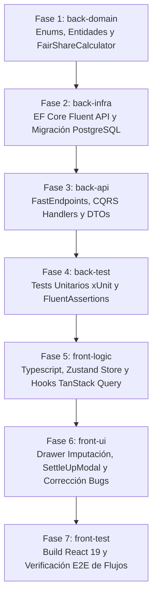

# Desglose de Tareas: Espacios Compartidos, Finanzas en Pareja, Reparto Fair-Share y Liquidaciones Bizum

- **ID de la Feature**: `004-shared-expenses`
- **Estado**: Listo para Ejecución del Pipeline Desatendido (SDD)
- **Especificaciones de Referencia**:
  - Funcional: [01-spec.md](./01-spec.md)
  - Técnica: [02-tech-spec.md](./02-tech-spec.md)
  - Visión Macro: [SYSTEM_VISION.md](../../SYSTEM_VISION.md) (Pilar 3: Modelo Dual del Gasto y Espacios Compartidos)
- **Orquestador Asignado**: `@jarvis`
- **Fecha de Creación**: 2026-10-06

---

## Matriz de Fases de Implementación por Agente Especialista

---

## Checklist de Progreso por Fase

### 🔹 Fase 1: Dominio (`back-domain`)
- [x] **Tarea 1.1**: Crear enums en `Nexus.Domain/Enums/`:
  - `SharedSpaceRole.cs` (`Owner`, `Member`).
  - `SplitRuleType.cs` (`Equal5050`, `FixedRatio`, `ProportionalToIncome`).
  - `SharedExpenseStatus.cs` (`Pending`, `Settled`).
  - `SettlementMethod.cs` (`Bizum`, `SepaTransfer`, `Cash`, `Offset`).
- [x] **Tarea 1.2**: Crear entidades de dominio en `Nexus.Domain/Entities/`:
  - `SharedSpace.cs` (con colección de miembros, partidas y liquidaciones).
  - `SharedSpaceMember.cs` (con rol, avatar, apodo e ingresos declarados opcionales).
  - `SharedExpenseEntry.cs` (con FK a `BankTransactionId` y `TransactionSplitItemId`, cuotas calculadas y estado).
  - `SharedSettlement.cs` (registro de extinción de balance).
- [x] **Tarea 1.3**: Implementar servicios de dominio puros:
  - `FairShareCalculator.cs`: Cálculo de cuotas con Banker's Rounding (`MidpointRounding.ToEven`) e invariante estricta de balance cero (0.00 € de tolerancia).
  - `SharedLedgerBalanceCalculator.cs`: Algoritmo de consolidación de balance neto bilateral.
- [x] **Tarea 1.4**: Definir interfaces de repositorio en `Nexus.Domain/Interfaces/`:
  - `ISharedSpaceRepository.cs`, `ISharedExpenseRepository.cs`, `ISharedSettlementRepository.cs`.

### 🔹 Fase 2: Infraestructura y Persistencia (`back-infra`)
- [x] **Tarea 2.1**: Mapeos Fluent API en `Nexus.Infrastructure/Configurations/` con nombres `snake_case`:
  - `SharedSpaceConfiguration.cs` (tabla `shared_spaces`).
  - `SharedSpaceMemberConfiguration.cs` (tabla `shared_space_members`, FK a `shared_spaces`).
  - `SharedExpenseEntryConfiguration.cs` (tabla `shared_expense_entries`, FK a `shared_spaces`, `bank_transactions` y `transaction_split_items`, índice en `(shared_space_id, status)`).
  - `SharedSettlementConfiguration.cs` (tabla `shared_settlements`).
  - Actualizar `NexusDbContext.cs` con los nuevos `DbSet`.
- [x] **Tarea 2.2**: Implementar repositorios de infraestructura con EF Core:
  - `SharedSpaceRepository.cs`, `SharedExpenseRepository.cs`, `SharedSettlementRepository.cs`.
- [x] **Tarea 2.3**: Generar y aplicar migración EF Core a PostgreSQL:
  - `dotnet ef migrations add 20261006_AddSharedExpensesAndLedgerSchema`
  - `dotnet ef database update`

### 🔹 Fase 3: Capa de Aplicación & API (`back-api`)
- [x] **Tarea 3.1**: DTOs y Comandos CQRS en `Nexus.Application/`:
  - `ShareTransactionCommand.cs`, `SettleBalanceCommand.cs`, `UpdateSplitConfigurationCommand.cs`.
  - `SharedSpaceSummaryDto.cs`, `SharedExpenseDto.cs`, `SettlementResultDto.cs`.
- [x] **Tarea 3.2**: Handlers de Aplicación con validadores `FluentValidation`:
  - `ShareTransactionCommandHandler.cs` (valida existencia de transacción, calcula cuotas e inserta).
  - `SettleBalanceCommandHandler.cs` (extinción FIFO de partidas pendientes).
  - `GetActiveSharedSpaceQueryHandler.cs` (proyección optimizada del resumen y balance).
- [x] **Tarea 3.3**: Crear FastEndpoints con patrón REPR en `Nexus.Api/Endpoints/SharedSpaces/`:
  - `GET /api/shared-spaces/active` (`GetActiveSharedSpaceEndpoint.cs`).
  - `POST /api/shared-spaces/{id}/share` (`ShareTransactionEndpoint.cs`).
  - `GET /api/shared-spaces/{id}/pending` (`GetPendingExpensesEndpoint.cs`).
  - `POST /api/shared-spaces/{id}/settle` (`SettleBalanceEndpoint.cs`).
  - `PATCH /api/shared-spaces/{id}/ratios` (`UpdateSplitRatioEndpoint.cs`).

### 🔹 Fase 4: Pruebas Backend (`back-test`)
- [x] **Tarea 4.1**: Pruebas unitarias de `FairShareCalculator`:
  - Verificación de redondeo bancario exacto (ej. 245.80 € al 55/45 -> 135.19 € + 110.61 €).
  - Cero céntimos huérfanos con importes impares (ej. 0.01 €, 100.01 €, 99.99 €).
- [x] **Tarea 4.2**: Pruebas unitarias de `SharedLedgerBalanceCalculator`:
  - Cálculo de balance neto cuando ambos cónyuges adelantan gastos en el mismo mes.
- [x] **Tarea 4.3**: Pruebas de integración de comandos (`ShareTransactionCommandHandler`, `SettleBalanceCommandHandler`).
- [x] **Tarea 4.4**: Ejecutar `dotnet test` global verificando 100% de tests en verde (79/79 superados).

### 🔹 Fase 5: Lógica de Frontend (`front-logic`)
- [x] **Tarea 5.1**: Definir modelos TypeScript en `frontend/src/types/shared-space.ts`:
  - `SharedSpaceMember`, `SharedExpenseEntry`, `SharedSpaceSummary`, `ShareExpenseInput`, `SettleBalanceInput`.
- [x] **Tarea 5.2**: Crear servicio en memoria `InMemorySharedLedgerService.ts` en `frontend/src/lib/services/`:
  - Mock state pre-poblado con Sergio & Elena (55/45), partidas pendientes reales que suman exactamente **170.61 €** (Mercadona 60 € + Suministros 110.61 €), métodos `getSummary()`, `shareExpense()`, `settle()`.
- [x] **Tarea 5.3**: Crear hooks TanStack Query en `frontend/src/hooks/useSharedSpace.ts`:
  - `useSharedSpaceQuery()`: Consulta reactiva del resumen y balance.
  - `useShareExpenseMutation()`: Imputación con invalidación de queries `['shared-space']`, `['transactions']`, `['dashboard']`.
  - `useSettleBalanceMutation()`: Liquidación Bizum con reinicio de balance a 0.00 €.

### 🔹 Fase 6: Interfaz de Usuario y Corrección de Bugs (`front-ui`)
- [x] **Tarea 6.1**: Implementar componente `ShareExpenseDrawer.tsx` en `frontend/src/components/shared/`:
  - Drawer deslizante lateral con selector pill (50/50, 55/45 Fair-Share, Custom), cálculo dinámico de cuotas y animación de destello cian.
- [x] **Tarea 6.2**: Implementar componente `SettleUpModal.tsx` en `frontend/src/components/shared/`:
  - Modal con resumen del total adeudado, referencia Bizum copiable y confirmación con animación de extinción a 0.00 €.
- [x] **Tarea 6.3**: Actualizar `TopBar.tsx`:
  - Conectar el mini-widget de pareja al hook `useSharedSpaceQuery()` (resolviendo el bug **FIN-03**).
  - Vincular el botón "Settle" para abrir `SettleUpModal` o navegar a `/shared-space?action=settle` (resolviendo el botón ciego).
  - Localizar cadenas `"Settle"` y `"Consolidated"` a los 5 idiomas (resolviendo **I18N-01**).
- [x] **Tarea 6.4**: Actualizar `SharedSpacePage.tsx`:
  - Eliminar mocks locales estáticos (`totalOwed = 142.50`). Consumir datos reales del store/hook.
  - Conectar botón "Saldar vía Bizum" con `SettleUpModal`.
  - Conectar botón "Nuevo Gasto" con modal de gasto rápido.
  - Traducir todas las etiquetas huérfanas en los 5 diccionarios (`es`, `en`, `zh`, `hi`, `fr`).
- [x] **Tarea 6.5**: Actualizar `TransactionsPage.tsx`:
  - Añadir acción contextual en cada fila para "Compartir Gasto", disparando `ShareExpenseDrawer`.
- [x] **Tarea 6.6**: Actualizar `SettingsPage.tsx`:
  - Conectar el slider 55/45 y la configuración Fair-Share al hook de actualización, persistiendo los datos (resolviendo **STATE-02**).

### 🔹 Fase 7: Testing y Verificación E2E (`front-test`)
- [x] **Tarea 7.1**: Ejecutar `cmd /c npm run build` en `frontend/` y verificar 0 errores TypeScript y bundle limpio.
- [x] **Tarea 7.2**: Verificar mediante navegador interactivo el ciclo completo de los 4 flujos cinematográficos:
  - Flujo A: Imputar gasto bancario desde Transacciones.
  - Flujo B: Desglose de ticket mixto.
  - Flujo C: Apertura de `SettleUpModal`, liquidación Bizum y balance a 0.00 €.
  - Flujo D: Cambio de ratio en Ajustes y persistencia.
- [x] **Tarea 7.3**: Verificar la alternancia en los 5 idiomas (`es`, `en`, `zh`, `hi`, `fr`) sin textos en inglés huérfanos.
