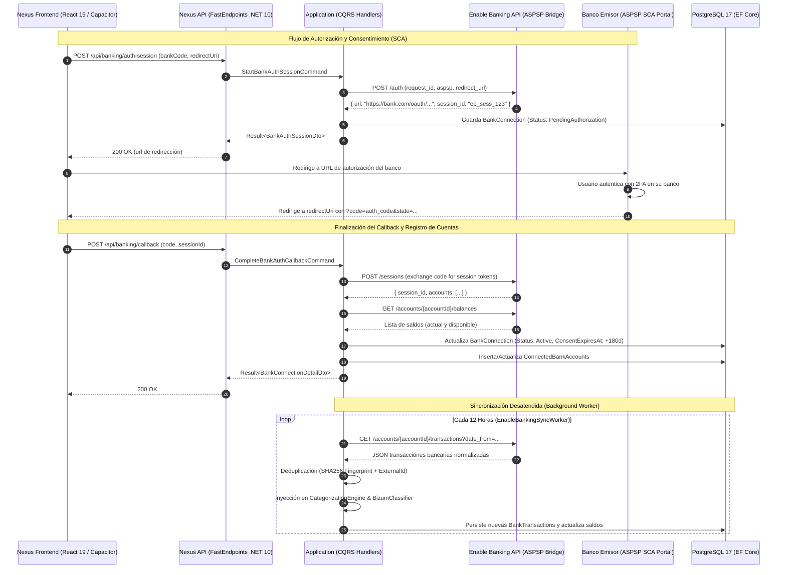

# Especificación Técnica: Sincronización Automática con Bancos mediante Enable Banking

- **ID de la Feature**: `005-open-banking-enable-banking`
- **Estado**: Aprobado para Planificación de Tareas (Gate 2 SDD)
- **Especificación Funcional Asociada**: [`01-spec.md`](./01-spec.md)
- **Fecha de Creación**: 2026-10-06
- **Última Actualización**: 2026-10-06
- **Orquestador Asignado**: `@jarvis`

---

## 1. Arquitectura General y Flujo de Integración



---

## 2. Modelo de Dominio (`Nexus.Domain`)

### 2.1. Enums
- **`BankConnectionStatus`**:
  - `PendingAuthorization = 0`: Sesión creada pero no confirmada por el usuario.
  - `Active = 1`: Consentimiento válido y sincronización operativa.
  - `ExpiringSoon = 2`: A menos de 15 días de la expiración de los 180 días.
  - `Expired = 3`: Consentimiento vencido; requiere reautorización SCA.
  - `Revoked = 4`: Desconectado voluntariamente por el usuario.
  - `Error = 5`: Fallo técnico en la conexión con la entidad bancaria.

### 2.2. Entidades
- **`BankConnection`** (`Nexus.Domain.Entities.BankConnection`):
  - `Guid Id`
  - `Guid UserId`
  - `string InstitutionCode` (e.g., `bbva_es`, `ing_es`, `santander_es`)
  - `string InstitutionName` (e.g., "BBVA España")
  - `string? LogoUrl`
  - `string ExternalSessionId` (Id de sesión retornado por Enable Banking)
  - `string? EncryptedAccessToken` (Cifrado con AES-256-GCM)
  - `string? EncryptedRefreshToken`
  - `DateTimeOffset ConsentExpiresAt` (Timestamp UTC exacto de expiración)
  - `DateTimeOffset? LastSyncedAt`
  - `BankConnectionStatus Status`
  - `ICollection<ConnectedBankAccount> Accounts`

- **`ConnectedBankAccount`** (`Nexus.Domain.Entities.ConnectedBankAccount`):
  - `Guid Id`
  - `Guid BankConnectionId`
  - `string ExternalAccountId` (Id de cuenta en Enable Banking)
  - `string Iban` (Sanitizado y validado con algoritmo mod 97)
  - `string AccountName` (e.g., "Cuenta Online Sin Comisiones")
  - `string Currency` (ISO 4217, e.g., "EUR")
  - `decimal CurrentBalance`
  - `decimal AvailableBalance`
  - `DateTimeOffset BalanceUpdatedAt`
  - `BankConnection BankConnection`

### 2.3. Interfaces de Dominio
- **`IBankConnectionRepository`**:
  - `Task<BankConnection?> GetByIdAsync(Guid id, CancellationToken ct)`
  - `Task<IReadOnlyList<BankConnection>> GetActiveConnectionsByUserAsync(Guid userId, CancellationToken ct)`
  - `Task<IReadOnlyList<BankConnection>> GetAllActiveConnectionsForSyncAsync(CancellationToken ct)`
  - `Task AddAsync(BankConnection connection, CancellationToken ct)`
  - `Task UpdateAsync(BankConnection connection, CancellationToken ct)`
- **`IEnableBankingClient`**:
  - `Task<IReadOnlyList<SupportedInstitutionDto>> GetSupportedInstitutionsAsync(string country, CancellationToken ct)`
  - `Task<StartSessionResultDto> StartAuthSessionAsync(string institutionCode, string redirectUri, CancellationToken ct)`
  - `Task<AuthorizedSessionResultDto> CompleteAuthSessionAsync(string code, string sessionId, CancellationToken ct)`
  - `Task<IReadOnlyList<RawBankTransactionDto>> GetTransactionsAsync(string accountId, DateOnly fromDate, CancellationToken ct)`
  - `Task<AccountBalanceDto> GetBalancesAsync(string accountId, CancellationToken ct)`

---

## 3. Capa de Aplicación (`Nexus.Application`)

### 3.1. Comandos y Handlers (CQRS)
1. **`StartBankAuthSessionCommand`**:
   - Request: `string InstitutionCode`, `string RedirectUri`
   - Validador: `InstitutionCode` no vacío, `RedirectUri` válida.
   - Handler: Llama a `IEnableBankingClient.StartAuthSessionAsync`, persiste `BankConnection` en estado `PendingAuthorization`, retorna la URL para redirigir al usuario.
2. **`CompleteBankAuthCallbackCommand`**:
   - Request: `string Code`, `string SessionId`
   - Handler: Finaliza el intercambio en Enable Banking, registra las cuentas descubiertas en `ConnectedBankAccount` con sus saldos iniciales y actualiza el estado a `Active` con fecha de caducidad en $+180$ días.
3. **`SyncBankConnectionCommand`**:
   - Request: `Guid ConnectionId`, `bool ForceFullSync = false`
   - Handler: Descarga transacciones desde la última fecha sincronizada, ejecuta la deduplicación multinivel y canaliza las transacciones nuevas a través del motor de categorización y detección de Bizums.
4. **`RevokeBankConnectionCommand`**:
   - Request: `Guid ConnectionId`
   - Handler: Marca la conexión como `Revoked` y elimina las credenciales cifradas.

### 3.2. Deduplicación y Conversión a Dominio
Se implementa el mapper `EnableBankingTransactionMapper`:
- Mapea `RawBankTransactionDto` hacia [`ParsedRawTransaction`](file:///C:/Projects/Nexus/src/Nexus.Application/Statements/Parsers/BbvaStatementParser.cs#L173-L186).
- Deduplicación:
  - Comprueba si existe una transacción con `ExternalReference == raw.EntryReference`.
  - Si no existe referencia externa, genera el fingerprint SHA-256 usando [`TransactionFingerprintGenerator`](file:///C:/Projects/Nexus/tests/Nexus.UnitTests/TransactionFingerprintGeneratorTests.cs).

---

## 4. Persistencia e Infraestructura (`Nexus.Infrastructure`)

### 4.1. Cliente de Integración: `EnableBankingClient`
- Implementa `IEnableBankingClient` utilizando `IHttpClientFactory` y `System.Net.Http.Json`.
- Autenticación con Enable Banking mediante clave privada RSA y generación de JWT firmados (*ES256 / RS256* según especificación OpenAPI de Enable Banking).
- Configuración en `appsettings.json`:
  ```json
  "EnableBanking": {
    "BaseUrl": "https://api.enablebanking.com",
    "ApplicationId": "your-app-id",
    "KeyPath": "certs/enable_banking_private.key",
    "UseRestrictedMode": true
  }
  ```

### 4.2. Worker en Segundo Plano: `EnableBankingSyncWorker`
- Hereda de `BackgroundService`.
- Utiliza `PeriodicTimer` configurado con frecuencia de 12 horas.
- Itera sobre todas las conexiones en estado `Active`, invocando `SyncBankConnectionCommand` con aislamiento de fallos (si falla la conexión de un banco, no interrumpe la del resto).

### 4.3. Mapeo EF Core (PostgreSQL 17)
- Tablas: `bank_connections` y `connected_bank_accounts` (en convención `snake_case`).
- Índices:
  - `IX_bank_connections_user_id_status` en `(user_id, status)`.
  - `IX_connected_bank_accounts_iban` en `(iban)`.
  - `IX_connected_bank_accounts_external_id` en `(external_account_id)`.
- Migración EF Core: `20261006_AddEnableBankingIntegrationSchema`.

---

## 5. API REST (`Nexus.Api`)

FastEndpoints bajo la ruta `/api/banking/`:
1. `GET /api/banking/institutions?country=ES` (`GetSupportedInstitutionsEndpoint.cs`).
2. `POST /api/banking/auth-session` (`StartBankAuthSessionEndpoint.cs`).
3. `POST /api/banking/callback` (`CompleteBankAuthCallbackEndpoint.cs`).
4. `GET /api/banking/connections` (`GetBankConnectionsEndpoint.cs`).
5. `POST /api/banking/connections/{id}/sync` (`SyncBankConnectionEndpoint.cs`).
6. `DELETE /api/banking/connections/{id}` (`RevokeBankConnectionEndpoint.cs`).

---

## 6. Frontend y Shell Móvil (`frontend/`)

### 6.1. Tipos e Interfaces (`types/banking.ts`)
- `BankInstitution`, `BankConnection`, `ConnectedBankAccount`, `BankAuthSession`.

### 6.2. Hooks React Query (`hooks/useBanking.ts`)
- `useSupportedInstitutionsQuery(country)`
- `useBankConnectionsQuery()`
- `useStartBankAuthMutation()`
- `useCompleteBankAuthMutation()`
- `useSyncBankConnectionMutation()`

### 6.3. Componentes de UI
1. `ConnectedBanksSection.tsx`: Lista de bancos conectados con logo, IBANs asociados, fecha de última sincronización y badge de expiración (verde: $> 15$ días, amarillo: $\le 15$ días, rojo: caducada).
2. `BankSelectorModal.tsx`: Grid con los logotipos y nombres de las entidades bancarias españolas (BBVA, Santander, CaixaBank, ING, Openbank, Revolut).
3. `BankCallbackHandler.tsx`: Componente de página para recibir la redirección `/banking/callback`, mostrar spinner con feedback animado y completar la vinculación.
4. Soporte Capacitor Deep Link:
   - Configuración en Android `AndroidManifest.xml` con esquema `nexus://banking/callback`.

---

## 7. Criterios de Calidad y Tests

- **Unit Tests en Backend**:
  - `EnableBankingClientTests`: Verificación de generación de JWT y serialización de peticiones.
  - `EnableBankingTransactionMapperTests`: Mapeo exacto de importes, fechas ISO y deduplicación.
  - `SyncBankConnectionCommandHandlerTests`: Comprobación de que no se duplican transacciones ni se sobrescriben registros manuales.
- **Pruebas de Frontend**:
  - `npm run build` sin errores TypeScript.
  - Verificación del renderizado del selector de bancos y manejo de errores.
