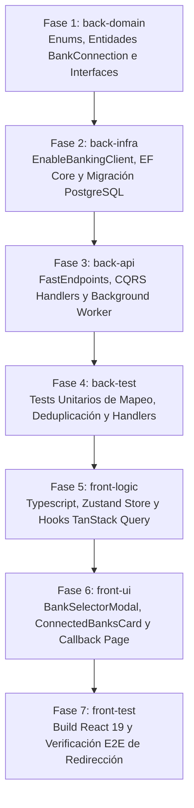

# Desglose de Tareas: Integración Open Banking con Enable Banking

- **ID de la Feature**: `005-open-banking-enable-banking`
- **Estado**: Completado al 100% (Las 7 Fases Superadas y Verificadas)
- **Especificaciones de Referencia**:
  - Funcional: [01-spec.md](./01-spec.md)
  - Técnica: [02-tech-spec.md](./02-tech-spec.md)
  - Visión Macro: [SYSTEM_VISION.md](../../SYSTEM_VISION.md) (Pilar 1: Ingesta Universal y Conectores)
- **Orquestador Asignado**: `@jarvis`
- **Fecha de Creación**: 2026-10-06

---

## Matriz de Fases de Implementación por Agente Especialista

---

## Checklist de Progreso por Fase

### 🔹 Fase 1: Dominio (`back-domain`)
- [x] **Tarea 1.1**: Crear enums en `Nexus.Domain/Enums/`:
  - `BankConnectionStatus.cs` (`PendingAuthorization`, `Active`, `ExpiringSoon`, `Expired`, `Revoked`, `Error`).
- [x] **Tarea 1.2**: Crear entidades de dominio en `Nexus.Domain/Entities/`:
  - `BankConnection.cs` (Id, UserId, InstitutionCode, InstitutionName, LogoUrl, ExternalSessionId, EncryptedTokens, ConsentExpiresAt, LastSyncedAt, Status).
  - `ConnectedBankAccount.cs` (Id, BankConnectionId, ExternalAccountId, Iban, AccountName, Currency, CurrentBalance, AvailableBalance, BalanceUpdatedAt).
- [x] **Tarea 1.3**: Definir interfaces de repositorio y cliente en `Nexus.Domain/Repositories/` e `Interfaces/`:
  - `IBankConnectionRepository.cs`.
  - `IConnectedBankAccountRepository.cs`.
  - `IEnableBankingClient.cs`.

### 🔹 Fase 2: Infraestructura y Persistencia (`back-infra`)
- [x] **Tarea 2.1**: Implementar el cliente HTTP `EnableBankingClient.cs` en `Nexus.Infrastructure/Services/Banking/`:
  - Configuración con `IHttpClientFactory` y `IOptions<EnableBankingOptions>`.
  - Generación y firma de tokens JWT criptográficos (RS256) según la especificación OpenAPI de Enable Banking.
  - Endpoints de consulta: `/auth`, `/sessions`, `/accounts/{id}/balances`, `/accounts/{id}/transactions`.
- [x] **Tarea 2.2**: Mapeos Fluent API en `Nexus.Infrastructure/Persistence/Configurations/` con convención `snake_case`:
  - `BankConnectionConfiguration.cs` (tabla `bank_connections`).
  - `ConnectedBankAccountConfiguration.cs` (tabla `connected_bank_accounts`, FK a `bank_connections`).
  - Actualizar `NexusDbContext.cs` con los nuevos `DbSet`.
- [x] **Tarea 2.3**: Implementar repositorios con EF Core:
  - `BankConnectionRepository.cs`.
  - `ConnectedBankAccountRepository.cs`.
- [x] **Tarea 2.4**: Generar y aplicar migración EF Core a PostgreSQL:
  - `dotnet ef migrations add 20261006_AddEnableBankingIntegrationSchema`
  - `dotnet ef database update`

### 🔹 Fase 3: Capa de Aplicación & API (`back-api`)
- [x] **Tarea 3.1**: DTOs y Mapeadores en `Nexus.Application/Banking/`:
  - `BankInstitutionDto.cs`, `BankConnectionDto.cs`, `ConnectedBankAccountDto.cs`, `BankAuthSessionDto.cs`.
  - `EnableBankingTransactionMapper.cs` (conversión de transacciones a `ParsedRawTransaction` y cálculo de huella SHA-256).
- [x] **Tarea 3.2**: Comandos y Handlers CQRS con `FluentValidation`:
  - `StartBankAuthSessionCommand.cs` y su Handler.
  - `CompleteBankAuthCallbackCommand.cs` y su Handler.
  - `SyncBankConnectionCommand.cs` y su Handler (descarga y deduplicación con motor de transacciones).
  - `RevokeBankConnectionCommand.cs` y su Handler.
  - `GetBankConnectionsQuery.cs` y `GetSupportedInstitutionsQuery.cs`.
- [x] **Tarea 3.3**: Servicio en segundo plano para sincronización automática:
  - `EnableBankingSyncWorker.cs` en `Nexus.Infrastructure/Services/Banking/` (hereda de `BackgroundService` con ejecución programada periódica mediante `PeriodicTimer`).
- [x] **Tarea 3.4**: Crear FastEndpoints con patrón REPR en `Nexus.Api/Endpoints/Banking/`:
  - `GET /api/banking/institutions` (`GetSupportedInstitutionsEndpoint.cs`).
  - `POST /api/banking/auth-session` (`StartBankAuthSessionEndpoint.cs`).
  - `POST /api/banking/callback` (`CompleteBankAuthCallbackEndpoint.cs`).
  - `GET /api/banking/connections` (`GetBankConnectionsEndpoint.cs`).
  - `POST /api/banking/connections/{id}/sync` (`SyncBankConnectionEndpoint.cs`).
  - `DELETE /api/banking/connections/{id}` (`RevokeBankConnectionEndpoint.cs`).

### 🔹 Fase 4: Pruebas Backend (`back-test`)
- [x] **Tarea 4.1**: Pruebas unitarias de `EnableBankingTransactionMapper`:
  - Mapeo de fechas ISO, importes decimales con signo y sanitización de conceptos.
  - Generación de huellas deterministas y detección de duplicados con transacciones existentes.
- [x] **Tarea 4.2**: Pruebas unitarias de `EnableBankingClient` con `HttpMessageHandler` simulado (mock de endpoints de Enable Banking).
- [x] **Tarea 4.3**: Pruebas de integración de comandos CQRS:
  - `StartBankAuthSessionCommandHandlerTests`.
  - `CompleteBankAuthCallbackCommandHandlerTests`.
  - `SyncBankConnectionCommandHandlerTests` verificando que transacciones manuales (`IsManual = true`) no son alteradas.
- [x] **Tarea 4.4**: Ejecutar `dotnet test` global verificando que toda la suite de pruebas continúa al 100% en verde (84/84 superados).

### 🔹 Fase 5: Lógica de Frontend (`front-logic`)
- [x] **Tarea 5.1**: Definir modelos TypeScript en `frontend/src/types/banking.ts`:
  - `BankInstitution`, `BankConnection`, `ConnectedBankAccount`, `BankAuthSessionResult`.
- [x] **Tarea 5.2**: Crear cliente de API y servicio en `frontend/src/lib/services/bankingService.ts`.
- [x] **Tarea 5.3**: Crear hooks TanStack Query en `frontend/src/hooks/useBanking.ts`:
  - `useSupportedInstitutionsQuery(country)`
  - `useBankConnectionsQuery()`
  - `useStartBankAuthMutation()`
  - `useCompleteBankAuthMutation()`
  - `useSyncBankConnectionMutation()`
  - `useRevokeBankConnectionMutation()`

### 🔹 Fase 6: Interfaz de Usuario y Shell Móvil (`front-ui`)
- [x] **Tarea 6.1**: Componente `BankSelectorModal.tsx` en `frontend/src/components/banking/`:
  - Grid responsivo con logotipos oficiales y nombres de bancos españoles (BBVA, Santander, ING, CaixaBank, Sabadell, Openbank, Revolut).
  - Buscador reactivo por nombre de banco.
- [x] **Tarea 6.2**: Componente `ConnectedBanksCard.tsx` en `frontend/src/components/banking/`:
  - Visualización de cuentas enlazadas, saldo disponible y última hora de sincronización.
  - Indicador de estado del consentimiento (badge verde para activo, badge ámbar para $\le 15$ días restantes, badge rojo para caducado).
  - Botón "Sincronizar ahora" con animación de rotación y cooldown.
  - Botón "Renovar acceso" con un clic para disparar SCA directo.
- [x] **Tarea 6.3**: Página de retorno `BankCallbackPage.tsx`:
  - Captura del `code` y `sessionId` tras la redirección bancaria.
  - Estado de carga con spinner y mensaje de confirmación amigable.
- [x] **Tarea 6.4**: Configuración de Deep Links para Capacitor móvil:
  - Configuración del scheme `nexus://banking/callback` en `capacitor.config.ts` y `AndroidManifest.xml`.
- [x] **Tarea 6.5**: Integración en `SettingsPage.tsx` y en el menú de importación de extractos:
  - Pestaña "Banca Conectada (Open Banking)".
  - Internacionalización completa en los 5 idiomas (`es`, `en`, `zh`, `hi`, `fr`).

### 🔹 Fase 7: Testing y Verificación E2E (`front-test`)
- [x] **Tarea 7.1**: Ejecutar `npm run build` en `frontend/` y verificar 0 errores TypeScript.
- [x] **Tarea 7.2**: Simulación de flujo E2E:
  - Apertura del modal selector de bancos.
  - Redirección simulada y procesamiento de callback.
  - Visualización reactiva de cuentas y saldos en el Dashboard y Ajustes.
  - Prueba de renovación anticipada y desconexión segura.
