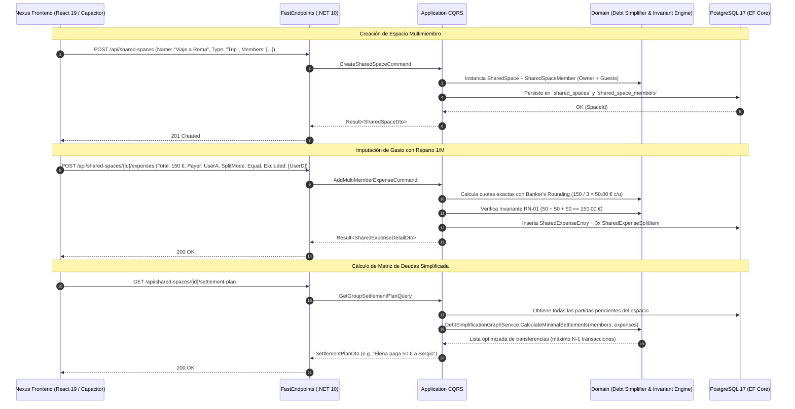

# Especificación Técnica: Espacios Compartidos Multigrupo, N-Miembros, Viajes y Simplificación de Deudas

- **ID de la Feature**: `006-multi-space-shared-expenses`
- **Estado**: Planificación Técnica para Revisión (Gate 2 SDD — NO EJECUTAR AÚN)
- **Especificación Funcional Asociada**: [`01-spec.md`](./01-spec.md)
- **Fecha de Creación**: 2026-10-07
- **Última Actualización**: 2026-10-07
- **Orquestador Asignado**: `@jarvis`

---

## 1. Arquitectura General y Flujo de Datos

---

## 2. Modelo de Dominio (`Nexus.Domain`)

### 2.1. Enums Nuevos y Evolucionados
- **`SharedSpaceType`**:
  - `Household = 0`: Espacio permanente de convivencia / hogar.
  - `Trip = 1`: Viaje o vacaciones con fecha acotada.
  - `Event = 2`: Salida, cena o evento puntual efímero.
  - `Project = 3`: Proyecto o inversión compartida.
- **`SharedSpaceStatus`**:
  - `Active = 0`: Espacio abierto a imputaciones cotidianas.
  - `Archived = 1`: Espacio cerrado/saldado que no aparece en selectores habituales.
- **`GroupSplitMode`**:
  - `Equal = 0`: Reparto a partes iguales entre los miembros activos ($1/M$).
  - `ExactAmounts = 1`: Cuota monetaria explícita por miembro.
  - `Percentages = 2`: Porcentaje asignado por miembro ($\sum \% = 100\%$).
  - `Shares = 3`: Multiplicador por pesos/partes (ej. 1 parte, 2 partes).
  - `FairShareIncome = 4`: Proporcional a ingresos para parejas/familias.

### 2.2. Entidades Actualizadas y Nuevas
1. **`SharedSpace`** (Evolución de `004`):
   - `Guid Id`
   - `string Name` (e.g., "Hogar", "Viaje Roma 2027", "Cena Viernes")
   - `string? Description`
   - `string Icon` (e.g., "home", "plane", "utensils")
   - `string Currency` (default "EUR")
   - `SharedSpaceType Type`
   - `SharedSpaceStatus Status`
   - `GroupSplitMode DefaultSplitMode`
   - `ICollection<SharedSpaceMember> Members`
   - `ICollection<SharedExpenseEntry> Expenses`
   - `ICollection<SharedSettlement> Settlements`

2. **`SharedSpaceMember`** (Evolución):
   - `Guid Id`
   - `Guid SharedSpaceId`
   - `Guid? UserId` (Opcional: nulo si es un miembro sombra/invitado)
   - `string DisplayName` (e.g., "Sergio", "Elena", "Carlos Amigo")
   - `string? AvatarUrl`
   - `string? PhoneNumber` (Para generar enlaces directos de Bizum)
   - `SharedSpaceRole Role` (`Owner`, `Admin`, `Member`)
   - `decimal? DeclaredIncome` (Para modo Fair-Share en espacios tipo Hogar)
   - `bool IsGuest` (true si no es un usuario registrado de Nexus)

3. **`SharedExpenseEntry`** (Evolución para $N$ participantes):
   - `Guid Id`
   - `Guid SharedSpaceId`
   - `Guid? BankTransactionId` (Enlace directo a movimiento bancario)
   - `Guid? TransactionSplitItemId` (Enlace a desglose de ticket)
   - `Guid PaidByMemberId` (Miembro pagador principal)
   - `string Description`
   - `DateTime TransactionDate`
   - `decimal TotalAmount`
   - `GroupSplitMode SplitMode`
   - `SharedExpenseStatus Status` (`Pending`, `Settled`)
   - `ICollection<SharedExpenseSplitItem> SplitItems` (Colección de cuotas por miembro)

4. **`SharedExpenseSplitItem`** (Nueva Entidad Core de Desglose):
   - `Guid Id`
   - `Guid SharedExpenseEntryId`
   - `Guid MemberId`
   - `decimal OwedAmount` (Importe exacto que este miembro debe por esta partida)
   - `decimal? PercentageApplied`
   - `decimal? SharesCount`
   - `bool IsPayer` (true si este miembro es quien desembolsó la cuantía)

### 2.3. Servicios de Dominio Puros
- **`DebtSimplificationGraphService`**:
  - Implementa el algoritmo de minimización de flujo de caja (*Min-Cash-Flow*):
    1. Calcula el balance neto de cada miembro:
       $$\text{Net}(M) = \sum \text{Pagado por } M - \sum \text{Consumo de } M$$
    2. Separa a los miembros en dos listas ordenadas: Deudores ($\text{Net} < 0$) y Acreedores ($\text{Net} > 0$).
    3. Empareja de forma voraz (*greedy match*) al mayor deudor con el mayor acreedor, resolviendo la deuda en un máximo de $N-1$ transacciones directas.
- **`MultiMemberSplitCalculator`**:
  - Calcula las cuotas para cualquier combinación de miembros y modalidades ($1/M$, $\%$, partes o pesos), garantizando la **Invariante RN-01 de suma exacta ($0.00\text{ \euro}$ de descuadre)** mediante redondeo bancario hacia el número par más cercano.

---

## 3. Capa de Aplicación (`Nexus.Application`)

### 3.1. Comandos CQRS
- `CreateSharedSpaceCommand`: Crea el espacio y asigna al creador y a los miembros iniciales (registrados o sombra).
- `UpdateSharedSpaceCommand`: Edita nombre, icono, divisa o tipo.
- `ArchiveSharedSpaceCommand`: Cambia estado a `Archived`.
- `AddSharedSpaceMemberCommand`: Incorpora un nuevo miembro (por email de usuario Nexus o como contacto sombra con teléfono Bizum).
- `AddMultiMemberExpenseCommand`: Registra un gasto grupal, calcula los `SharedExpenseSplitItem` y valida las invariantes.
- `SettleSpaceDebtsCommand`: Registra una liquidación (unilateral o colectiva) extinguiendo partidas de forma FIFO.

### 3.2. Consultas CQRS (Queries)
- `GetUserSharedSpacesSummaryQuery`: Devuelve la lista de espacios del usuario con el balance neto que tiene en cada uno y el sumatorio global de deudas por cobrar / pagar.
- `GetSharedSpaceDetailQuery`: Detalle completo con feed de partidas, miembros y filtros.
- `GetGroupSettlementPlanQuery`: Ejecuta el `DebtSimplificationGraphService` y retorna la lista óptima de transferencias necesarias para liquidar el grupo a $0.00\text{ \euro}$.

---

## 4. Persistencia e Infraestructura (`Nexus.Infrastructure`)

### 4.1. Mapeo EF Core (PostgreSQL 17)
- Actualización de tablas existentes:
  - `shared_spaces`: Se añaden columnas `type`, `status`, `description`, `icon`, `default_split_mode`.
  - `shared_space_members`: Se añade `phone_number`, `is_guest`, `user_id` pasa a ser nullable.
  - `shared_expense_entries`: Pasa a relacionarse 1:N con `shared_expense_split_items`.
- Nueva tabla:
  - `shared_expense_split_items` (PK `id`, FK `shared_expense_entry_id`, FK `member_id`, `owed_amount`, `percentage_applied`, `shares_count`, `is_payer`).
- Índices:
  - `IX_shared_spaces_status`
  - `IX_shared_space_members_space_user`
  - `IX_shared_expense_split_items_entry_member`

---

## 5. API REST (`Nexus.Api`)

FastEndpoints bajo `/api/shared-spaces/`:
1. `GET /api/shared-spaces` (`GetSharedSpacesEndpoint.cs`): Lista de espacios del usuario con balances agregados.
2. `POST /api/shared-spaces` (`CreateSharedSpaceEndpoint.cs`): Creación de nuevo espacio.
3. `GET /api/shared-spaces/{id}` (`GetSharedSpaceDetailEndpoint.cs`): Detalle, miembros y movimientos.
4. `POST /api/shared-spaces/{id}/expenses` (`AddMultiMemberExpenseEndpoint.cs`): Registro de gasto.
5. `GET /api/shared-spaces/{id}/settlement-plan` (`GetSettlementPlanEndpoint.cs`): Matriz de liquidación óptima.
6. `POST /api/shared-spaces/{id}/settle` (`SettleSpaceBalanceEndpoint.cs`): Confirmación de pago/liquidación.
7. `PATCH /api/shared-spaces/{id}/archive` (`ArchiveSharedSpaceEndpoint.cs`): Archivo de espacio.

---

## 6. Frontend y Shell Móvil (`frontend/`)

### 6.1. Componentes de UI
1. **`SharedSpaceSelector.tsx` (TopBar)**:
   - Dropdown que reemplaza el texto fijo "Sergio & Elena".
   - Permite conmutar instantáneamente entre "Hogar (Pareja)", "Viaje Roma", "Cena Amigos" o ver la "Visión Global".
   - Muestra el saldo neto del espacio activo (ej. `+170,61 €` en verde o `-45,00 €` en rojo).
2. **`SharedSpacesHubPage.tsx`**:
   - Galería de tarjetas organizadas por pestañas: *Permanentes (Hogar)*, *Viajes & Eventos*, *Archivados*.
   - Botón destacado `[+ Nuevo Espacio]`.
3. **`ShareExpenseDrawer.tsx` (Evolucionado)**:
   - Selector de espacio de destino (Hogar, Viaje, etc.).
   - Selector de participantes con checkboxes (permitiendo excluir miembros puntuales).
   - Selector de modo de división: *Partes iguales (1/N)*, *Porcentajes*, *Importes fijos*, *Shares*.
4. **`GroupSettlementModal.tsx`**:
   - Visualización gráfica de "Quién paga a quién" con número mínimo de transferencias.
   - Botón *"Pagar con Bizum"* que abre el deep link o copia el teléfono y concepto.
