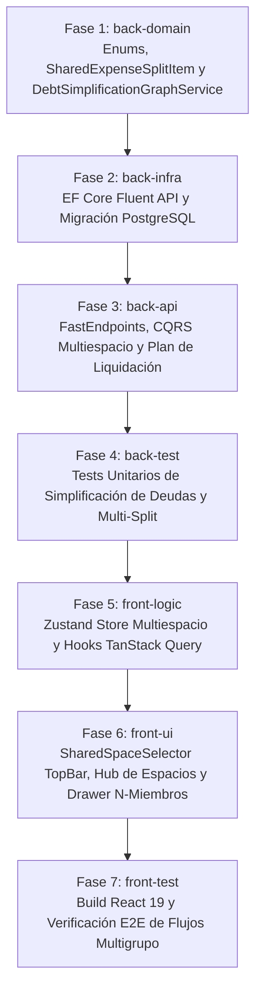

# Desglose de Tareas: Espacios Compartidos Multigrupo, N-Miembros y Simplificación de Deudas

- **ID de la Feature**: `006-multi-space-shared-expenses`
- **Estado**: Planificado para Revisión Previa del Usuario (Gate 2 SDD Completado — NO EJECUTAR AÚN)
- **Especificaciones de Referencia**:
  - Funcional: [01-spec.md](./01-spec.md)
  - Técnica: [02-tech-spec.md](./02-tech-spec.md)
  - Visión Macro: [SYSTEM_VISION.md](../../SYSTEM_VISION.md) (Pilar 3: Espacios Compartidos Dinámicos)
- **Orquestador Asignado**: `@jarvis`
- **Fecha de Creación**: 2026-10-07

---

## Matriz de Fases de Implementación por Agente Especialista

---

## Checklist de Progreso por Fase

### 🔹 Fase 1: Dominio (`back-domain`)
- [ ] **Tarea 1.1**: Crear y evolucionar enums en `Nexus.Domain/Enums/`:
  - `SharedSpaceType.cs` (`Household`, `Trip`, `Event`, `Project`).
  - `SharedSpaceStatus.cs` (`Active`, `Archived`).
  - `GroupSplitMode.cs` (`Equal`, `ExactAmounts`, `Percentages`, `Shares`, `FairShareIncome`).
- [ ] **Tarea 1.2**: Evolucionar entidades de dominio en `Nexus.Domain/Entities/`:
  - `SharedSpace.cs`: Añadir `Type`, `Status`, `Description`, `Icon`, `DefaultSplitMode`.
  - `SharedSpaceMember.cs`: Añadir `IsGuest`, `PhoneNumber`, `DisplayOrder`, hacer `UserId` nullable.
  - `SharedExpenseEntry.cs`: Añadir colección `SplitItems` de tipo `SharedExpenseSplitItem`.
  - `SharedExpenseSplitItem.cs` (Nueva entidad): `SharedExpenseEntryId`, `MemberId`, `OwedAmount`, `PercentageApplied`, `SharesCount`, `IsPayer`.
- [ ] **Tarea 1.3**: Implementar servicios de dominio puros:
  - `MultiMemberSplitCalculator.cs`: Algoritmo de cálculo de cuotas multimiembro con exclusiones y *Banker's Rounding* (Invariante RN-01 de $0.00\text{ \euro}$).
  - `DebtSimplificationGraphService.cs`: Algoritmo de minimización de transferencias (*Min-Cash-Flow* para grupos de $N$ personas).
- [ ] **Tarea 1.4**: Actualizar interfaces de repositorio en `Nexus.Domain/Repositories/`:
  - `ISharedSpaceRepository.cs`, `ISharedExpenseRepository.cs`.

### 🔹 Fase 2: Infraestructura y Persistencia (`back-infra`)
- [ ] **Tarea 2.1**: Mapeos Fluent API en `Nexus.Infrastructure/Persistence/Configurations/`:
  - Actualizar `SharedSpaceConfiguration.cs` con nuevas columnas y defaults.
  - Actualizar `SharedSpaceMemberConfiguration.cs` para soportar miembros sombra con FK nullable a `users`.
  - Crear `SharedExpenseSplitItemConfiguration.cs` (tabla `shared_expense_split_items` en `snake_case`, índices en `(shared_expense_entry_id, member_id)`).
  - Actualizar `ApplicationDbContext.cs` con `DbSet<SharedExpenseSplitItem>`.
- [ ] **Tarea 2.2**: Actualizar repositorios con EF Core:
  - `SharedSpaceRepository.cs` (consultas con `Include` de miembros y partidas activas).
- [ ] **Tarea 2.3**: Generar y aplicar migración EF Core a PostgreSQL:
  - `dotnet ef migrations add 20261007_AddMultiSpaceAndGroupSplitsSchema`
  - `dotnet ef database update`

### 🔹 Fase 3: Capa de Aplicación & API (`back-api`)
- [ ] **Tarea 3.1**: DTOs y Mapeadores en `Nexus.Application/SharedSpaces/`:
  - `SharedSpaceSummaryDto.cs`, `SharedSpaceDetailDto.cs`, `SharedExpenseSplitItemDto.cs`, `SettlementPlanDto.cs`.
- [ ] **Tarea 3.2**: Comandos y Handlers CQRS con `FluentValidation`:
  - `CreateSharedSpaceCommand.cs` y su Handler.
  - `ArchiveSharedSpaceCommand.cs` y su Handler.
  - `AddSharedSpaceMemberCommand.cs` y su Handler.
  - `AddMultiMemberExpenseCommand.cs` y su Handler (valida suma de cuotas == total).
  - `SettleGroupDebtsCommand.cs` y su Handler.
  - `GetUserSharedSpacesQuery.cs` y `GetGroupSettlementPlanQuery.cs`.
- [ ] **Tarea 3.3**: FastEndpoints en `Nexus.Api/Endpoints/SharedSpaces/`:
  - `GET /api/shared-spaces` (`GetSharedSpacesEndpoint.cs`).
  - `POST /api/shared-spaces` (`CreateSharedSpaceEndpoint.cs`).
  - `GET /api/shared-spaces/{id}` (`GetSharedSpaceDetailEndpoint.cs`).
  - `POST /api/shared-spaces/{id}/expenses` (`AddMultiMemberExpenseEndpoint.cs`).
  - `GET /api/shared-spaces/{id}/settlement-plan` (`GetGroupSettlementPlanEndpoint.cs`).
  - `POST /api/shared-spaces/{id}/settle` (`SettleGroupDebtsEndpoint.cs`).
  - `PATCH /api/shared-spaces/{id}/archive` (`ArchiveSharedSpaceEndpoint.cs`).

### 🔹 Fase 4: Pruebas Backend (`back-test`)
- [ ] **Tarea 4.1**: Pruebas unitarias de `DebtSimplificationGraphService`:
  - Caso clásico de 3 miembros cíclicos ($A \to B \to C \to A$) resolviéndose en 0 transferencias.
  - Caso de viaje de 5 miembros con pagos desiguales resolviéndose en $\le 4$ transferencias.
  - Caso de deuda neta del usuario activo (un tercero paga el gasto grupal y el usuario queda en posición deudora con propuesta de Bizum).
- [ ] **Tarea 4.2**: Pruebas unitarias de `MultiMemberSplitCalculator`:
  - Reparto $1/M$ con céntimos huérfanos (ej. 100 € entre 3 personas = 33.34 €, 33.33 €, 33.33 € con suma exacta 100.00 €).
  - Reparto con exclusión de miembros específicos.
- [ ] **Tarea 4.3**: Pruebas de integración de comandos CQRS.
- [ ] **Tarea 4.4**: Ejecutar `dotnet test` global verificando 100% de tests en verde.

### 🔹 Fase 5: Lógica de Frontend (`front-logic`)
- [ ] **Tarea 5.1**: Definir modelos TypeScript en `frontend/src/types/shared-space.ts`:
  - `SharedSpace`, `SharedSpaceMember`, `SharedExpenseSplitItem`, `SettlementTransfer`.
- [ ] **Tarea 5.2**: Crear store global de navegación `useSharedSpacesStore.ts`:
  - Espacio activo seleccionado, lista de espacios disponibles, balance global acumulado.
- [ ] **Tarea 5.3**: Crear hooks TanStack Query en `frontend/src/hooks/useSharedSpaces.ts`:
  - `useUserSharedSpacesQuery()`, `useSharedSpaceDetailQuery(id)`, `useSettlementPlanQuery(id)`, `useAddMultiMemberExpenseMutation()`.

### 🔹 Fase 6: Interfaz de Usuario y Shell Móvil (`front-ui`)
- [ ] **Tarea 6.1**: Componente `SharedSpaceSelector.tsx` en `TopBar.tsx`:
  - Selector desplegable que sustituye el texto fijo "Sergio & Elena" por un menú dinámico de espacios.
  - Indicador de saldo neto individual del espacio activo.
- [ ] **Tarea 6.2**: Página `SharedSpacesHubPage.tsx`:
  - Grid con tarjetas de espacios clasificados por pestañas: *Permanentes*, *Viajes & Ocio*, *Archivados*.
  - Modal de creación rápida `CreateSpaceModal.tsx`.
- [ ] **Tarea 6.3**: Componente evolucionado `ShareExpenseDrawer.tsx`:
  - Selector de espacio de destino.
  - Checkboxes para incluir/excluir miembros del grupo.
  - Selector de modo de división (Igualitario, Porcentajes, Exacto, Shares).
- [ ] **Tarea 6.4**: Modal `GroupSettlementModal.tsx`:
  - Lista simplificada de transferencias de deuda con botón directo de Bizum (referencia + teléfono).
- [ ] **Tarea 6.5**: Internacionalización completa de nuevas cadenas en los 5 idiomas (`es`, `en`, `zh`, `hi`, `fr`).

### 🔹 Fase 7: Testing y Verificación E2E (`front-test`)
- [ ] **Tarea 7.1**: Ejecutar `npm run build` en `frontend/` y verificar 0 errores TypeScript.
- [ ] **Tarea 7.2**: Verificación de flujos interactivos:
  - Creación de espacio de viaje con 4 amigos.
  - Registro de gasto con exclusión de 1 miembro.
  - Consulta de plan de liquidación y verificación de simplificación de deudas.
  - Archivo de espacio y desaparición del selector principal.
