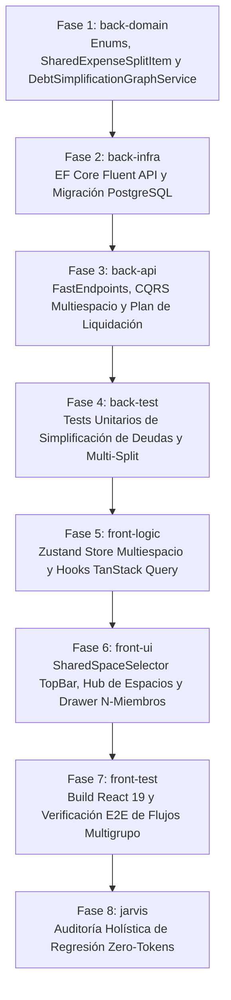

# Desglose de Tareas: Espacios Compartidos Multigrupo, N-Miembros y Simplificación de Deudas

- **ID de la Feature**: `006-multi-space-shared-expenses`
- **Estado**: Aprobado por Jarvis y Warren (Gate 2 SDD Completado — Listo para Implementación tras Revisión del Usuario)
- **Especificaciones de Referencia**:
  - Funcional: [01-spec.md](./01-spec.md)
  - Técnica: [02-tech-spec.md](./02-tech-spec.md)
  - Visión Macro: [SYSTEM_VISION.md](../../SYSTEM_VISION.md) (Pilar 3: Espacios Compartidos Dinámicos)
- **Orquestador Asignado**: `@jarvis`
- **Fecha de Creación**: 2026-10-07
- **Última Actualización**: 2026-10-08

---

## Salvaguarda de Definición de Listo (Definition of Ready - DoR)

Conforme a las directrices de Nexus, **ningún especialista puede comenzar una tarea si la misma no cumple con la DoR**:
1. **Rutas Exactas**: Cada tarea especifica los archivos absolutos o relativos exactos a crear o modificar.
2. **Propiedades y Firmas Exhaustivas**: Sin descripciones vagas; cada modelo o método detalla tipos, nombres y modificadores.
3. **Comando de Validación Obligatorio**: Cada tarea concluye con el comando CLI determinista que el especialista debe ejecutar antes de marcarla como completada.

---

## Matriz de Fases de Implementación por Agente Especialista



---

## Checklist de Progreso por Fase

### 🔹 Fase 1: Dominio (`back-domain`)
- [ ] **Tarea 1.1**: Crear y evolucionar enums en `src/Nexus.Domain/Enums/`:
  - `SharedSpaceType.cs` (`Household = 0`, `Trip = 1`, `Event = 2`, `Project = 3`).
  - `SharedSpaceStatus.cs` (`Active = 0`, `Archived = 1`).
  - `GroupSplitMode.cs` (`Equal = 0`, `ExactAmounts = 1`, `Percentages = 2`, `Shares = 3`, `FairShareIncome = 4`).
  - *Comando de verificación*: `dotnet build src/Nexus.Domain`
- [ ] **Tarea 1.2**: Evolucionar entidades de dominio en `src/Nexus.Domain/Entities/`:
  - `SharedSpace.cs`: Añadir `string? Description`, `string Icon`, `string Currency`, `SharedSpaceType Type`, `SharedSpaceStatus Status`, `GroupSplitMode DefaultSplitMode`, `ICollection<SharedSpaceMember> Members`, `ICollection<SharedExpenseEntry> Expenses`.
  - `SharedSpaceMember.cs`: Añadir `Guid? UserId` (nullable), `string DisplayName`, `string? AvatarUrl`, `string? PhoneNumber`, `SharedSpaceRole Role`, `decimal? DeclaredIncome`, `bool IsGuest`.
  - `SharedExpenseSplitItem.cs` (Nueva entidad): `Guid Id`, `Guid SharedExpenseEntryId`, `Guid MemberId`, `decimal OwedAmount`, `decimal? PercentageApplied`, `decimal? SharesCount`, `bool IsPayer`.
  - `SharedExpenseEntry.cs`: Añadir colección `ICollection<SharedExpenseSplitItem> SplitItems` y propiedad `GroupSplitMode SplitMode`.
  - *Comando de verificación*: `dotnet build src/Nexus.Domain`
- [ ] **Tarea 1.3**: Implementar servicios de dominio puros en `src/Nexus.Domain/Services/`:
  - `MultiMemberSplitCalculator.cs`: Algoritmo de cálculo de cuotas multimiembro con exclusiones y *Banker's Rounding* (garantizando Invariante RN-01 de suma exacta con $0.00\text{ \euro}$ de descuadre).
  - `DebtSimplificationGraphService.cs`: Algoritmo de minimización de transferencias (*Min-Cash-Flow* para grupos de $N$ personas resolviendo la deuda en un máximo de $N-1$ pagos).
  - *Comando de verificación*: `dotnet build src/Nexus.Domain`
- [ ] **Tarea 1.4**: Actualizar interfaces de repositorio en `src/Nexus.Domain/Repositories/`:
  - `ISharedSpaceRepository.cs`: Añadir `Task<SharedSpace?> GetByIdWithMembersAndExpensesAsync(Guid id, CancellationToken ct)`, `Task<List<SharedSpace>> GetByUserIdAsync(Guid userId, CancellationToken ct)`.
  - *Comando de verificación*: `dotnet build src/Nexus.Domain`

---

### 🔹 Fase 2: Infraestructura y Persistencia (`back-infra`)
- [ ] **Tarea 2.1**: Mapeos Fluent API en `src/Nexus.Infrastructure/Persistence/Configurations/`:
  - `SharedSpaceConfiguration.cs`: Mapear tabla `shared_spaces` con columnas `type` (int), `status` (int), `description` (varchar 500, nullable), `icon` (varchar 50), `default_split_mode` (int).
  - `SharedSpaceMemberConfiguration.cs`: Mapear `phone_number` (varchar 20, nullable), `is_guest` (bool), `user_id` (nullable FK a `users`).
  - `SharedExpenseSplitItemConfiguration.cs` (Nueva configuración): Tabla `shared_expense_split_items`, PK `id`, FK `shared_expense_entry_id` con borrado en cascada, FK `member_id`, columna `owed_amount` (numeric 18,2), `percentage_applied` (numeric 5,2, nullable), `shares_count` (numeric 6,2, nullable), `is_payer` (bool). Índice compuesto en `(shared_expense_entry_id, member_id)`.
  - `ApplicationDbContext.cs`: Añadir `DbSet<SharedExpenseSplitItem> SharedExpenseSplitItems { get; set; }`.
  - *Comando de verificación*: `dotnet build src/Nexus.Infrastructure`
- [ ] **Tarea 2.2**: Implementar métodos en repositorios EF Core en `src/Nexus.Infrastructure/Persistence/Repositories/`:
  - `SharedSpaceRepository.cs`: Implementar `GetByIdWithMembersAndExpensesAsync` con `Include(s => s.Members).Include(s => s.Expenses).ThenInclude(e => e.SplitItems)`.
  - *Comando de verificación*: `dotnet build src/Nexus.Infrastructure`
- [ ] **Tarea 2.3**: Generar y aplicar migración EF Core a PostgreSQL:
  - Generar migración: `dotnet ef migrations add 20261008_AddMultiSpaceAndGroupSplitsSchema --project src/Nexus.Infrastructure --startup-project src/Nexus.Api`
  - Aplicar en base de datos de desarrollo: `dotnet ef database update --project src/Nexus.Infrastructure --startup-project src/Nexus.Api`
  - *Comando de verificación*: `dotnet ef migrations list --project src/Nexus.Infrastructure --startup-project src/Nexus.Api`

---

### 🔹 Fase 3: Capa de Aplicación & API REST (`back-api`)
- [ ] **Tarea 3.1**: DTOs Espejo en `src/Nexus.Application/SharedExpenses/DTOs/` (siguiendo estrictamente Sección 5.2 de `02-tech-spec.md`):
  - `SharedSpaceMemberSummaryDto`, `SharedSpaceSummaryDto`, `GetUserSharedSpacesResponse`.
  - `CreateSpaceMemberRequest`, `CreateSharedSpaceRequest`, `CreateSharedSpaceResponse`.
  - `ExpenseSplitItemRequest`, `AddMultiMemberExpenseRequest`, `ExpenseSplitItemDto`, `SharedExpenseEntryDetailDto`.
  - `MemberNetBalanceDto`, `SettlementTransferDto`, `GroupSettlementPlanResponse`.
  - `SettleGroupDebtsRequest`, `SettleGroupDebtsResponse`, `ArchiveSharedSpaceResponse`.
  - *Comando de verificación*: `dotnet build src/Nexus.Application`
- [ ] **Tarea 3.2**: Comandos, Consultas y Validadores CQRS con FluentValidation en `src/Nexus.Application/SharedExpenses/`:
  - `CreateSharedSpaceCommand.cs` + Handler + `CreateSharedSpaceValidator.cs` (nombre obligatorio, mínimo 2 miembros).
  - `AddMultiMemberExpenseCommand.cs` + Handler + `AddMultiMemberExpenseValidator.cs` (valida Invariante RN-01: suma de splits == total amount con tolerancia 0.00 €).
  - `GetGroupSettlementPlanQuery.cs` + Handler (invoca `DebtSimplificationGraphService`).
  - `SettleGroupDebtsCommand.cs` + Handler + `SettleGroupDebtsValidator.cs` (importe > 0).
  - `ArchiveSharedSpaceCommand.cs` + Handler.
  - `GetUserSharedSpacesQuery.cs` + Handler (calcula NetBalance individual, TotalReceivables y TotalPayables).
  - *Comando de verificación*: `dotnet build src/Nexus.Application`
- [ ] **Tarea 3.3**: FastEndpoints en `src/Nexus.Api/Endpoints/SharedSpaces/`:
  - `GetSharedSpacesEndpoint.cs` (`GET /api/shared-spaces`).
  - `CreateSharedSpaceEndpoint.cs` (`POST /api/shared-spaces`).
  - `GetSharedSpaceDetailEndpoint.cs` (`GET /api/shared-spaces/{id}`).
  - `AddMultiMemberExpenseEndpoint.cs` (`POST /api/shared-spaces/{id}/expenses`).
  - `GetGroupSettlementPlanEndpoint.cs` (`GET /api/shared-spaces/{id}/settlement-plan`).
  - `SettleGroupDebtsEndpoint.cs` (`POST /api/shared-spaces/{id}/settle`).
  - `ArchiveSharedSpaceEndpoint.cs` (`PATCH /api/shared-spaces/{id}/archive`).
  - Incluir verificación de pertenencia al espacio (política Zero-Knowledge: 404/403 si el usuario no es miembro).
  - *Comando de verificación*: `dotnet build src/Nexus.Api`

---

### 🔹 Fase 4: Pruebas Backend (`back-test`)
- [ ] **Tarea 4.1**: Pruebas unitarias de `DebtSimplificationGraphService` en `tests/Nexus.Domain.Tests/Services/DebtSimplificationGraphServiceTests.cs`:
  - Test 1: Reducción cíclica 3 miembros ($A \to B \to C \to A$) resolviendo a 0 transferencias netas.
  - Test 2: Viaje de 5 miembros con gastos asimétricos resolviendo en $\le 4$ transferencias mínimas.
  - Test 3: Miembro con balance neutro (0.00 €) queda excluido de transferencias.
  - Test 4: Verificación de Invariante RN-02 ($\sum \text{NetBalances} == 0.00\text{ \euro}$).
  - *Comando de verificación*: `dotnet test tests/Nexus.Domain.Tests --filter FullyQualifiedName~DebtSimplificationGraphServiceTests`
- [ ] **Tarea 4.2**: Pruebas unitarias de `MultiMemberSplitCalculator` en `tests/Nexus.Domain.Tests/Services/MultiMemberSplitCalculatorTests.cs`:
  - Test 1: Reparto equitativo 100.00 € entre 3 miembros $\to$ 33.34 € pagador, 33.33 € resto; suma exacta 100.00 €.
  - Test 2: Reparto con exclusión explícita de miembros.
  - Test 3: Reparto por porcentajes con validación de 100%.
  - Test 4: Reparto por partes / shares.
  - *Comando de verificación*: `dotnet test tests/Nexus.Domain.Tests --filter FullyQualifiedName~MultiMemberSplitCalculatorTests`
- [ ] **Tarea 4.3**: Pruebas de integración de endpoints en `tests/Nexus.Api.Tests/Endpoints/SharedSpacesEndpointTests.cs`:
  - Test de creación de espacio con miembros sombra.
  - Test de aislamiento Zero-Knowledge (usuario B no puede leer gastos del espacio donde solo está A).
  - Test de flujo de liquidación de deuda.
  - *Comando de verificación*: `dotnet test tests/Nexus.Api.Tests --filter FullyQualifiedName~SharedSpacesEndpointTests`
- [ ] **Tarea 4.4**: Verificación de Suite Completa de Tests Backend:
  - *Comando de verificación*: `dotnet test Nexus.sln --logger "console;verbosity=normal"`

---

### 🔹 Fase 5: Lógica de Frontend (`front-logic`)
- [ ] **Tarea 5.1**: Definir modelos TypeScript espejo en `frontend/src/types/shared-space.ts`:
  - `SharedSpaceType`, `SharedSpaceStatus`, `GroupSplitMode`, `SharedSpaceRole`.
  - `SharedSpaceMemberSummary`, `SharedSpaceSummary`, `GetUserSharedSpacesResponse`.
  - `CreateSpaceMemberInput`, `CreateSharedSpaceInput`, `CreateSharedSpaceResponse`.
  - `ExpenseSplitItemInput`, `AddMultiMemberExpenseInput`, `ExpenseSplitItem`, `SharedExpenseEntryDetail`.
  - `MemberNetBalance`, `SettlementTransfer`, `GroupSettlementPlanResponse`.
  - `SettleGroupDebtsInput`, `SettleGroupDebtsResponse`, `ArchiveSharedSpaceResponse`.
  - *Comando de verificación*: `npx --prefix frontend tsc --noEmit`
- [ ] **Tarea 5.2**: Crear store global de navegación en `frontend/src/store/useSharedSpacesStore.ts`:
  - Estado: `activeSpaceId: string | null`, `spaces: SharedSpaceSummary[]`, `totalReceivables: number`, `totalPayables: number`.
  - Acciones: `setActiveSpace(id: string | null)`, `setSpaces(data: GetUserSharedSpacesResponse)`.
  - Sincronización con `localStorage` de la última selección activa.
  - *Comando de verificación*: `npx --prefix frontend tsc --noEmit`
- [ ] **Tarea 5.3**: Crear hooks TanStack Query en `frontend/src/hooks/useSharedSpaces.ts`:
  - `useUserSharedSpaces()` (`GET /api/shared-spaces`).
  - `useSharedSpaceDetail(spaceId: string)` (`GET /api/shared-spaces/{id}`).
  - `useGroupSettlementPlan(spaceId: string)` (`GET /api/shared-spaces/{id}/settlement-plan`).
  - `useCreateSharedSpaceMutation()`, `useAddMultiMemberExpenseMutation()`, `useSettleDebtsMutation()`, `useArchiveSpaceMutation()`.
  - Invalidación automática de queries en mutaciones exitosas.
  - *Comando de verificación*: `npx --prefix frontend tsc --noEmit`

---

### 🔹 Fase 6: Interfaz de Usuario y Shell Móvil (`front-ui`)
- [ ] **Tarea 6.1**: Componente `SharedSpaceSelector.tsx` en `frontend/src/components/shared/SharedSpaceSelector.tsx`:
  - Dropdown interactivo en `TopBar.tsx` mostrando nombre del espacio, icono según tipo, badge con saldo individual (verde positivo / rojo deudor), y opción "Todos los Espacios".
  - *Comando de verificación*: `npx --prefix frontend tsc --noEmit`
- [ ] **Tarea 6.2**: Vista Hub de Espacios en `frontend/src/pages/SharedSpacesHubPage.tsx`:
  - Pestañas: *Permanentes*, *Viajes & Ocio*, *Archivados*.
  - Tarjetas con participantes, último movimiento y botón rápido de liquidación.
  - Modal `frontend/src/components/shared/CreateSpaceModal.tsx` con formulario guiado (nombre, tipo, moneda, miembros sombra con teléfono Bizum).
  - *Comando de verificación*: `npx --prefix frontend tsc --noEmit`
- [ ] **Tarea 6.3**: Drawer de Gasto Multimiembro en `frontend/src/components/shared/ShareExpenseDrawer.tsx`:
  - Selector de espacio de destino.
  - Checkboxes con avatar y nombre para incluir/excluir miembros del gasto.
  - Selector de modalidad de reparto ($1/M$, Porcentajes, Importes fijos, Shares) con cálculo automático en vivo.
  - *Comando de verificación*: `npx --prefix frontend tsc --noEmit`
- [ ] **Tarea 6.4**: Modal `GroupSettlementModal.tsx` en `frontend/src/components/shared/GroupSettlementModal.tsx`:
  - Grafo simplificado de transferencias mínimas recomendadas.
  - Botón *"Pagar con Bizum"* para deudas del usuario activo con enlace `tel:` y copia al portapapeles de la referencia preformateada.
  - *Comando de verificación*: `npx --prefix frontend tsc --noEmit`
- [ ] **Tarea 6.5**: Soporte multi-idioma i18n en `frontend/src/locales/`:
  - Actualizar `es.json`, `en.json`, `fr.json`, `zh.json`, `hi.json` con claves bajo `sharedSpaces.*`.
  - *Comando de verificación*: `npm --prefix frontend run build`

---

### 🔹 Fase 7: Testing y Verificación E2E (`front-test`)
- [ ] **Tarea 7.1**: Pruebas unitarias e integración de componentes en `frontend/src/tests/`:
  - `SharedSpaceSelector.test.tsx`: Conmutación de espacio activo y actualización reactiva de balances.
  - `ShareExpenseDrawer.test.tsx`: Desglose equitativo y exclusión de participantes.
  - `GroupSettlementModal.test.tsx`: Representación de liquidaciones y botón de pago Bizum.
  - *Comando de verificación*: `npm --prefix frontend test`
- [ ] **Tarea 7.2**: Verificación de compilación de producción en Frontend:
  - *Comando de verificación*: `npm --prefix frontend run build` (0 advertencias críticas, 0 errores TypeScript).

---

### 🔹 Fase 8: Verificación Holística de Regresión (`jarvis` — Zero Tokens)
- [ ] **Tarea 8.1**: Ejecución del Pipeline Automatizado de Auditoría:
  - Ejecutar el script CLI determinista del repositorio sin consumo de contexto ni lectura manual:
    ```powershell
    powershell -ExecutionPolicy Bypass -File tests/audit-pipeline.ps1 "006-multi-space-shared-expenses"
    ```
  - **Criterios de Aceptación (Definition of Done)**:
    1. Base de datos EF Core: 0 migraciones pendientes.
    2. Backend Tests: 100% de la suite xUnit en verde.
    3. Frontend Build: Vite build completado en modo producción con 0 errores TypeScript.
  - *Comando de verificación*: `powershell -ExecutionPolicy Bypass -File tests/audit-pipeline.ps1 "006-multi-space-shared-expenses"`
