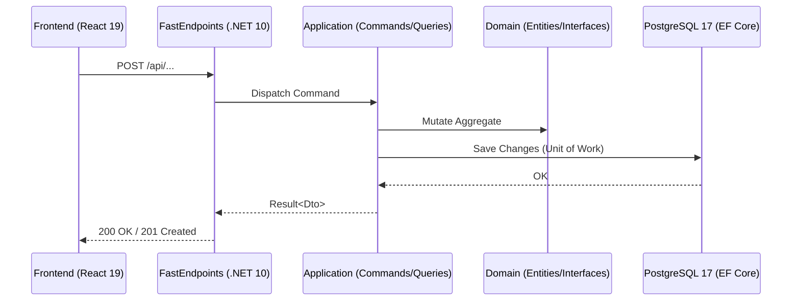

# Especificación Técnica: [Título de la Feature]

- **ID de la Feature**: [Ej. 001-user-profiles]
- **Estado**: [Borrador | En Revisión | Aprobado | En Implementación | Completado]
- **Especificación Funcional Asociada**: `01-spec.md`
- **Fecha de Creación**: YYYY-MM-DD
- **Última Actualización**: YYYY-MM-DD

---

## 1. Arquitectura General y Flujo de Datos



---

## 2. Modelo de Dominio (`Nexus.Domain`)

### Entidades y Value Objects
- **`I[Nombre]` / `[Nombre]`**:
  - Propiedades obligatorias y tipos (`Guid Id`, `DateTimeOffset CreatedAt`, etc.).
  - Comportamientos o métodos de mutación internos.
- **Interfaces de Repositorio**:
  - `I[Nombre]Repository`: Definición de métodos de escritura (`AddAsync`, `GetByIdAsync`, etc.).

---

## 3. Capa de Aplicación (`Nexus.Application`)

### Comandos y Queries (CQRS)
- **`[Nombre]Command`**:
  - Parámetros del comando.
  - Validador `FluentValidation`: Reglas, mensajes de error.
  - Handler `[Nombre]CommandHandler`: Lógica de orquestación y transaccionalidad con `IUnitOfWork`.
- **`[Nombre]Query`**:
  - Parámetros de filtrado/paginación.
  - Proyección optimizada a DTO (`AsNoTracking`).

### DTOs
- `[Nombre]Dto`: Estructura inmutable devuelta por la API.

---

## 4. Persistencia e Infraestructura (`Nexus.Infrastructure`)

### Mapeo EF Core y Base de Datos
- Tabla: `snake_case` (e.g., `user_profiles`).
- Claves primarias, foráneas, índices únicos y de búsqueda.
- Migración EF Core esperada: `Add[Nombre]Schema`.

---

## 5. API REST (`Nexus.Api`)

### Endpoints (FastEndpoints)
- **Ruta**: `POST /api/[ruta]` | `GET /api/[ruta]`
- **Autorización**: `AllowAnonymous()` o `Policies(...)`
- **Request Payload**:
  ```json
  {
    "campo": "valor"
  }
  ```
- **Response Payloads**:
  - `200 OK` / `201 Created`:
    ```json
    {
      "id": "guid",
      "campo": "valor"
    }
    ```
  - `400 Bad Request` / `404 Not Found`:
    ```json
    {
      "statusCode": 400,
      "message": "Descripción del error"
    }
    ```

---

## 6. Frontend y Shell Móvil (`frontend/`)

### Tipos TypeScript
- `interface [Nombre] { ... }`

### Estado y Mutaciones (TanStack Query)
- Hook `use[Nombre]()`: query / mutation con invalidación automática de cache.

### Componentes de UI
- Componente principal, estados de carga (skeletons), manejo de errores y feedback visual.

---

## 7. Pruebas y Criterios de Verificación
- Pruebas unitarias o de integración requeridas.
- Script de verificación de endpoint (e.g. PowerShell / curl).
